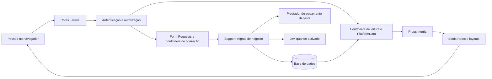
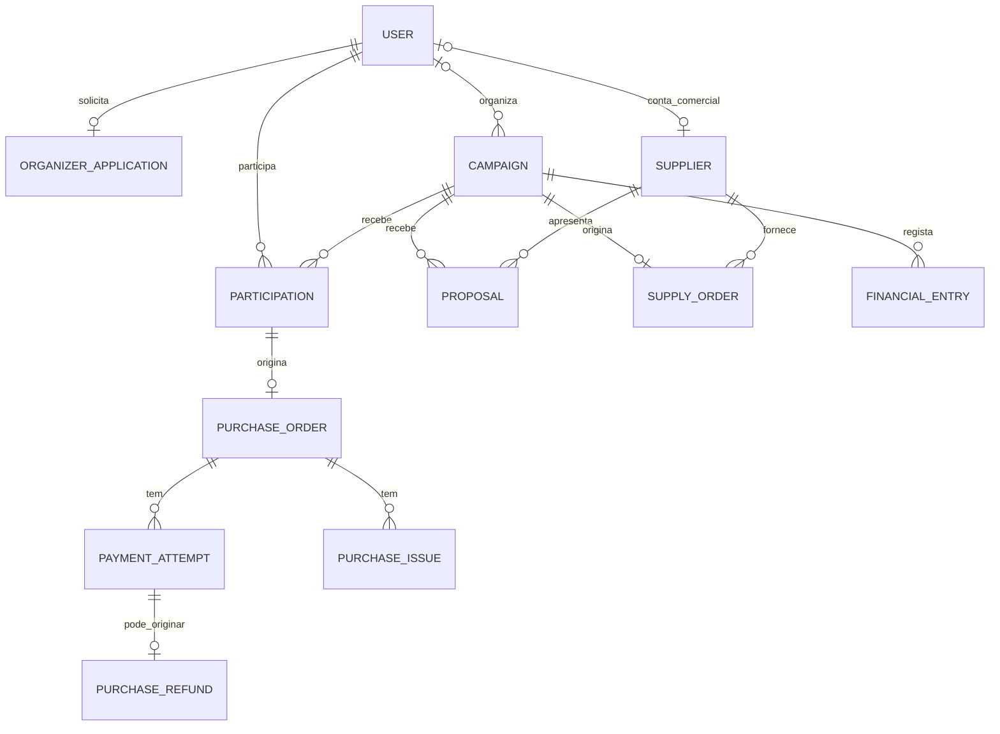
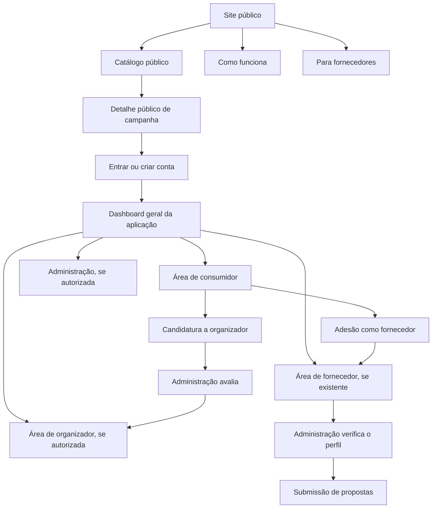
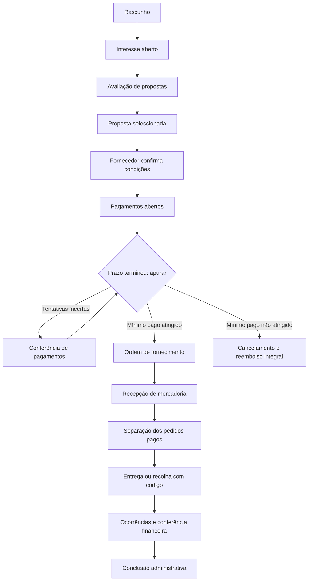

# Junta — Documento do fluxo actual do projecto

> **Integração OpenAI preparada — 18 de Novembro de 2026.** O módulo de IA usa agora a OpenAI, substituindo o transporte TypeSafe/Jev. Está activo com a chave privada configurada no servidor; as referências anteriores a Jev ficam como histórico. A ligação real e a resposta estruturada foram confirmadas com um rascunho fictício, sem alterar dados do negócio.

## Recomendação directa de fornecedor — 19 de Novembro de 2026

A comparação de IA apresenta primeiro «Escolha [fornecedor]», com o total de produto e transporte declarado, prazo, motivos concretos e diferença de preço face à próxima opção da classificação. O botão «Escolher esta proposta» abre a confirmação de selecção já existente; obter uma análise não selecciona nem altera propostas. A comparação completa, as fórmulas e os pontos a esclarecer ficam recolhidos.

Avisos sobre clareza, confiança subjectiva, coerência e correspondência do texto são agora separados dos impedimentos comerciais. A pontuação de clareza continua a receber o peso definido e os avisos aparecem para esclarecimento, mas não excluem automaticamente uma oferta com condições comerciais válidas. Expiração, fornecedor não verificado, capacidade insuficiente, mínimo ou reserva por confirmar, custo incompleto e modalidade incompatível continuam a impedir a recomendação. A avaliação recebe o contexto de que a oferta responde à campanha e usa a sua unidade; as notas não têm de repetir toda a especificação.

A ordenação usa a pontuação ponderada, seguida de custo total, prazo, histórico e clareza nos empates de pontuação. Pontuações próximas conservam uma indicação da primeira opção. Quando as condições avaliadas são efectivamente iguais, o painel explica o empate; quando todas as ofertas têm impedimentos, identifica o que é preciso corrigir. A validade e a indicação de análise desactualizada mantêm-se.

Verificação: 45 testes de IA aprovados; suite completa com 315 aprovados, 3 ignorados e 2818 asserções; PHPStan, Pint, TypeScript, lint e build aprovados. Capturas e registos em `storage/app/openai-preparation/`. A verificação visual usa SQLite isolado e respostas fictícias, inclui o botão de escolha e confirma o fornecedor no diálogo sem submeter uma selecção.

## Previsão das campanhas e histórico na comparação — 19 de Novembro de 2026

O Resumo de cada campanha em fase de interesse inclui agora «Previsão da campanha». O organizador autorizado pede uma estimativa da probabilidade de atingir a meta antes do prazo, quantidade final provável e intervalo de cenários. O painel mostra também o gráfico da procura actualmente activa, o ritmo médio e recente, participantes, categoria, localização e tempo restante. As adesões são relidas a cada minuto; uma alteração dos dados ou a expiração da análise exige actualização. Só o botão de previsão faz um pedido à OpenAI.

`CampaignForecast` prepara os dados no servidor e `OpenAiClient` pede uma resposta estruturada com probabilidade e quantidades. Não envia nomes, contactos, notas individuais ou identificadores de participantes. Usa quantidades activas, datas de registo, concentração da procura, ritmo recente e anterior, projecção linear de referência e contexto agregado de até 50 campanhas anteriores da mesma categoria e unidade, distinguindo a localização. O início usa a auditoria de publicação quando existe, ou a criação como aproximação. As séries mostram quantidades actualmente retidas por data de registo: não reconstroem todas as alterações, reactivação e desistências. O contexto histórico também não equivale a resultados comprovados no prazo.

A probabilidade é uma **estimativa inicial da OpenAI, ainda sem validação histórica ou calibração no Junta**; o intervalo representa cenários, não um intervalo estatístico garantido. Não foi treinado nem anunciado um modelo preditivo próprio. Antes de 24 horas de observação ou de três participantes activos, não se inventa uma percentagem. Meta já atingida e fase fechada devolvem observações sem pedido externo. Probabilidades inválidas, quantidades incoerentes, indisponibilidade e alterações durante a análise impedem o registo de uma previsão válida. A validade é limitada a cinco minutos e nunca ultrapassa o prazo de interesse.

A comparação de propostas inclui agora quatro pesos: custo conhecido, prazo, clareza e histórico de recepção. O valor inicial na interface é 45/20/20/15; clientes anteriores sem peso de histórico mantêm peso zero neste critério. Produto e transporte aparecem separados e os totais continuam calculados em cêntimos para uma quantidade comum. `SupplierHistory` lê as ordens anteriores em conjunto, exclui a própria campanha e mostra recepções completas, parciais e ordens em curso. A pontuação é `100 × (recepções completas + 1) ÷ (ordens terminadas + 2)`: sem histórico, vale 50/100 neutros; ordens em curso não contam como falhas. Não se inventam avaliações de qualidade, pontualidade ou responsabilidade por problemas. O histórico é enviado à IA apenas como agregados anónimos; a pontuação de histórico e a classificação ponderada são calculadas pela aplicação.

Permissões, selecção humana, pagamentos e fornecimento mantêm os fluxos existentes. Novo endpoint: `POST /ia/campanhas/{campaign}/previsao`, sujeito à autorização de gestão e ao limite de pedidos de IA. Foram acrescentados testes de previsão e histórico de fornecedor. Verificação: **66 testes de IA aprovados; suite completa com 308 aprovados, 3 ignorados e 2757 asserções; PHPStan, Pint, TypeScript, lint e build aprovados.** Capturas e registos em `storage/app/openai-preparation/`; os testes visuais usam uma cópia SQLite, credencial fictícia e respostas interceptadas no navegador, sem consumir a API real.

## Preparação da IA com OpenAI

### Funcionalidades e limites

Além da previsão de campanhas descrita acima, mantêm-se os três fluxos de revisão existentes: revisão de rascunho de campanha, revisão de proposta do próprio fornecedor e comparação assistida de até 20 propostas pelo organizador autorizado. A IA avalia clareza, confiança subjectiva, coerência e correspondência; custo em cêntimos, capacidade, mínimo comercial, reserva, validade, autorização, pesos e decisão final continuam no código da aplicação e no utilizador. Uma análise não publica, submete, selecciona, cobra nem liquida.

`OpenAiClient` usa a Responses API com JSON Schema estrito, limites numéricos e validação local dos itens esperados. A leitura procura os blocos de texto da mensagem final, incluindo quando há itens de raciocínio antes deles. Respostas incompletas, recusas, JSON inválido, itens inesperados, falhas de autenticação, limites/créditos e indisponibilidade devolvem mensagens controladas e mantêm a revisão manual. Não há repetição automática de chamadas facturáveis nem redireccionamento da chave para outro endereço.

O modelo configurável é `gpt-6.1-terra`; a documentação oficial confirma Responses e saídas estruturadas. Na activação, o esforço foi ajustado de `low` para `none` no ambiente privado após o primeiro teste exceder o tempo disponível; o novo teste concluiu e validou a resposta. O limite inicial é de 6000 tokens de saída e 25 segundos, com ligação de 3 segundos. Mantém-se o limite existente de seis pedidos por minuto e a verificação de permissões/validação antes da chamada externa. Não se adicionaram dependências, migrações, ferramentas autónomas ou integrações de pagamentos.

A chave é lida exclusivamente da configuração privada do servidor, nunca de uma variável `VITE_*` nem de props React. O navegador recebe apenas `ai.enabled`. Os textos e condições passam pela selecção de campos e remoção de contactos já existentes; o formulário informa que os envia à OpenAI. As chamadas usam `store=false`; isto não é uma promessa adicional sobre todas as políticas de retenção do prestador.

### Configuração e activação

Os campos já estão preparados no `.env` privado e em `.env.example`, inicialmente assim:

```dotenv
OPENAI_ENABLED=false
OPENAI_API_KEY=
OPENAI_MODEL=gpt-6.1-terra
OPENAI_REASONING_EFFORT=low
OPENAI_MAX_OUTPUT_TOKENS=6000
OPENAI_TIMEOUT=25
```

Depois de inserir a chave no `.env`, activar `OPENAI_ENABLED=true` e recarregar a configuração com `php artisan config:clear`. Se for escolhido um modelo que não aceita `reasoning.effort`, deixar `OPENAI_REASONING_EFFORT` vazio. O modelo e o acesso efectivo da conta só podem ser confirmados com a chave configurada.

- `php artisan junta:ai-status`: mostra fornecedor, modelo, estado e presença da chave, sem a revelar nem contactar o prestador.
- `php artisan junta:ai-status --check`: faz uma única análise curta com dados fictícios e valida a resposta estruturada. É um teste real que pode consumir tokens; não altera campanhas, propostas nem movimentos financeiros.

Na preparação executaram-se o diagnóstico local e testes HTTP simulados. Após o utilizador configurar a chave, activou-se `OPENAI_ENABLED=true`, confirmou-se o acesso ao modelo e validou-se uma análise real com dados fictícios. O ambiente privado usa agora `OPENAI_REASONING_EFFORT=none`. A primeira análise excedeu o tempo disponível; a segunda, após o ajuste, concluiu com resposta estruturada válida. Não se alteraram campanhas, propostas nem operações financeiras.

### Ficheiros e verificação

Novos: `app/Support/OpenAiClient.php`, `app/Console/Commands/CheckAiConfiguration.php`, `tests/Feature/OpenAiIntegrationTest.php`, `tests/OpenAiTestHelpers.php`. Alterados: `app/Support/AiAdvisor.php`, `app/Http/Middleware/HandleInertiaRequests.php`, `config/services.php`, `.env.example`, o `.env` privado, `resources/js/components/junta/AiReviewPanel.tsx` e os mocks do teste existente `tests/Feature/AiAdvisorTest.php`. Removido o cliente sem uso `app/Support/JevClient.php`; nenhum teste foi eliminado.

Os testes existentes de permissões, privacidade do fornecedor, classificação em cêntimos, escolha humana e falhas mantêm as suas asserções. Foram acrescentados casos de protocolo OpenAI, respostas parciais/recusadas, esquema, configurações incompletas, segredo fora do navegador, diagnóstico e limites antes da chamada. Resultados e logs em `storage/app/openai-preparation/`. **Verificação final: 37 testes de IA aprovados; suite completa com 279 aprovados, 3 ignorados e 2593 asserções; PHPStan, Pint, TypeScript, lint e build aprovados. Ligação real confirmada após a activação, com resposta estruturada validada pelo cliente da aplicação.**

Referências oficiais: [Responses API](https://developers.openai.com/api/docs/guides/text), [saídas estruturadas](https://developers.openai.com/api/docs/guides/structured-outputs), [GPT-6.1 Terra](https://developers.openai.com/api/docs/models/gpt-6.1-terra).

> **Fase 9 — Área do administrador, 18 de Novembro de 2026.** A administração usa agora um painel de supervisão. Esta secção descreve o estado actual; mantém-se a apresentação anterior do organizador pedida pelo utilizador e o compromisso do fornecedor definido na Fase 8.

<a id="fase9"></a>

## Fase 9 — Área do administrador

> **Melhoria posterior dos relatórios:** a página passa a ter imagens de categorias, quatro indicadores de actividade, evolução mensal em área/linha, distribuição circular por fase, cartões de categorias e ranking regional. Os gráficos permitem alternar medidas, destacar fases e consultar os dados; mantém-se o período de 3/6/12 meses e há CSV mensal, por categoria e por região. A grelha analítica substitui os antigos blocos de barras simples a pedido do utilizador. As imagens ilustrativas são identificadas e reutilizam os recursos locais existentes; fotografias de campanhas têm prioridade nos cartões. Não foram instaladas dependências.

A leitura dos relatórios considera as campanhas criadas no período, em hora de Maputo, até ao instante actual. As participações são as contagens globais actuais dessas campanhas, não pessoas únicas nem novas adesões por mês; o gráfico explica esta distinção ao alternar a medida. Não usa a lista de participações da conta do administrador para calcular totais globais. O volume continua a ser preço estimado × interesse, separado de receita e movimentos financeiros. Novos ficheiros: `resources/js/components/junta/ReportCharts.tsx`, `resources/js/lib/admin-reporting.ts`, `tests/Unit/AdminReporting.test.mjs`; actualizados `pages/admin/relatorios.tsx`, `components/junta/AdminFinance.tsx` (ReportBlock) e `resources/css/app.css`. Sem alterações a endpoints, permissões ou cálculos financeiros.

Verificação desta melhoria: **54 testes Node aprovados**, incluindo seis regressões de preparação dos relatórios; TypeScript, lint e build aprovados. **36 cenários Edge, sem erros JavaScript nem transbordo horizontal**, com três CSV validados. Capturas finais em `storage/app/phase9-captures/reports/release/`, com desktop/móvel e temas claro/escuro. O estado vazio foi verificado apenas no navegador com um relógio de teste, sem mudar os dados. A suite PHP não foi repetida nesta melhoria, que não altera PHP.

> **Revisão visual solicitada após a Fase 9:** o verde Junta passa também para as bordas dos painéis, remates superiores, cabeçalhos das tabelas, navegação activa, botões secundários e cabeçalhos dos drawers/diálogos. Usam-se os tokens existentes nos dois temas, com profundidade discreta. Esta preferência posterior substitui a apresentação neutra descrita na implementação inicial; a estrutura e as regras mantêm-se. Verificação: `npm.cmd run check` e `npm.cmd run build` aprovados; 30 cenários Edge sem erros JavaScript nem transbordo, em `storage/app/phase9-captures/green-borders/`.

### Auditoria e mudança de estrutura

A auditoria foi apresentada antes da implementação. Compras e financeiro recebia seis eixos de estado (campanha, pedido, recepção, pagamento, reembolso e ocorrência) e repetia valores em indicadores, ficha e formulários. A página seleccionava implicitamente a primeira campanha. A fila anterior cobria ocorrências, reembolsos e tentativas em revisão ou atrasadas; faltavam os saldos por liquidar e as compras prontas a concluir. O histórico apresentava apenas as últimas 100 entradas. A segunda confirmação do fornecedor já tinha sido removida na Fase 8.

Os links entre áreas autorizadas continuam no menu da conta. A consulta financeira administrativa deixou de encaminhar para a operação do organizador. A comparação comercial mantém a rota de comparação existente, autorizada ao administrador, fora da consulta financeira; não assume a identidade de outro utilizador.

| Ecrã                 | Antes                                     | Agora                                                                                                                           |
| -------------------- | ----------------------------------------- | ------------------------------------------------------------------------------------------------------------------------------- |
| Início               | Indicadores e gráficos                    | Caixa de tarefas por antiguidade, incluindo candidaturas e fornecedores; últimas oito operações; estado positivo sem pendências |
| Compras e financeiro | Informação global e de campanha misturada | Sem selecção implícita: fila global paginada e campanhas com compra; detalhe com Pedidos, Movimentos e Encerramento             |
| Campanhas            | Resumos, menus e estados paralelos        | Cinco colunas, fase derivada de PurchaseProgress, procura e prazo humano; condições em drawer                                   |
| Propostas            | Lista e edição em diálogo                 | Cinco colunas, validade humana, detalhe comercial e edição em drawer; selecção protegida                                        |
| Candidaturas         | Indicadores e avaliação em diálogo        | Pendentes/Decididas, detalhe com motivação, decisão confirmada e comunicada ao candidato                                        |
| Fornecedores         | Lista comercial com diálogo               | Não verificados primeiro, associação de conta visível, confirmação para verificar/suspender, dependências explicadas            |
| Utilizadores         | Consulta de perfis                        | Pesquisa, filtro por capacidades efectivas e associação comercial; drawer apenas de leitura                                     |
| Relatórios           | Indicadores e vários gráficos paralelos   | Período 3/6/12 meses, quatro blocos verticais, estimativas explícitas e exportação das tabelas por categoria/região             |
| Histórico            | Últimas 100 operações                     | Arquivo paginado no servidor, pesquisa, operação e datas de Maputo; antes/depois disponível e payload recolhido                 |

### Dados, operações e limites

- `AdminData` prepara leituras autorizadas, contadores e intervenções. A fila tem uma causa por pedido, com prioridade reembolso, problema e pagamento; a campanha pode ter uma intervenção própria de saldo ou prontidão. Tentativas em revisão entram de imediato; um pagamento apenas pendente entra depois do prazo. A ordenação usa a antiguidade e desempates estáveis. Pesquisa e datas das outras listas não escondem esta fila.
- Os links conservam `campaignId` e `orderId`, seleccionam o separador adequado e abrem o pedido exacto. Um link só com `orderId` também fixa o contexto da campanha, incluindo os totais. O código privado de levantamento não é enviado ao administrador.
- `PurchaseProgress` fornece o estado administrativo do pedido e a checklist de cinco critérios. O botão usa o resultado dos critérios de conclusão existentes, sem os reescrever. Uma campanha cancelada pode continuar a ter um reembolso por verificar; um pedido entregue, reembolsado ou cancelado não oferece operações.
- As operações reutilizam os endpoints e serviços existentes. Verificar consulta o prestador e pode processar reembolsos; não confirma um pagamento manualmente. Resolver uma ocorrência explica se encerra o problema ou aprova o reembolso integral. Custos e liquidações pedem valor positivo, referência e motivo; o servidor mantém os limites de saldo e a unicidade por tipo/campanha. Os diálogos apresentam erros e impedem novo envio durante o processamento. Depois de uma operação, fecha-se o detalhe antigo do pedido para consultar os dados actualizados.
- Liquidação externa mostra: **«Regista um pagamento já efectuado fora da plataforma. Não executa nenhuma transferência.»** Cancelar só é apresentado em pagamento/revisão, exige motivo e explica a devolução integral. Os endpoints conservam o comportamento anterior fora dessas fases. Sem nova gestão de privilégios, integrações bancárias, migrações ou alterações a gates, cálculos, transacções e idempotência.
- Movimentos, CSV e totais filtrados partilham pesquisa, campanha, tipo e intervalo de datas. As datas são convertidas de Maputo para limites UTC. O total da campanha é independente dos filtros; o total do filtro só aparece quando existe filtro adicional activo.
- Campanhas só permitem editar condições quando `canEditConditions()` permite e remover sem participações/propostas. O editor conserva o estado actual; não oferece avanço de fase nem cancelamento por alteração de estado. Propostas seleccionadas não oferecem editar/remover nem transferência de campanha. Fornecedores com propostas não são removíveis. A verificação não é uma caixa de alteração imediata no editor: tem confirmação própria.
- Relatórios calculam procura estimada, nunca receita: preço estimado × interesse. As quantidades de unidades diferentes não são somadas; participações não são apresentadas como pessoas únicas. Os relatórios adoptam a grelha analítica e os gráficos solicitados na melhoria posterior; esta disposição e as barras por linha nas listas são as excepções às regras gerais de dois blocos e um indicador.
- Referências técnicas ficam recolhidas. A coluna Referência dos movimentos mantém o comprovativo pedido expressamente na especificação. A auditoria escrita não foi alterada: apresenta antes/depois quando o evento os contém; eventos antigos sem essa comparação não ganham dados inventados.

### Componentes e ficheiros

A navegação usa `AdminSidebarGroups`, menu de conta no topo e Sheet no móvel. `TaskInbox` e `ActionBanner` foram alargados mantendo a apresentação do organizador. `Breadcrumbs` passou a ser partilhado com um alias compatível do consumidor. `FilterBar`, `DataTable`, `StatusPill`, `DeadlineLabel`, `ProgressMeter`, `TechnicalDetails`, `ConfirmDialog`, `PageHeader`, `SegmentedControl` e `EmptyState` são os componentes existentes. Os estilos novos estão limitados à raiz administrativa e aos seus drawers/diálogos.

- Novos: `app/Support/AdminData.php`; `resources/js/types/admin.ts`; `components/junta/AdminSidebarGroups.tsx`, `AdminFinance.tsx` (InterventionQueue, CampaignFinanceHeader, FinanceSummary, MovementsTable, ClosureChecklist e ReportBlock), `AdminResources.tsx`, `ResourceDrawer.tsx`; `layouts/notification-layout.tsx`; `tests/Feature/AdminSupervisionTest.php`.
- Alterados no backend: `Support/OrganizerData.php`, `PurchaseProgress.php`, `PurchaseFinanceFilters.php`; `Http/Controllers/Admin/DashboardController.php`, `PurchaseFinanceController.php`, `Http/Controllers/PlatformController.php`; `Http/Middleware/HandleInertiaRequests.php`.
- Alterados na interface: as nove páginas `resources/js/pages/admin/**`; `layouts/admin/layout.tsx`; `components/user-menu-content.tsx`; componentes partilhados `ConsumerUi.tsx`, `OrganizerConsole.tsx`, `OrganizerUi.tsx`, `Page.tsx`, `PageHeader.tsx`; `lib/audit-labels.ts`, `lib/organizer-presentation.ts`; `app.tsx` e `resources/css/app.css`.
- Eliminados por falta de uso: `AdminResourceDialog.tsx`, `AdminCharts.tsx`, `AdminListSummary.tsx`. Nenhum teste foi eliminado. A comparação de ficheiros com o início da fase ficou em `storage/app/phase9-captures/changed-baseline.json`.

### Verificação

| Verificação                                                         | Resultado                                                                                                                                                                                                                                                                                                       |
| ------------------------------------------------------------------- | --------------------------------------------------------------------------------------------------------------------------------------------------------------------------------------------------------------------------------------------------------------------------------------------------------------- |
| `php artisan test --compact`                                        | **257 aprovados, 3 ignorados, 2471 asserções**                                                                                                                                                                                                                                                                  |
| Regressões de supervisão                                            | **18 aprovadas**: cinco causas, revisão dentro do prazo, links/contexto, totais/CSV, cinco critérios, estados finais, excesso de liquidação, referência repetida, decisões/notificação, motivo de rejeição, fases de cancelamento, arquivo com mais de 100 entradas e acesso às nove páginas                    |
| Testes de apresentação Node                                         | **48 aprovados**                                                                                                                                                                                                                                                                                                |
| PHPStan, 512 MB, formato table                                      | Sem erros                                                                                                                                                                                                                                                                                                       |
| Pint `--dirty --format agent` e ficheiros PHP da fase               | Aprovado                                                                                                                                                                                                                                                                                                        |
| `npm.cmd run types:check`, `npm.cmd run check`, `npm.cmd run build` | Aprovados                                                                                                                                                                                                                                                                                                       |
| Edge headless, SQLite isolada, TestPaymentGateway                   | **134 cenários visuais, 234 PNG, sem erros JavaScript nem transbordo horizontal.** Capturas em `storage/app/phase9-captures/verified/`, 1440×1050 e 390×844, claro/escuro; listas e drawers, três separadores, checklist bloqueada/pronta, painel vazio/com tarefas, formulários, confirmação e navegação móvel |

As pré-visualizações usam cópias SQLite próprias, configurações em cache próprias e perfil Edge exclusivo. A cópia vazia é independente da que contém pendências. Não houve escrita na base MySQL nem alteração dos servidores habituais.

### Divergências e decisões pendentes

1. **Notificações administrativas:** já existia aviso para pagamentos incertos escalados. Ocorrências, reembolsos pendentes, saldos e prontidão não tinham canais administrativos equivalentes. A nova caixa/fila torna-os visíveis sem criar notificações durante uma leitura nem afirmar que avisos inexistentes foram enviados. Uniformizar esses canais exige uma decisão de produto posterior; não impede a supervisão no painel.
2. **Compatibilidade de dados:** alguns campos globais antigos da resposta financeira e o payload partilhado de recursos foram mantidos para os contratos existentes e respectivos testes. A nova interface não os repete. O Histórico usa o arquivo paginado novo, independentemente do antigo resumo limitado no payload partilhado.
3. **Arquivo histórico:** a disponibilidade de antes/depois depende do conteúdo gravado originalmente. Não se reescreveu a auditoria para preencher acontecimentos antigos.
4. **Âmbito visual:** o layout anterior do organizador foi conservado. Não se redesenharam as outras áreas nem se ligaram pagamentos reais.

> **Fase 8 — Remoção da confirmação do fornecedor, 18 de Novembro de 2026.** As regras desta secção prevalecem sobre as referências anteriores à confirmação posterior. Mantêm-se os layouts actuais e a apresentação anterior do organizador, por preferência do utilizador.

<a id="fase5"></a>

## Fase 8 — Remoção da confirmação do fornecedor

A proposta submetida passa a ser o compromisso do fornecedor. A escolha do organizador fixa as condições comerciais, sem segunda confirmação. Esta fase altera essa regra e os textos/links necessários; mantém os layouts, navegação, cores e componentes actuais, incluindo a apresentação anterior do organizador que o utilizador pediu para conservar.

A auditoria inicial encontrou a confirmação no GET/POST de `routes/web.php:132`, na página `fornecedor/compra.tsx`, em `CampaignPurchaseController::confirm`, `CollectivePurchase::confirmSupplier`, `PurchaseActionRequest`, na notificação de selecção e nos indicadores/links do fornecedor. `ProposalRequest` aceitava mínimo, reserva e transporte opcionais; `openPayments` exigia `supplier_confirmed_at`. O prazo de pagamento tinha de caber na validade e na reserva; não existia uma ordem obrigatória entre essas duas datas.

### Comportamento e limites

- Na submissão do fornecedor são obrigatórios preço, capacidade, mínimo, prazo, validade, reserva e a opção de transporte. Quando cobrado separadamente, o custo por unidade é obrigatório; incluído implica custo adicional zero. Mantêm-se mínimo ≤ capacidade, datas futuras e as duas janelas independentes.
- O formulário e a revisão mantêm os componentes existentes, com a frase de compromisso junto da submissão e a explicação junto das datas. Depois da selecção, a edição encaminha para o detalhe só de leitura, com o motivo.
- A selecção grava o instantâneo comercial no JSON `purchase_config`, usando as chaves existentes. `hasFixedPurchaseTerms()` distingue esse instantâneo dos pagamentos abertos: comissão, prazo, ponto e opções de entrega só são fixados na operação do organizador. A selecção não cria pedidos, cobranças nem movimentos financeiros; a abertura continua a criar automaticamente os pedidos.
- A abertura usa as condições congeladas e valida o prazo contra validade **e** reserva, com mensagem no campo `paymentDeadline`. O checkout e o orçamento do consumidor não são disponibilizados só por existir um instantâneo comercial. O direito anterior de cancelar antes dos pagamentos foi conservado.
- A notificação de selecção é informativa e aponta ao detalhe da proposta. O POST antigo, o método de confirmação, as regras específicas do request, o indicador `canConfirmSupplier` e a página de confirmação foram retirados. O GET antigo mantém o âmbito próprio e redirecciona com **301** para o novo detalhe.
- O detalhe mostra condições e, quando existente, quantidade efectiva e recepção da ordem. Não apresenta pedidos, pagamentos individuais ou dados pessoais de consumidores. A leitura na área do fornecedor fica limitada às suas propostas, mesmo quando também organiza campanhas.
- «Comunicar um problema» é opcional: motivo e texto geram auditoria e aviso ao organizador. Não altera a campanha, incluindo a data de actualização, nem pedidos, pagamentos ou movimentos financeiros. Sem organizador associado, mostra a causa em vez de afirmar que enviou um aviso inexistente.
- Propostas já aceites/confirmadas continuam a usar as condições existentes. As antigas aceites sem confirmação podem abrir pagamentos se todas as condições comerciais forem completas e válidas; incompletas/expiradas ficam bloqueadas para decisão do organizador. As leituras não preenchem campos nem reescrevem registos. Não há migrações.
- A validação administrativa anterior foi conservada para não redesenhar formulários fora do âmbito; qualquer selecção, incluindo de origem administrativa, exige o compromisso comercial completo. A IA continua consultiva e opcional.
- Os comandos e seeders de demonstração foram adaptados porque chamavam o método removido. Novas propostas fictícias nascem com condições completas; os seeders continuam a preservar registos e decisões já existentes.

### Verificação e ficheiros

| Verificação                                        | Resultado                                                                                                       |
| -------------------------------------------------- | --------------------------------------------------------------------------------------------------------------- |
| `php artisan test --compact`                       | **239 aprovados, 3 ignorados, 2278 asserções**                                                                  |
| Testes de apresentação Node                        | **48 aprovados**                                                                                                |
| PHPStan, memória 512 MB, formato table             | Sem erros                                                                                                       |
| Pint `--dirty --format agent`                      | Concluído; ficheiros PHP alterados também verificados explicitamente                                            |
| `npm.cmd run types:check`                          | Concluído                                                                                                       |
| `npm.cmd run check`                                | Concluído, sem avisos nem erros                                                                                 |
| `npm.cmd run build`                                | Concluído; apenas aviso informativo de duração dos plugins                                                      |
| Edge headless, SQLite isolado e TestPaymentGateway | **28 verificações, 50 PNG**, 1440×1050 e 390×844, claro/escuro, sem erros de execução nem transbordo horizontal |

As capturas em `storage/app/phase8-captures/after/` incluem dashboard, lista, formulário, revisão, detalhe seleccionado, fornecimento e comunicação de problema. O navegador submeteu uma proposta e comunicou um problema com sucesso, exclusivamente na cópia `storage/app/phase8-preview.sqlite`. Os testes HTTP usam SQLite em memória e desligam a dependência do SSR de desenvolvimento apenas numa configuração temporária isolada. O MySQL original e a configuração normal da aplicação não foram alterados.

Ficheiros de código actualizados:

- `app/Console/Commands/PreparePurchaseDemonstration.php`
- `app/Http/Controllers/Admin/CampaignController.php`
- `app/Http/Controllers/CampaignController.php`
- `app/Http/Controllers/CampaignPurchaseController.php`
- `app/Http/Controllers/ProposalController.php`
- `app/Http/Requests/ProposalRequest.php`
- `app/Http/Requests/PurchaseActionRequest.php`
- `app/Models/Campaign.php`
- `app/Support/CollectivePurchase.php`
- `app/Support/OrganizerData.php`
- `app/Support/PlatformData.php`
- `app/Support/ProposalSelection.php`
- `app/Support/ProposalValidation.php`
- `app/Support/PurchaseData.php`
- `app/Support/PurchaseProgress.php`
- `database/factories/ProposalFactory.php`
- `database/seeders/CompleteDemoSeeder.php`
- `database/seeders/PlatformTestDataSeeder.php`
- `database/seeders/RealisticPlatformSeeder.php`
- `resources/js/components/junta/PurchaseForms.tsx`
- `resources/js/lib/campaign-management.ts`
- `resources/js/lib/selected-form-validation.ts`
- `resources/js/pages/fornecedor/dashboard.tsx`
- `resources/js/pages/fornecedor/propostas/criar.tsx`
- `resources/js/pages/fornecedor/propostas/index.tsx`
- `resources/js/pages/organizador/campanhas/propostas.tsx`
- `resources/js/types/junta.ts`
- `resources/js/types/purchase.ts`
- `routes/web.php`
- `tests/Feature/OrganizerPresentationTest.php`
- `tests/Feature/PaymentOperationsTest.php`
- `tests/Feature/ProposalConsistencyTest.php`
- `tests/Feature/SelectedValidationIntegrationTest.php`
- `tests/PurchaseTestHelpers.php`

Criados:

- `resources/js/pages/fornecedor/propostas/detalhes.tsx`
- `tests/Feature/SupplierCommitmentTest.php`
- `tests/Feature/PurchaseBoundaryTest.php`
- `tests/Unit/SupplierCommitmentPresentation.test.mjs`

Foi removido `resources/js/pages/fornecedor/compra.tsx`. As funções tipadas em `resources/js/actions` e `resources/js/routes` foram regeneradas pelo Wayfinder. Este documento também foi actualizado.

O ambiente voltou a fazer desaparecer `tests/Feature/PurchaseSecurityTest.php` e o caminho original recusa reposição. A cobertura integral foi preservada em `PurchaseBoundaryTest.php`; o caso da confirmação antiga foi adaptado para exigir condições comerciais completas, sem reduzir asserções. A cópia está em `storage/app/phase8-purchase-boundary-recovery.txt`. Não foi desactivada nenhuma protecção. Se o ficheiro original for restaurado externamente, evitar executar duas cópias da mesma cobertura. `PaymentJourneyTest.php`, já bloqueado em fases anteriores, permanece fora da suite disponível.

Não há dependência pendente da confirmação eliminada. Mantêm-se as dependências operacionais já existentes: gateway disponível, fornecedor verificado, condições válidas e organizador associado para receber avisos. As excepções de compatibilidade são o GET 301, o tratamento conservador de dados antigos e a conservação do formulário administrativo; não foi retomado o redesenho da Fase 7.

## Fase 7 — Apresentação anterior reposta

Por preferência expressa do utilizador, os ecrãs, navegação e estilos do organizador foram repostos a partir da cópia anterior à experiência da Fase 7. A reposição foi confirmada no Edge, em computador/móvel e claro/escuro, com 216 testes PHP aprovados e 3 ignorados. Mantiveram-se as melhorias internas de leitura e a cobertura de regressão. O antigo `CampaignManagementTest.php`, entretanto ausente e com caminho bloqueado, foi recuperado em `CampaignManagementRegressionTest.php`; as 12 regressões passaram. As capturas da apresentação efectivamente reposta estão em `storage/app/phase7-captures/restored/`; as capturas em `after/` dessa fase representam a experiência visual descartada.

## Fase 6 — Área do consumidor

Esta fase substitui a apresentação anterior dos percursos do consumidor. As operações comerciais, permissões, cêntimos, capacidade atómica, idempotência, reembolsos integrais e utilização única do código continuam nos serviços existentes. Não foram criadas migrações: o método e o telefone cifrado já estavam presentes nas tentativas.

### Ecrãs e navegação

A área tem quatro entradas: Início, Explorar, As minhas compras e Notificações. Em móvel são apresentadas na barra inferior; o avatar abre o perfil, a saída e as candidaturas a organizador/fornecedor. As áreas já autorizadas continuam acessíveis pelo mesmo menu. O histórico usa a mesma lista com o filtro Concluídas. A página antiga de participação conserva a resposta 200 e reutiliza o novo produto, onde o interesse se regista num diálogo simples.

O Início destaca pagamentos e compras prontas, sem repetir essas compras na lista compacta seguinte, e apresenta até quatro campanhas abertas. O catálogo tem pesquisa, categorias horizontais, ordenação e Ver mais; usa imagens 4:3 e, sem fotografia, a inicial da categoria. O produto tem separadores e caixa de compra sticky; no móvel, total e acção ficam na barra fixa. O destino protegido da campanha conserva a retoma após login.

O checkout usa uma página com Entrega, Método, Dados e Termos visíveis em simultâneo. O resumo discrimina as parcelas calculadas pelo servidor; em móvel começa recolhido. O telefone vem do perfil, é editável e usa +258 com nove dígitos nacionais. Com vários métodos, nenhum começa seleccionado. Há um único botão de pagamento, desactivado até existir método, telefone válido, termos e, quando necessária, morada. A modalidade escolhida no produto acompanha a entrada no checkout; só é persistida ao confirmar o pagamento. Um pedido anteriormente aceite conserva as condições já fixadas.

O novo GET `consumidor.pedidos.checkout` só permite ao dono consultar o pedido. O mesmo destino mostra formulário, espera, sucesso ou falha a partir do estado confirmado. Um pagamento incerto nunca apresenta novo formulário. Ligações antigas ao checkout de compras prontas, encerradas ou com um problema retomam o acompanhamento actual. A espera actualiza apenas `purchase` de três em três segundos e mantém a verificação manual como alternativa. O contador de três minutos é orientação de interface, não confirma expiração no gateway nem liberta capacidade; depois desse tempo mantém a espera, sem nova cobrança.

As minhas compras usa Em curso, Concluídas e Todas, com tarefas a pagar primeiro. O acompanhamento separa pagamento, progresso, resumo, levantamento e ajuda. O código só é mostrado ao dono do pedido pago e pronto; desaparece depois da utilização. No reembolso, a linha de progresso dá lugar ao valor e data devolvidos, sem prazo, mínimo ou acções de pagamento. Antes da decisão comercial, o passo do mínimo diz «A aguardar o mínimo»; só depois de confirmado aparece concluído.

Notificações são agrupadas por Hoje, Esta semana e Antes, com filtros Todas/Não lidas, leitura ao abrir e eliminação no menu. A leitura explícita é idempotente; a utilização anterior do endpoint como alternador mantém compatibilidade. «Pague a sua compra» aponta para o checkout, incluindo a preparação de ligações antigas na leitura. O perfil reúne dados pessoais, telefone, morada e avisos; os dados de identidade continuam a ser editados no formulário de conta existente.

### Dados e componentes

`PurchaseProgress::consumerState()` prepara o contrato `label`, `tone`, `isFinal`, `primaryAction`, `steps` e `deadline`, a partir do estado único existente. `PurchaseData` prepara compras próprias com relações carregadas em lote, totais inteiros, métodos utilizáveis e telefone mascarado para a espera. Os contratos anteriores continuam disponíveis para as restantes áreas. As regras de cobrança e disponibilidade são novamente verificadas nos serviços de escrita.

Foram refactorados CampaignCard, PurchaseCheckout e ParticipationFlow. Os componentes partilhados incluem QuantityStepper, SegmentedControl, PaymentMethodPicker, PhoneField, OrderSummary, StickyBuyBox, MobileActionBar, WaitingScreen, ResultScreen, OrderTimeline, OrderCard, CodeDisplay e BottomNav. EmptyState, DeadlineLabel, StatusPill, TechnicalDetails e o diálogo de confirmação são reutilizados. Os estilos novos usam os tokens existentes e ficam nos componentes do consumidor; os ecrãs operacionais do organizador mantêm a apresentação anterior.

### Ficheiros alterados

- `FLUXO-ACTUAL-DO-PROJECTO.md`
- `app/Http/Controllers/NotificationController.php`
- `app/Http/Controllers/PlatformController.php`
- `app/Http/Controllers/PurchaseController.php`
- `app/Support/CollectivePurchase.php`
- `app/Support/PlatformData.php`
- `app/Support/PurchaseData.php`
- `app/Support/PurchaseProgress.php`
- `app/Support/TestPaymentGateway.php`
- `resources/css/junta.css`
- `resources/js/app.tsx`
- `resources/js/components/junta/CampaignCard.tsx`
- `resources/js/components/junta/CampaignVisual.tsx`
- `resources/js/components/junta/ConsumerUi.tsx`
- `resources/js/components/junta/OrganizerUi.tsx`
- `resources/js/components/junta/ParticipationFlow.tsx`
- `resources/js/components/junta/PurchaseCheckout.tsx`
- `resources/js/components/junta/PurchaseForms.tsx`
- `resources/js/components/user-menu-content.tsx`
- `resources/js/layouts/consumidor/layout.tsx`
- `resources/js/lib/consumer-presentation.ts`
- `resources/js/pages/campanhas/detalhes.tsx`
- `resources/js/pages/campanhas/index.tsx`
- `resources/js/pages/consumidor/acompanhamento.tsx`
- `resources/js/pages/consumidor/campanhas/index.tsx`
- `resources/js/pages/consumidor/campanhas/participar.tsx`
- `resources/js/pages/consumidor/checkout.tsx`
- `resources/js/pages/consumidor/dashboard.tsx`
- `resources/js/pages/consumidor/historico.tsx`
- `resources/js/pages/consumidor/notificacoes.tsx`
- `resources/js/pages/consumidor/perfil.tsx`
- `resources/js/types/consumer.ts`
- `resources/js/types/purchase.ts`
- `routes/web.php`
- `tests/Feature/ConsumerExperienceTest.php`
- `tests/Unit/ConsumerPresentation.test.mjs`

As funções de rotas em `resources/js/actions` e `resources/js/routes` foram regeneradas pelo Wayfinder.

### Limites, decisões pendentes e divergências

O TestPaymentGateway disponibiliza M-Pesa, e-Mola e mKesh no fluxo simulado. Cartão está oculto na interface porque o contrato actual não recolhe dados de cartão nem oferece uma página de pagamento alojada; mantém-se a compatibilidade da simulação técnica anterior. Não são enviadas cobranças reais, SMS ou mensagens WhatsApp.

Antes de activar um prestador real falta escolher a integração, configurar credenciais e URL de callback assinado, definir o tempo limite contratual da confirmação e implementar os métodos efectivamente suportados. As credenciais e o PIN não são recolhidos pela interface de espera. O simulador só devolve aprovado/recusado, pelo que não se inventam causas específicas, como saldo insuficiente. As preferências de avisos existentes são guardadas; esta fase não acrescenta novos canais de envio.

### Verificação

As capturas Edge a 1440×1050 e 390×844, em claro e escuro, usam exclusivamente `storage/app/phase6-preview.sqlite` e o gateway de teste; ficam em `storage/app/phase6-captures/`. A cópia inclui dados próprios de demonstração para cada estado. O MySQL original não é alterado. Os resultados finais dos comandos e as verificações de navegação ficam registados nesse directório.

| Verificação                                                                              | Resultado                                                           |
| ---------------------------------------------------------------------------------------- | ------------------------------------------------------------------- |
| `php artisan test --compact`                                                             | 208 passaram, 3 ignorados, 1971 asserções                           |
| `php -d memory_limit=512M vendor/bin/phpstan analyse --no-progress --error-format=table` | Sem erros                                                           |
| `php vendor/bin/pint --dirty --format agent`                                             | Concluído; ficheiros PHP alterados também formatados explicitamente |
| `npm.cmd run types:check`                                                                | Sem erros                                                           |
| `npm.cmd run check`                                                                      | Sem avisos nem erros                                                |
| `npm.cmd run build`                                                                      | Concluído                                                           |
| Testes Node de apresentação                                                              | 40 passaram                                                         |

Os testes HTTP usam a mesma base SQLite em memória do `phpunit.xml`, com cache de configuração temporária e SSR externo desactivado; assim não dependem do servidor Vite de desenvolvimento. A verificação visual também usa renderização no cliente. As asserções de negócio e de autorização dos testes existentes foram conservadas.

As verificações no Edge confirmam escolha explícita do método, bloqueio sem termos ou telefone válido, actualização parcial da espera e transição automática para sucesso, repetição só depois de falha confirmada, cópia do código, reembolso sem tarefa, menu de notificações, gravação do perfil, registo de interesse e filtros do catálogo. As 130 imagens incluem os quatro tamanhos/temas de cada ecrã solicitado e capturas completas das páginas mais longas. Não foram encontrados erros JavaScript nem deslocamento horizontal.

## Fase 5 — Área do organizador

### Ajuste da lista de campanhas — 18 de Novembro de 2026

Na lista `/organizador/campanhas`, este ajuste prevalece sobre a apresentação da Fase 5 e os complementos de cor. As campanhas são agrupadas em «Precisam de si», «A aguardar», «Rascunhos» e «Concluídas e canceladas»; secções vazias são omitidas e as duas últimas começam recolhidas. Cada secção tem contador e paginação independente de 20, com prioridade para o prazo mais antigo. Mantêm-se pesquisa por produto, referência JNT e local e o filtro de fase; a ordenação é automática.

A tabela tem quatro colunas e linhas de 64 px, com título truncado, selo sem ícone, progresso numérico com barra e uma acção secundária ou motivo de espera. Sem fotografia não existe miniatura de substituição. Abaixo de 768 px, a mesma informação ocupa cartões de três linhas. Datas completas e unidade ficam nos tooltips; o prazo curto só fica vermelho quando expirou e bloqueia a compra. `PurchaseProgress` deriva o rótulo «Em distribuição» quando há mercadoria recebida e pedidos por separar ou entregar. O Resumo identifica a medida do progresso no cabeçalho. Estas alterações são de apresentação e leitura autorizada.

Capturas Edge antes/depois, a 1440×1050 e 390×844 nos temas claro e escuro, ficam em `storage/app/phase5-captures/list/`, usando exclusivamente `phase5-list-preview.sqlite`.

### Sistema de cor — complemento da Fase 5

O complemento introduz hierarquia visual nos mesmos ecrãs, sem alterar os estados, permissões, endpoints ou cálculos comerciais. As cores originais continuam intactas. `junta.css` define variantes semânticas derivadas por `color-mix()`; `app.css` liga-as aos namespaces `brand-*` e `status-*` do Tailwind. As regras novas estão limitadas ao organizador e aos seus diálogos.

| Papel                    | Token                                                                                                                                                  | Uso                                                                                               |
| ------------------------ | ------------------------------------------------------------------------------------------------------------------------------------------------------ | ------------------------------------------------------------------------------------------------- |
| Fundo da área            | `--brand-50`                                                                                                                                           | Fundo esverdeado, cabeçalhos de destaque, passagem do rato nas linhas                             |
| Superfície de marca      | `--brand-100`                                                                                                                                          | Círculos de ícones, item activo da barra lateral, contadores e pista de progresso                 |
| Borda de marca suave     | `--brand-200`                                                                                                                                          | Contornos dos cartões, separadores, anel suave de foco e etapa actual                             |
| Marca de acção           | `--brand-600`                                                                                                                                          | Botões, ligações, foco, linhas concluídas e barras de acento                                      |
| Título de destaque       | `--brand-800`, `--brand-900`                                                                                                                           | Cabeçalhos de cartões, títulos da página e números dos indicadores                                |
| Sucesso                  | `--state-success-{bg,border,fg,solid}`                                                                                                                 | Pago, mínimo atingido, indicadores de entregas e estado positivo                                  |
| Aviso                    | `--state-warning-{bg,border,fg,solid}`                                                                                                                 | Por pagar, espera bloqueada, prazo próximo e faixa de pagamento de teste                          |
| Perigo                   | `--state-danger-{bg,border,fg,solid}`                                                                                                                  | Problema, prazo vencido, erro de formulário e cancelamento                                        |
| Informação               | `--state-info-{bg,border,fg,solid}`                                                                                                                    | Pagamento a confirmar e espera por outra pessoa                                                   |
| Neutro                   | `--state-neutral-{bg,border,fg,solid}`                                                                                                                 | Cancelado, preparação e etapas futuras                                                            |
| Neutro de reembolso      | `--state-refunded-{bg,border,fg,solid}`                                                                                                                | Reembolsado; deriva do neutro frio já existente `foreground-soft`, sem acrescentar uma matiz azul |
| Limite de controlo       | `--organizer-control-border`                                                                                                                           | Borda legível dos campos; separada das bordas decorativas dos cartões                             |
| Texto auxiliar           | `--organizer-text-muted`                                                                                                                               | Datas completas, descrições, contadores e placeholders com contraste reforçado                    |
| Geometria e profundidade | `--radius-card`, `--radius-control`, `--radius-pill`, `--border-card`, `--border-accent`, `--border-indicator`, `--shadow-card`, `--shadow-card-hover` | Raios, espessuras e sombras comuns                                                                |

No tema escuro, os fundos de estado misturam 15% da cor existente com a superfície verde escura, e as bordas usam 55%. Os tokens de títulos passam a verdes claros legíveis; as superfícies mantêm-se escuras. Informação e neutros conservam baixa saturação; aviso e perigo são as duas famílias cromáticas de atenção além do verde.

`organizer-colors.ts` concentra a correspondência entre estado e papel de cor. Os selos mantêm texto e ícone e acrescentam um ponto sólido. Pronto usa marca sólida; Entregue/Concluído usa verde mais profundo; Reembolsado usa o neutro frio existente. O contrato de negócio continua a vir de `PurchaseProgress`.

Os cartões principais têm cabeçalho suave e barra lateral de marca; os cartões de atenção usam o estado correspondente. Os restantes usam contorno de marca e sombra discreta, reforçados ao passar o rato. Os indicadores têm ícone e borda superior por significado. As tabelas têm cabeçalho esverdeado, linhas alternadas e acento apenas onde há atenção. A barra lateral e os separadores activos ganham barras de 3 px. A zona de cancelamento continua recolhida e só a confirmação final usa perigo sólido.

O progresso mantém o elemento nativo acessível, com gradiente subtil, marca vertical e rótulo da meta/mínimo. O mínimo atingido tem prioridade visual de sucesso. Se ainda faltar atingir o mínimo e o prazo estiver a menos de 24 horas, a barra usa aviso; a avaliação do relógio ocorre no navegador, sem divergência na primeira renderização e sem operação financeira. A faixa de teste aparece uma vez, no topo do conteúdo da campanha.

As bordas suaves dos cartões são decorativas. Os controlos e o contorno forte de foco têm tokens próprios para cumprir o contraste não textual; o anel suave continua a acompanhar o foco. Os rácios dos pares principais são registados em `storage/app/phase5-captures/color/contrast.json`, usando as cores calculadas pelo Edge e a fórmula de luminância sRGB dos critérios [1.4.3](https://www.w3.org/WAI/WCAG22/Understanding/contrast-minimum.html) e [1.4.11](https://www.w3.org/WAI/WCAG22/Understanding/non-text-contrast.html). A comparação não constitui uma auditoria de acessibilidade completa da aplicação.

As capturas correspondentes antes/depois ficam em `storage/app/phase5-captures/color/before/` e `after/`, a 1440×1050 e 390×844 nos dois temas, sobre a mesma cópia SQLite isolada.

#### Resultados do complemento de cor

| Par verificado              | Claro   | Escuro  | Mínimo aplicado |
| --------------------------- | ------- | ------- | --------------- |
| Texto principal / página    | 11.71:1 | 14.64:1 | 4.5:1           |
| Texto auxiliar / página     | 5.62:1  | 7.73:1  | 4.5:1           |
| Primário / fundo sólido     | 8.05:1  | 9.04:1  | 4.5:1           |
| info · texto                | 5.62:1  | 6.32:1  | 4.5:1           |
| Borda de campo / superfície | 3.84:1  | 4.32:1  | 3:1             |
| Marca do mínimo / pista     | 3.07:1  | 3.17:1  | 3:1             |

Passaram os 56 pares principais: o mínimo de texto foi 4,70:1 no claro e 5,55:1 no escuro; o mínimo de controlos/ícones foi 3,07:1 e 3,17:1. A comparação usa o valor não arredondado para decidir a aprovação. Antes do complemento, o texto de informação tinha 3,67:1 e a borda dos campos sobre branco 1,49:1.

- Capturas emparelhadas: 24 ecrãs/estados, 96 combinações por versão (antes e depois), nos dois tamanhos e temas. Incluem criação, edição, revisão, resumo, participantes, comparação, fases de compra, prazos vencidos, distribuição parcial e estados vazios. As variantes de interacção acrescentam a zona de perigo, as confirmações e os erros/foco dos campos.
- `php artisan test --compact`: 180 passaram, 3 ignorados, 1486 asserções; `node --test tests/Unit/*.test.mjs`: 24 passaram, incluindo quatro regressões novas para o mapa de cor, Pronto sólido, o limite das 24 horas e as linhas/cartões com uma tarefa pendente.
- `npm.cmd run types:check`, `npm.cmd run check` e `npm.cmd run build`: aprovados; compilação de 2378 módulos. Não foram alterados ficheiros PHP da aplicação, migrações ou dependências.
- Resultados, logs e rácios completos: `storage/app/phase5-captures/color/`. A cópia `phase5-color-preview.sqlite` só é usada para esta verificação; a base original não recebe operações de teste.

### Ecrãs e orientação à tarefa

| Ecrã                  | Antes                                              | Agora                                                                                                                                                                            |
| --------------------- | -------------------------------------------------- | -------------------------------------------------------------------------------------------------------------------------------------------------------------------------------- |
| Início                | Indicadores e campanhas sem hierarquia de decisões | «Precisa de si» primeiro, até 8 tarefas por urgência, 4 indicadores com significado e até 5 campanhas                                                                            |
| Campanhas             | Filtragem sobre os dados carregados                | Pesquisa por título, referência JNT e local; sete fases; secções por responsabilidade, urgência automática e paginação independente de 20 por secção; filtros no URL e histórico |
| Criar / editar        | Formulário longo e revisão                         | Assistente Produto → Condições → Revisão, URL de fotografia com fallback identificado, prazos Maputo, contadores, erros junto do campo e resumo                                  |
| Estrutura da campanha | Orientações e estados derivados em várias páginas  | Cabeçalho comum, estado do servidor, sete etapas, contadores nos separadores e uma tarefa ou pessoa responsável                                                                  |
| Resumo                | Ficha e painéis sobrepostos                        | Principal 2/3 e lateral 1/3, progresso actual, produto, oito eventos e diálogo até 30, condições e cancelamento recolhido com motivo e confirmação                               |
| Participantes         | Registos com pouca orientação ao pagamento         | Nomes, telefone, quantidade, valor e estado único, pesquisa, filtro, CSV dos resultados e observações completas em diálogo                                                       |
| Propostas             | Comparação extensa e selecção dispersa             | Cartões com condições alinhadas, cobertura, destaque apenas de ofertas elegíveis, confirmação das consequências e IA consultiva opcional                                         |
| Pagamentos e entrega  | Painéis de várias fases e termos internos          | Apenas a fase actual: interesse, propostas, espera do fornecedor, abertura, pagamentos, mercadoria/distribuição ou resultado final                                               |

A barra lateral mantém Início, Campanhas e Criar campanha. O conteúdo tem máximo de 1200 px, margens 24/16 px, ritmo de 8 px e escala de títulos 28/32 e 20/28. Tabelas passam a cartões abaixo de 768 px. Todas as declarações CSS anteriores à Fase 5, incluindo a paleta e tokens claro/escuro, foram comparadas com a cópia inicial e conservadas. Os estilos novos usam esses tokens.

### Estado, dados e componentes

`PurchaseProgress::organizer()` e `visibleOrder()` são a origem do contrato `{label, tone, icon, isFinal, primaryAction, waitingOn, blocker}`. A apresentação recebe também código, descrição e posição da etapa. A campanha tem uma única fase visível; cada pedido tem um único estado de negócio. Concluída, Cancelada e Reembolsado não geram próxima tarefa nem formulários de alteração.

`OrganizerData` prepara leituras autorizadas, procura/progresso, indicadores, prazo humano de Maputo, propostas e participantes. Os agregados são consultados em lote, sem consulta por linha. A lista pagina no servidor; o início percorre lotes até reunir oito tarefas, sem um limite arbitrário que esconda tarefas posteriores. Nas listagens do organizador o transporte legado `business.campaigns` fica vazio para não voltar a carregar todas as campanhas. Os contratos legados de detalhe permanecem compatíveis com os restantes consumidores e testes.

Componentes partilhados: `PageShell` sobre `Page/PageHeader`, `OrganizerPageBody` (esqueleto e erro de leitura com repetição), `CampaignManagementLayout`, `CampaignManagementTabs`, `NextStepBanner`, `PhaseStepper`, `KpiStrip`, `ProgressMeter`, `StatusPill`, `DataTable`, `EmptyState`, `DeadlineLabel`, `SummaryCard`, `ConfirmDialog`, `TechnicalDetails`, `OrganizerCampaignTable` e `OpenPaymentForm`. Os componentes antigos `RecordTable` e `LifecycleAction` continuam apenas onde têm outros consumidores. Foram retirados os exports de etapas do antigo helper que deixaram de ser usados; o helper de acções da administração continua nessa área.

Os links usam Wayfinder. Na distribuição, o saldo recebido menos já separado determina o motivo de desactivação enviado pelo servidor. Cada entrega continua a exigir o código privado de utilização única, validado pelo serviço existente. A pré-visualização de uma unidade usa cêntimos e arredondamento da comissão iguais aos cálculos actuais; a tarifa de entrega continua fixa por pedido. A decisão e validação definitivas permanecem no backend.

### Prazos vencidos e dados finais

O prazo da confirmação do fornecedor usa a primeira das duas datas de validade aplicáveis. O prazo vencido explica quem tem de agir. Havendo pagamentos incertos, mostra a quantidade e a espera pela confirmação; «A administração foi notificada» só aparece quando existe `escalated_at`. Sem esse registo, explica que o sistema verifica e encaminha os pagamentos demorados. Não são criadas notificações pela leitura. A acção manual de verificação do mínimo aparece apenas após o prazo e sem pagamentos incertos, como contingência.

Após cancelamento com valores cobrados, o ecrã apresenta a devolução integral e o estado de cada participante. Depois da conclusão, mostra unidades, total recebido, entregues e reembolsados, sem botões de operação. Referências técnicas ficam recolhidas. A faixa de pagamento de teste aparece uma vez na operação e só quando o backend habilita o gateway de teste em local/testing.

### Limites e decisões mantidas

- **Rascunho incompleto:** o botão está disponível nos três passos, mas as regras actuais exigem produto e condições completos também para guardar rascunho. Os erros levam ao passo correspondente. Permitir rascunhos parciais exigiria alterar validação/regras, fora do âmbito autorizado.
- **Lembrar de pagar:** omitido porque não existe endpoint/canal SMS ou WhatsApp para essa acção. As notificações internas de abertura de pagamentos mantêm-se.
- **Vocabulário das etapas:** «Mercadoria» / «Mercadoria a caminho» substitui «Fornecimento» no indicador e filtro, respeitando o princípio de não expor o termo interno.
- **Selecção:** as consequências apresentadas são as do serviço existente: as outras propostas são recusadas, o fornecedor é notificado e deve confirmar condições. A IA nunca escolhe nem abre pagamentos automaticamente.
- **Campos em falta:** condições opcionais de propostas usam «Não indicado»; não são preenchidas com valores inventados.
- **Migrações:** a Fase 5 não cria nem executa migrações e a verificação visual não toca no MySQL original. Antes desta fase, a migração já existente da Fase 4 foi aplicada ao MySQL para resolver o erro `Unknown column escalated_at`; isso corrige a cronologia do diagnóstico original abaixo.
- **Antivírus:** a reposição de `tests/Feature/PaymentJourneyTest.php`, já ausente no início desta fase, continua a falhar com acesso recusado. As regressões anteriores estão preservadas em `storage/app/phase4-regression-tests.txt`. Não foi desactivada a protecção. Este ficheiro bloqueado não integra a contagem da suite disponível.

### Ficheiros alterados

- Backend: `app/Support/OrganizerData.php`, `PurchaseProgress.php`, `PlatformData.php`; controllers `PlatformController.php`, `CampaignController.php` (leitura de edição e formatação), `CampaignPurchaseController.php` (apenas leitura da operação).
- Componentes: `CampaignManagementLayout.tsx`, `CampaignManagementTabs.tsx`, `OrganizerUi.tsx`, `OrganizerCampaignTable.tsx`, `OpenPaymentForm.tsx`, `Page.tsx`, `PageHeader.tsx`, `StatusBadge.tsx`, `EmptyState.tsx`.
- Área do organizador: `dashboard.tsx` e `campanhas/{index,criar,detalhes,participantes,propostas,compra}.tsx`; `layouts/workspace-layout.tsx`.
- Tipos e apresentação: `types/organizer.ts`, `lib/organizer-presentation.ts`, `lib/organizer-routes.ts`, `lib/campaign-management.ts`; `resources/css/junta.css`.
- Testes: `tests/Feature/OrganizerPresentationTest.php` e `tests/Unit/OrganizerPresentation.test.mjs`.
- Documento: `FLUXO-ACTUAL-DO-PROJECTO.md`. Os ficheiros Wayfinder são regenerados pela compilação; a lista exacta, incluindo ficheiros gerados que mudaram, está no manifesto de alterações.

### Verificação da Fase 5

- `php artisan test --compact`: 180 passaram, 3 ignorados, 1486 asserções. Inclui os 19 novos casos de contratos e percurso do organizador; todos passaram também isoladamente.
- `node --test tests/Unit/*.test.mjs`: 20 passaram; os 10 novos casos de apresentação incluem estados finais, causa e responsável do atraso, etapas, indicador do mínimo, nomes na tabela/cartões, detalhes recolhidos, Maputo, CSV e exemplo financeiro.
- PHPStan: zero erros. TypeScript: sem erros. Pint aplicado aos ficheiros PHP alterados e executado com `--dirty --format agent`.
- `npm.cmd run check`: formatação e lint sem avisos; `npm.cmd run build`: compilação de 2377 módulos. A compilação usa PHP para regenerar Wayfinder, pelo que exige execução com acesso ao PHP instalado neste ambiente.
- Edge headless: criação nos três passos, selecção com confirmação do fornecedor e abertura de pagamentos verificadas pelos endpoints existentes. Erro de rede e esqueleto provocados por condições reais no navegador. Estados finais sem formulários e separação parcial com motivo de bloqueio. Foram verificados 35 ecrãs/estados em 140 combinações de tamanho e tema, sem transbordo horizontal, links administrativos ou erros de execução JavaScript. Capturas e resultados detalhados em `storage/app/phase5-captures/` e `storage/app/phase5-browser-results.jsonl`, sobre `storage/app/phase5-preview.sqlite`, cópia isolada com TestPaymentGateway. A configuração própria da pré-visualização desactiva SSR para evitar interrupções do serviço de desenvolvimento; a aplicação habitual mantém a configuração original. O servidor visual usa processos PHP-CGI isolados, sem dependências novas.
- Lista completa de ficheiros da aplicação/testes alterados: `storage/app/phase5-changed-files.json`. Este documento foi também actualizado. Scripts e base de demonstração ficam em `storage/app/phase5-*`.

---

> **Fase 4 — pagamento e operação, 17 de Novembro de 2026.** Esta secção prevalece sobre as descrições de checkout e operação das fases anteriores. O fluxo comercial continua a começar por interesse; o piloto com oferta confirmada antes da divulgação permanece uma proposta.

<a id="fase4"></a>

## Fase 4 — Um estado por pedido e pagamento num passo

### Diagnóstico antes das alterações

O levantamento foi feito primeiro por leitura do código e numa cópia SQLite de `storage/app/phase3-preview.sqlite`, guardada como `storage/app/phase4-preview.sqlite`. A base configurada no `.env` habitual é MySQL; não foi usada nas operações de teste nem recebeu esta migração. As referências de linha abaixo referem-se ao código anterior à Fase 4, preservado em `storage/app/phase4-baseline/`.

| Pergunta                                           | Conclusão e evidência anterior                                                                                                                                                                                                                                                                                                                                                                                                                                                                                                                           |
| -------------------------------------------------- | -------------------------------------------------------------------------------------------------------------------------------------------------------------------------------------------------------------------------------------------------------------------------------------------------------------------------------------------------------------------------------------------------------------------------------------------------------------------------------------------------------------------------------------------------------- |
| Um pedido reembolsado mostrava pagamento «Pago»?   | Sim. A cópia tem o pedido 11 com `status=refunded`, pagamento `paid` e devolução `refunded`. `PurchaseCheckout.tsx:370–371` mostrava o estado bruto do pagamento, sem considerar a devolução.                                                                                                                                                                                                                                                                                                                                                            |
| Que comando verifica o mínimo no prazo?            | `ReconcilePurchases.php:27–28` seleccionava campanhas `payment/review` com prazo vencido e chamava `closeCampaign`. `ProcessPlatform.php:21` tratava o prazo de interesse, não o mínimo pago. Ambos estão agendados a cada minuto em `routes/console.php:7–8`.                                                                                                                                                                                                                                                                                           |
| Porque permanecem os painéis solares por resolver? | Na cópia disponível, a campanha 9 está em `review`, com um pagamento pendente e cinco unidades retidas. O prazo dessa cópia é **10/11/2026 09:44:30 UTC**, e não o prazo de **13/11/2026 02:58** referido no pedido. O bloqueio por pagamento incerto está confirmado em `CollectivePurchase.php:356–362`; não se pode atribuir uma causa exacta ao outro registo sem a respectiva cópia. Não foi encontrado processo `schedule:work` nem tarefa Windows de PHP/Junta na inspecção local. O comando `composer run dev` existente não inicia o scheduler. |
| Há timeout que liberte capacidade pendente?        | Não. `CollectivePurchase.php:276–277` conservava pagamentos pendentes. `:326–332` só libertava capacidade perante resolução financeira. O prazo vencido bloqueava a decisão e levava a campanha a revisão; a passagem do tempo não constituía prova de falha. Esta regra foi preservada.                                                                                                                                                                                                                                                                 |
| Quantos estados chegavam ao mesmo ecrã?            | Seis dimensões internas: estado da campanha, fase da compra, pedido, recepção, pagamento e devolução; ainda existia uma orientação `nextStep`. O checkout do consumidor e a operação do organizador combinavam-nas, por vezes repetindo rótulos. As fontes eram `PurchaseData.php:20–31,58–63`, `PurchaseCheckout.tsx:213–219,370–371` e `organizador/campanhas/compra.tsx:313–331`.                                                                                                                                                                     |

### Pagamento do consumidor

Ao abrir pagamentos, o organizador cria automaticamente um pedido `awaiting_payment` para cada participação não cancelada, com valores em cêntimos, condições fixadas e **`accepted_at=null`**. Isto não promete stock nem aumenta `held_quantity`. O próprio consumidor escolhe modalidade, método, telefone quando aplicável e aceita as condições no formulário único **Pagar X MZN**. A aceitação é guardada com a versão das condições. A disponibilidade, o prazo, a validade e a reserva comercial continuam a ser conferidos dentro da operação financeira; a aquisição de capacidade mantém a actualização atómica anterior.

Campanhas históricas já abertas que ainda não tenham pedido continuam a permitir o mesmo formulário: o endpoint existente de emissão pode emitir e iniciar o pagamento numa só submissão. A leitura do acompanhamento não cria nem reescreve pedidos históricos. Pedidos anteriormente aceites conservam valores, modalidade e condições; os serviços internos usados pelos seeders continuam compatíveis com a assinatura anterior de `pay`.

O contrato `PaymentGateway::availableMethods()` fornece exclusivamente as opções disponíveis. `TestPaymentGateway` declara **M-Pesa, e-Mola e cartão**, todos simulados; não declara mKesh. Carteiras exigem `+258` seguido de nove dígitos, sem regra de prefixo por operadora. Cartão não exige telefone de carteira. O método fica na tentativa; o telefone usa cast cifrado, está oculto na serialização e não entra nos dados de auditoria. O campo não é guardado no flash de erros; falhas de iniciação/consulta são reportadas sem copiar a mensagem potencialmente sensível do gateway.

O acompanhamento faz polling parcial a cada quatro segundos nos estados em que pode haver evolução. O estado pendente instrui a confirmar no telemóvel; cartão usa «A confirmar o pagamento». «Verificar agora» aparece apenas após trinta segundos como contingência, e consulta a referência existente. O simulador fica em **Ferramentas de teste**, recolhido, apenas em `local/testing` com o gateway disponível. Há uma única faixa de pagamento de teste por ecrã.

O resumo destaca produto, quantidade, modalidade, local/morada, total, prazo e consequência do mínimo. Datas e contagem decrescente usam Maputo. A hora inicial do contador vem do servidor, para que a primeira renderização seja igual no servidor e no navegador. UUIDs, referências de pagamento e versão das condições ficam em **Detalhes técnicos**. O código privado só é enviado ao dono do pedido pago e pronto e deixa de existir depois de utilizado.

### Estado visível antes e depois

`PurchaseProgress` passa a ser a origem do estado, acção principal e capacidades visíveis de cada pedido. Os componentes deixam de escolher entre estado do pedido, recepção e pagamentos. Os estados brutos mantêm-se para a operação financeira e a administração.

| Antes                                            | Consumidor                                                | Participante na operação do organizador |
| ------------------------------------------------ | --------------------------------------------------------- | --------------------------------------- |
| Pedido por emitir / emitido e por pagar          | A pagar                                                   | Por pagar                               |
| Pedido pendente + pagamento pendente/revisão     | A confirmar no telemóvel; cartão: A confirmar o pagamento | A confirmar                             |
| Pago + mercadoria em espera, antes do mínimo     | Pago, a aguardar o mínimo (X de Y)                        | Pago                                    |
| Pago depois do mínimo, ainda sem pedido pronto   | Pago; explicação «A mercadoria está a caminho»            | Pago                                    |
| Pago + recepção pronta                           | Pronto para levantar; código e ponto em destaque          | Pronto                                  |
| Pago + recepção confirmada                       | Concluído                                                 | Entregue                                |
| Reembolsado + pagamento ainda `paid`             | Reembolsado, valor e referência; pagamento bruto oculto   | Reembolsado                             |
| Cancelado / prazo vencido sem pagamento iniciado | Cancelado / Prazo de pagamento terminado                  | Cancelado / Prazo terminado             |
| Problema aberto                                  | Problema reportado                                        | Problema reportado                      |
| Devolução ainda sem confirmação                  | Reembolso em processamento                                | Reembolso em processamento              |

«Concluído» refere-se à recepção **do pedido**; não altera a fase global da campanha nem substitui a conclusão administrativa. Os estados finais não têm próxima etapa, formulário, prazo, mínimo ou actualização. O pedido reembolsado apresenta apenas o estado final, valor/referência e detalhes técnicos recolhidos.

Há variantes adicionais à lista resumida do pedido de trabalho: **Reembolso em processamento** conserva a distinção financeira exigida para devoluções incertas; **Pago** depois de atingido o mínimo evita afirmar que esse mínimo ainda está pendente; cartão evita instruções de carteira móvel. Cancelamento, prazo terminado e problema também permanecem explícitos para o organizador, em vez de os rotular incorrectamente como «Por pagar» ou «Reembolsado».

### Organizador: compra e entregas

Durante pagamentos, o ecrã apresenta um único indicador **Pagos X de Y do mínimo**, barra, prazo humano e participantes com **nome, quantidade, valor e um rótulo**. A tabela passa a cartões em móvel. Saem da tarefa principal a meta indicativa, a capacidade retida e as referências técnicas. A navegação da compra deixa de mostrar simultaneamente o percurso completo de sete etapas; as restantes secções de gestão conservam-no.

A página recebe directamente a campanha autorizada, incluindo nas actualizações parciais, para que a sua renderização não dependa da chegada da lista partilhada. A recepção de mercadoria e a separação só aparecem na fase de mercadoria a caminho. Cada pedido tem no máximo a tarefa apropriada de preparação ou confirmação pelo código apresentado pelo consumidor. Não há ligações da operação do organizador para páginas administrativas. Problemas, devoluções e conclusão continuam sob as permissões e serviços anteriores da administração.

Depois do prazo, o ecrã explica quantos pagamentos por confirmar impedem o mínimo e que o sistema continua a verificar. Depois do encaminhamento confirmado, informa que a administração foi notificada. Se não há pagamentos incertos e a campanha continua por decidir, **Verificar mínimo agora** é a contingência manual. O botão não é mostrado antes do prazo nem enquanto há pagamentos incertos.

### Automatismos, prazos e notificações

A política não expira pagamentos incertos nem liberta capacidade por timeout. O novo `PaymentFollowUp` agenda consultas por tentativa e reclama a consulta de forma atómica, evitando duplicação entre execuções concorrentes. Intervalos por defeito: **300 segundos antes do prazo**, **120 segundos depois do prazo** e **60 segundos a partir de dez minutos de atraso**. A precisão efectiva depende do scheduler, configurado a cada minuto. A consulta manual e os eventos autenticados continuam a poder resolver o resultado mais cedo.

Após **30 minutos de atraso**, configuráveis por `PURCHASE_UNCERTAIN_ESCALATION_MINUTES`, o pagamento incerto é encaminhado aos administradores e o organizador recebe aviso. A fila administrativa existente já inclui pagamentos pendentes/em revisão, e a notificação liga ao pedido filtrado. `escalated_at` regista o encaminhamento, sem transformar o resultado financeiro em falha. Se não existe conta administrativa, o sistema não declara que a administração foi notificada. A consulta continua depois do encaminhamento. Resultados tardios continuam sujeitos às regras anteriores de devolução integral.

| Evento                                      | Chave estável em `PlatformNotifier`                      |
| ------------------------------------------- | -------------------------------------------------------- |
| Abertura: Pague a sua compra                | `payments.opened:{campaignId}`                           |
| Lembrete nas janelas de 24 h e 2 h          | `payment.reminder:{orderId}:{deadlineTimestamp}:{hours}` |
| Pagamento incerto depois do prazo           | `payment.overdue:{campaignId}`                           |
| Encaminhamento administrativo               | `payment.escalated:{attemptId}`                          |
| Informação de encaminhamento ao organizador | `payment.escalated.organizer:{attemptId}`                |

Os lembretes respeitam `notifReminder`, só abrangem pedidos por pagar e não se repetem em execuções subsequentes. Os avisos usam o canal interno existente; `PlatformActivity::via()` é o ponto de extensão para canais futuros. SMS e WhatsApp não foram implementados nem configurados.

`php artisan schedule:list --no-interaction` confirmou os dois comandos a cada minuto, com `withoutOverlapping(10)`. `schedule:run` executou ambos sobre a cópia isolada e decidiu a compra paga depois do prazo real. Para funcionamento contínuo local, é necessário um terminal adicional com **a ligação de dados pretendida e configuração correcta**, executando `php artisan schedule:work`; numa instalação servida, o sistema operativo deve chamar `php artisan schedule:run` a cada minuto, conforme a [documentação oficial do scheduler](https://laravel.com/docs/13.x/scheduling). Não foi instalado nem iniciado um scheduler permanente contra a base habitual.

### Ficheiros alterados e limites

| Área                         | Ficheiros                                                                                                                                                      |
| ---------------------------- | -------------------------------------------------------------------------------------------------------------------------------------------------------------- |
| Estado e dados               | `app/Support/PurchaseProgress.php`, `PurchaseData.php`                                                                                                         |
| Compra e contrato do gateway | `app/Support/CollectivePurchase.php`, `PaymentGateway.php`, `TestPaymentGateway.php`                                                                           |
| Consultas e avisos           | novo `app/Support/PaymentFollowUp.php`; `app/Console/Commands/ReconcilePurchases.php`, `ProcessPlatform.php`                                                   |
| HTTP                         | `app/Http/Controllers/PurchaseController.php`, `CampaignPurchaseController.php`; `app/Http/Requests/PurchaseActionRequest.php`                                 |
| Persistência e privacidade   | `app/Models/PurchaseOrder.php`, `PaymentAttempt.php`; `bootstrap/app.php`; `config/purchases.php`; `.env.example`                                              |
| Migração                     | `database/migrations/2026_11_17_040714_add_checkout_details_to_purchase_payments.php`                                                                          |
| Interface                    | `resources/js/components/junta/PurchaseCheckout.tsx`, `PurchaseForms.tsx`, `StatusBadge.tsx`, `CampaignManagementLayout.tsx`; `resources/js/types/purchase.ts` |
| Páginas                      | `resources/js/pages/consumidor/acompanhamento.tsx`; `resources/js/pages/organizador/campanhas/compra.tsx`                                                      |
| Testes                       | `tests/PurchaseTestHelpers.php`, `tests/Feature/PurchaseSecurityTest.php`; `PaymentJourneyTest.php`, `PaymentOperationsTest.php`, `PaymentRecoveryTest.php`    |
| Documento                    | esta secção de `FLUXO-ACTUAL-DO-PROJECTO.md`                                                                                                                   |

Os ficheiros TypeScript gerados por Wayfinder também foram regenerados. Não foram acrescentadas dependências, gates ou rotas comerciais. A aplicação, reversão e reaplicação foram verificadas, com valores históricos preservados em 22 tabelas, numa segunda cópia `storage/app/phase4-rollback.sqlite`. A migração só foi aplicada às cópias SQLite: acrescenta método, telefone cifrado e acompanhamento da consulta, e permite ausência de aceitação nos pedidos automáticos. Não executa backfill de pedidos, preços, datas ou termos históricos. O rollback repõe a exigência de aceitação e remove as colunas novas; **recusa a operação antes de alterar o esquema se ainda há pedidos sem aceitação**, para não inventar datas de consentimento. Como qualquer remoção de colunas preenchidas, exige uma decisão de conservação dos dados novos antes de utilização fora de testes.

**Pagamentos reais M-Pesa/e-Mola/cartão não foram implementados.** Falta seleccionar e contratar um prestador, obter credenciais, implementar o adaptador e os seus métodos efectivamente suportados, autenticar callbacks e validar a integração em ambiente próprio. Não existe recolha de PIN ou dados de cartão. O único gateway continua a ser o de teste, bloqueado em produção. **SMS/WhatsApp permanecem pendentes**, incluindo fornecedor, credenciais, consentimentos e entrega após confirmação da transacção. A reserva atómica, idempotência, cálculo em cêntimos, mínimo por unidades pagas, devolução integral, código privado de uso único e conclusão administrativa mantêm-se.

Durante a verificação, ficheiros PHP de testes desapareceram e os caminhos originais passaram a recusar reposição, coincidindo com avisos do Avast confirmados pelo utilizador. Não foi possível obter o nome da detecção. Os testes anteriores de `PurchaseOperationsTest.php` e `PurchaseRecoveryTest.php` foram preservados nos ficheiros relacionados `PaymentOperationsTest.php` e `PaymentRecoveryTest.php`, com actualização dos payloads para os campos obrigatórios do checkout; os novos percursos ficaram em `PaymentJourneyTest.php`. As cópias anteriores e as regressões em texto estão em `storage/app/phase4-baseline/` e `storage/app/phase4-regression-tests.txt`. Esta diferença de nomes deve ser resolvida quando os caminhos deixarem de estar bloqueados, evitando executar duas cópias do mesmo teste se o antivírus restaurar os originais.

### Verificação da Fase 4

A verificação visual usa Microsoft Edge headless com perfil separado, viewports **1440 × 1050 e 390 × 844**, `TestPaymentGateway` e a cópia `storage/app/phase4-preview.sqlite`. As capturas ficam em `storage/app/phase4-captures/`, incluindo versões de página completa. A campanha fictícia do percurso foi criada exclusivamente nessa cópia; o prazo real foi respeitado antes da verificação do mínimo. A base original não recebeu alterações de teste nem cobranças.

- Suite completa final: **180 aprovados, 3 ignorados, 1432 asserções** (`storage/app/phase4-tests-final.log`).
- Conjunto dos testes preservados e novos percursos: **29 aprovados**, também incluídos na suite completa final (`storage/app/phase4-recovered-tests.log`).

| Comando                                                                                  | Resultado final                                                    |
| ---------------------------------------------------------------------------------------- | ------------------------------------------------------------------ |
| `php artisan test --compact`                                                             | 180 aprovados, 3 ignorados, 1432 asserções                         |
| `php -d memory_limit=512M vendor/bin/phpstan analyse --no-progress --error-format=table` | Zero erros                                                         |
| `php vendor/bin/pint --dirty --format agent`                                             | Executado, seguido de formatação explícita dos ficheiros alterados |
| `npm.cmd run types:check`                                                                | Aprovado                                                           |
| `npm.cmd run check`                                                                      | 163 ficheiros formatados; 148 verificados sem avisos ou erros      |
| `npm.cmd run build`                                                                      | Aprovado, 2372 módulos; informação de duração dos plugins          |

Uma tentativa intermédia de Pint encontrou o caminho de teste bloqueado pelo ambiente; a execução final usou os nomes de recuperação acima, sem excluir cobertura.

- Capturas: pagamento, confirmação, pago, pronto, concluído, reembolsado; organizador com pagamento pendente, prazo vencido e mercadoria em recepção. O pedido reembolsado foi verificado sem formulários, prazo ou rótulo de pagamento «Pago»; não foram encontrados links administrativos na operação do organizador.

---

> **Demonstração reproduzível — 12 de Novembro de 2026:** [preparação, reposição e verificação dos percursos](DEMONSTRACAO-DO-FLUXO.md), com [guião para participantes](GUIAO-PARTICIPANTE-JUNTA.md), base isolada e pagamentos de teste.

> **Fase 3 — redesign implementado, 11 de Novembro de 2026.** Esta secção actualiza a apresentação descrita nas fases anteriores. O fluxo de interesse e as regras de compra permanecem activos; o piloto com oferta confirmada antes da divulgação continua apenas como proposta de produto.

<a id="fase3"></a>

## Fase 3 — Frontend da compra e áreas operacionais

### Direcção visual e ecrãs revistos

Mantém-se a identidade verde do Junta, com fundos neutros, superfícies brancas no tema claro e superfícies verdes escuras no tema escuro. As cores de estado acompanham rótulos e, nos pedidos, ícones. Preços, totais e quantidades têm maior destaque; informação histórica e condições extensas passam para detalhes expansíveis quando não são a tarefa principal.

| Ecrã / componente                           | Resultado implementado                                                                                                                                                                                                                        |
| ------------------------------------------- | --------------------------------------------------------------------------------------------------------------------------------------------------------------------------------------------------------------------------------------------- |
| Catálogo público e exploração do consumidor | Cartões com produto, local, referência, estado, preço estimado e prazo; pesquisa, categoria, ordenação e saída dos filtros preservadas                                                                                                        |
| Imagem da campanha                          | Apenas a URL de imagem fornecida pela campanha é utilizada. Sem fotografia ou em caso de falha, apresenta um fallback neutro identificado; retirou-se a ilustração genérica repetida que podia sugerir produtos diferentes como sendo o mesmo |
| Detalhe público/interno                     | Identificação no topo, condições e acção principal próximas, preço estimado distinguido do preço confirmado. Em móvel, as condições antecedem a descrição longa                                                                               |
| Acompanhamento do consumidor                | Estado, responsável e próximo passo; pedido pronto dá prioridade ao ponto e ao código privado; informação inicial de interesse fica secundária depois de fixar a compra                                                                       |
| Checkout / resumo do pedido                 | Quantidade, modalidade, parcelas, total em MZN, prazo de Maputo, termos e consequência do mínimo. Resumo antes do formulário em móvel e lateral em desktop; total actualizado também junto da aceitação                                       |
| Pagamento em curso / revisão                | Referência e estado, consulta da tentativa existente e simulador explicitamente de teste; não aparece uma segunda cobrança com resultado incerto                                                                                              |
| Reembolso                                   | Valor, estado e referências em destaque; conserva a apresentação das devoluções de tentativas adicionais e o histórico do pedido                                                                                                              |
| Campanhas do organizador                    | Indicadores de revisão, avaliação, confirmação e distribuição; lista ordenada para dar prioridade às situações de trabalho                                                                                                                    |
| Comparação de propostas                     | Preço, capacidade, mínimo, transporte, prazo, validade e cobertura na comparação principal; restantes condições em detalhe, mantendo a revisão humana da selecção                                                                             |
| Distribuição                                | Recepção e saldo recebido ainda não alocado ao lado dos pedidos; indicação por pedido da possibilidade de separar e do estado de recepção                                                                                                     |
| Fornecedor                                  | Ofertas à espera de confirmação em destaque; condições seleccionadas ao lado do formulário; verificação comercial e estados bloqueados mantêm explicação                                                                                      |
| Administração                               | Fila de intervenções com ligação directa ao pedido, causas e referências; totais globais e totais do recorte identificados separadamente; pesquisa por campanha e intervalo de dias                                                           |
| Formulários e tabelas partilhados           | Erros associados ao campo, feedback durante a submissão, botão desactivado enquanto envia, rótulos acessíveis, tabelas com deslocação e cartões em ecrãs pequenos                                                                             |

Não se alteraram as permissões, a publicação de campanhas, a entrada de novos compradores durante pagamentos, o apuramento ou as regras financeiras. O detalhe interno passou a receber os dados de compra **apenas quando existe participação da própria conta**, reutilizando `PurchaseData::consumer()`. A leitura das propostas acrescenta a confirmação e a verificação do fornecedor para apresentar tarefas e bloqueios já existentes no backend. Não foram necessárias migrações nem novas dependências.

### Verificação no navegador e isolamento

Foi usado o **Microsoft Edge em modo headless**, com perfil separado, na largura de 1440 × 1050 e em móvel de 390 × 844. A aplicação foi executada com SQLite numa cópia em `storage/app/phase3-preview.sqlite`, contas e cenários existentes do piloto, e `TestPaymentGateway`. Um servidor local de pré-visualização serve os assets estáticos e encaminha as rotas para Laravel. Não se executaram cobranças reais nem se alterou a base original do piloto.

| Percurso observado                     | Verificação efectuada                                                                                                                                                  |
| -------------------------------------- | ---------------------------------------------------------------------------------------------------------------------------------------------------------------------- |
| Visitante → campanha de arroz → login  | Destino da campanha preservado, incluindo correcção de credenciais inválidas                                                                                           |
| Visitante → registo                    | Conta criada apenas na cópia isolada e regresso à mesma campanha                                                                                                       |
| Notificação → pedido pronto            | Ligação chegou à campanha 11 e disponibilizou o código ao consumidor destinatário                                                                                      |
| Checkout → pedido → tentativa pendente | Quantidade e total em MZN visíveis, aceitação obrigatória, feedback de envio e botão desactivado durante resposta atrasada; depois disponibiliza consulta da tentativa |
| Tentativa em revisão                   | Pedido da campanha 9 consultável, sem formulário para nova cobrança; consulta da mesma tentativa disponível                                                            |
| Recolha pronta                         | Código e ponto visíveis para o dono, em desktop/móvel; ligação de atalho chega ao código                                                                               |
| Mínimo falhado                         | Campanha 13 mostra estado de devolução e reembolso integral, com referências                                                                                           |
| Fornecedor → organizador               | Confirmação da oferta seguida de disponibilidade da abertura de pagamentos; valor inválido no formulário apresenta erro junto de `unitPrice`                           |
| Distribuição parcial                   | Na cópia da campanha 10, recepção de 3 unidades registada pela operação autorizada; saldo e pedidos individualmente separáveis apresentados                            |
| Fila administrativa                    | A ligação da tentativa pendente abriu `campaignId=9&orderId=4`, mantendo o pedido correcto                                                                             |
| Teclado e tema                         | Menu móvel abriu e fechou com Escape; foco visível no salto para o conteúdo; temas claro/escuro observados                                                             |

As capturas estão em `storage/app/phase3-captures/`. Exemplos: [catálogo](storage/app/phase3-captures/catalogue-desktop.png), [campanha móvel](storage/app/phase3-captures/campaign-mobile.png), [checkout](storage/app/phase3-captures/checkout-desktop.png), [código móvel](storage/app/phase3-captures/collection-code-mobile.png), [fornecedor](storage/app/phase3-captures/supplier-confirmation-desktop.png), [distribuição](storage/app/phase3-captures/distribution-partial-desktop.png), [financeiro](storage/app/phase3-captures/finance-desktop.png) e [reembolso escuro](storage/app/phase3-captures/refund-mobile-dark.png).

### Validação técnica e alcance

- Base antes das alterações: 40 testes de percurso/consistência/segurança aprovados e 5 testes JavaScript de apresentação aprovados.
- `php artisan test --compact`: **200 aprovados, 3 ignorados, 1848 asserções**. Os ignorados pertencem aos percursos de 2FA desactivados.
- `php -d memory_limit=512M vendor/bin/phpstan analyse --no-progress --error-format=table`: zero erros.
- Pint executado nos ficheiros PHP afectados e pelo comando `--dirty --format agent`.
- `npm.cmd run types:check`: aprovado. `npm.cmd run check`: 155 ficheiros com formatação correcta e 142 sem avisos nem erros de lint. `npm.cmd run build`: aprovado, 2368 módulos; mantém apenas o aviso já existente da dependência opcional `fontaine` e informação de duração dos plugins.
- Na revisão móvel final confirmou-se a ordem do resumo antes do formulário, o total junto da aceitação e a actualização da modalidade de entrega com morada obrigatória. Verificou-se também o bloqueio por capacidade quando uma participação histórica de 30 unidades ultrapassou as 10 unidades confirmadas na cópia do piloto; não se alterou a participação para contornar essa regra.
- Um ensaio de testes coincidiu com a limpeza dos assets pela compilação e falhou ao ler o CSS de fontes. A suite foi repetida depois de terminar a compilação e passou. Não se alterou o teste nem a configuração para esconder a falha.
- A verificação de navegador cobre os estados e percursos indicados; não constitui auditoria completa de acessibilidade nem ensaio em todos os navegadores, dispositivos ou motores de base de dados.

As decisões comerciais pendentes das fases anteriores mantêm-se. Esta fase termina no redesign do percurso em funcionamento.

---

> **Actualização — Fase 2, 11 de Novembro de 2026:** a secção seguinte descreve o percurso implementado depois da Fase 1. Prevalece sobre as descrições de navegação e bloqueios do levantamento inicial. A proposta de piloto com oferta confirmada está separada do fluxo activo e **não foi activada**.

<a id="fase2"></a>

## Fase 2 — Retoma da compra, responsáveis e próximo passo

O fluxo activo continua a ser interesse → propostas → selecção → confirmação comercial → pagamentos → apuramento → fornecimento → recepção dos consumidores → conferência/conclusão. Não foram criadas novas fases comerciais, rotas de pagamento ou permissões. As alterações de interface são locais: texto, ligações, explicações, actualização do estado e disponibilidade das acções nos componentes existentes.

### Quebras confirmadas e resultado da correcção

| Rota/contexto                                             | Estado e acção esperada                                          | Comportamento encontrado depois da Fase 1                                                                                       | Resultado da Fase 2                                                                                                                                                                         |
| --------------------------------------------------------- | ---------------------------------------------------------------- | ------------------------------------------------------------------------------------------------------------------------------- | ------------------------------------------------------------------------------------------------------------------------------------------------------------------------------------------- |
| Detalhe público → detalhe interno → login/registo         | Visitante quer participar na mesma campanha                      | O link já atravessa uma rota autenticada e Fortify já respeita o destino guardado; não foi necessário substituir a autenticação | Testes confirmam a retoma depois do login, de uma palavra-passe inválida corrigida e da troca para registo. O registo mantém o acesso de consumidor, sem conceder administração/organização |
| `/consumidor/acompanhamento/{id}`                         | Pagamento/revisão/fornecimento com estado comercial antigo       | O selo tinha sido corrigido na Fase 1, mas o texto ainda oferecia uma explicação genérica por estado comercial                  | Orientação específica por pedido e fase: responsável, espera, bloqueio e acção; botão para actualizar o estado                                                                              |
| Mesmo acompanhamento, com tentativa incerta               | Conferir a referência existente                                  | Não havia uma explicação explícita da reserva de capacidade nem da ausência de um segundo pagamento                             | Explica por que não se pode pagar novamente e liga à consulta da tentativa existente; conserva referências e valores                                                                        |
| Compra do consumidor com pagamentos abertos               | Rever total, aceitar e pagar                                     | O total já estava discriminado, mas a consequência do mínimo falhado não era explícita no contexto da decisão                   | Expõe reembolso integral, prazo em Maputo, termos guardados e disponibilidade da acção devolvida pelo backend                                                                               |
| `/organizador/campanhas/{id}/propostas` após selecção     | Aguardar fornecedor e seguir para operação                       | Sucesso genérico: «a compra continua por executar»                                                                              | Identifica a confirmação comercial pendente e liga directamente à operação                                                                                                                  |
| `/fornecedor/propostas` e dashboard                       | Oferta aceite precisa de confirmação                             | A confirmação era acessível sobretudo no detalhe em diálogo/notificação                                                         | Ligação directa na lista e nos destaques. A página de confirmação explica a passagem ao organizador, permite actualizar estado e deixa de desenhar formulário em campanha cancelada/fixada  |
| `/organizador/campanhas/{id}/compra` antes da confirmação | Aguardar preço/reserva do fornecedor                             | Aviso coexistia com formulário activo de abertura, destinado a falhar no backend                                                | O formulário só aparece com os pré-requisitos cumpridos. Expõe a condição concreta em falta. Confirmar condições envia aviso deduplicado ao organizador com ligação a esta página           |
| Mesma operação antes do prazo                             | Esperar e conferir pagamentos                                    | Apuramento apresentava botão activo mesmo antes de ser permitido                                                                | Explica o prazo e desactiva a submissão enquanto esse prazo não terminar; mantém a conferência autorizada                                                                                   |
| Mesma operação, recepção parcial                          | Separar apenas pedidos inteiros que cabem na mercadoria recebida | O botão de separação surgia sem explicar a falta de mercadoria                                                                  | Mostra recebido ainda não alocado, pedidos individualmente separáveis e pedidos prontos; cada pedido indica a falta concreta ou disponibiliza a separação                                   |
| `/admin/compras`                                          | Distinguir operação normal de excepções                          | Listas genéricas e formulários de cancelar/concluir sem diagnóstico                                                             | Fila global paginada de intervenções; ligações por campanha e pedido; tentativas/reembolsos identificados; bloqueios de conclusão e saldo explícitos; acções indisponíveis explicadas       |

### Destino estável e passagem pela autenticação

Para uma participação existente, a retoma é **`/consumidor/acompanhamento/{idDaCampanha}`**. Participações, histórico e avisos de compra continuam a usar essa rota. O ID é da campanha; operações sobre pagamento continuam a usar o ID do pedido. Não foram removidas rotas antigas: o acompanhamento sem ID mantém a escolha determinística da Fase 1 e redirecciona para o destino explícito.

Um novo comprador chega pelo detalhe público e segue para `/consumidor/campanhas/{id}`. A rota autenticada guarda o destino na sessão; login e registo usam o mecanismo `intended` do Fortify. Depois de entrar, a mesma campanha permite registar intenção ou abrir o acompanhamento da participação existente. Os erros do formulário de login não apagam esse destino. Não se introduziu um parâmetro de redireccionamento externo controlado pelo navegador.

Os requisitos de email verificado continuam os actuais, por rota. Registar uma conta não concede organização, fornecimento ou administração; abrir uma ligação não substitui os gates ou a verificação de propriedade.

### Percurso implementado, etapa a etapa

| Etapa e estado                                      | Quem actua                                      | O que vê e a acção disponível                                                                                         | Destino seguinte                           | Quando bloqueia ou fica à espera                                                                                                                |
| --------------------------------------------------- | ----------------------------------------------- | --------------------------------------------------------------------------------------------------------------------- | ------------------------------------------ | ----------------------------------------------------------------------------------------------------------------------------------------------- |
| Publicação, rascunho                                | Organizador autorizado                          | Identificação e condições; rever e publicar                                                                           | Detalhe de gestão e catálogo               | Sem autorização não entra; condições com dependências não são livremente editáveis                                                              |
| Descoberta, activa                                  | Visitante                                       | Produto, unidade, procura e preço de referência; entrar para participar                                               | Login/registo → mesma campanha interna     | Prazo fechado impede novo interesse; preço de referência continua a ser estimativa                                                              |
| Interesse aberto                                    | Consumidor                                      | Quantidade de intenção, observações e revisão; confirmar interesse                                                    | Acompanhamento da campanha                 | Não há cobrança nem capacidade paga reservada nesta etapa                                                                                       |
| Interesse registado                                 | Consumidor                                      | Orientação «a reunir intenção», quantidade própria; alterar/cancelar/retomar enquanto permitido                       | Mesmo acompanhamento                       | Depois do fecho, a quantidade deixa de ser editável; aguarda organizador                                                                        |
| Propostas e avaliação                               | Fornecedor verificado / organizador             | Fornecedor envia condições; organizador compara e selecciona                                                          | Oferta aceite e operação da compra         | Sem oferta elegível aguarda novas propostas/revisão; IA indisponível não impede decisão manual                                                  |
| Oferta seleccionada                                 | Fornecedor seleccionado                         | Aviso e ligação directa; confirmar preço, mínimo, capacidade, validade, reserva e transporte                          | Mesma página, agora a aguardar organizador | Verificação comercial e propriedade continuam obrigatórias; compra fixada/cancelada não permite confirmar                                       |
| Confirmação comercial                               | Organizador                                     | Aviso e operação com confirmação/validade; definir comissão, prazo e ponto de recolha/entrega                         | Pagamentos abertos                         | Informa falta de confirmação, verificação, mínimo, reserva válida ou prestador. Prazo escolhido continua sujeito à validade/reserva no backend  |
| Pagamentos abertos, sem pedido                      | Consumidor participante                         | Condições confirmadas, total da quantidade/modalidade, prazo e consequência do mínimo; aceitar termos e emitir pedido | Mesmo acompanhamento, pedido emitido       | Prazo/reserva/capacidade/prestador indisponíveis retiram a acção e explicam o motivo. Não aceita novos compradores sem participação neste fluxo |
| Pedido por pagar                                    | Consumidor dono                                 | Referência, total, termos guardados; iniciar pagamento de teste                                                       | Tentativa pendente no mesmo destino        | Não se altera automaticamente a quantidade/modalidade de um pedido já emitido                                                                   |
| Tentativa pendente/revisão                          | Prestador; consumidor ou administrador consulta | Referência e estado; consultar no prestador, mantendo capacidade e tentativa                                          | Confirmado, falhado ou continua em revisão | Resultado incerto não permite uma segunda cobrança. Não há botão administrativo para inventar uma confirmação                                   |
| Pagamento confirmado antes do apuramento            | Organizador/prestador                           | Consumidor vê «aguarda apuramento»; organizador acompanha prazo e tentativas                                          | Apurar após prazo                          | Mesmo com interesse/meta atingidos, só as unidades pagas contam; tentativas incertas exigem conferência                                         |
| Apuramento em revisão                               | Prestador e organizador; administração apoia    | Referências incertas, causa da espera, operação e fila administrativa                                                 | Conferir e repetir apuramento              | O organizador pode apurar, operação que consulta tentativas; consulta individual directa ao prestador continua limitada ao dono/admin           |
| Mínimo falhado ou cancelamento financeiro permitido | Prestador/administração                         | Reembolso solicitado com referência e valor; consultar/retomar                                                        | Reembolsado, no mesmo acompanhamento       | Resposta incerta conserva devolução pendente; reexecução usa a mesma referência                                                                 |
| Mínimo atingido, fornecimento emitido               | Fornecedor e organizador                        | Ordem e quantidade efectiva; fornecedor entrega, organizador regista recepção acumulada                               | Separação dos pedidos pagos                | A ordem não prova recepção física; fornecedor não confirma recolhas individuais                                                                 |
| Mercadoria parcial/integral recebida                | Organizador                                     | Unidades ainda não alocadas e disponibilidade por pedido; separar pedido inteiro                                      | Pedido pronto                              | Se pedido exige mais do que o saldo recebido, explica a diferença; cada submissão volta a verificar o saldo                                     |
| Pedido pronto                                       | Consumidor e organizador                        | Consumidor vê código privado; organizador introduz o código na entrega/recolha                                        | Pedido recebido                            | Código só chega ao dono, só pode ser usado uma vez; operador não recebe o código na listagem                                                    |
| Ocorrência                                          | Consumidor reporta; administrador decide        | Descrição, estado e resolução; administrador abre o pedido e resolve                                                  | Resolvida ou reembolso integral solicitado | Sem decisão, bloqueia a conclusão; acção continua protegida por perfil                                                                          |
| Conferência e conclusão                             | Administrador                                   | Pedidos sem recepção, ocorrências, reembolsos e saldo devido; tratar cada causa e concluir                            | Concluída, histórico preservado            | Conclusão indisponível enquanto qualquer bloqueio do backend permanecer                                                                         |

O novo [PurchaseProgress.php](app/Support/PurchaseProgress.php) prepara orientação de leitura. `PurchaseData` só junta a orientação privada do consumidor à participação/pedido próprios. As métricas operacionais e financeiras são preparadas nos controllers autorizados. Estes indicadores são fotografias do estado da página: todas as mutações voltam a verificar autorização, prazo, saldo/capacidade e estado dentro das protecções da Fase 1.

No financeiro, `campaignId` selecciona a campanha de trabalho e `orderId` permite abrir directamente um pedido; quando ambos são fornecidos, o pedido tem de pertencer à campanha. A fila global de intervenções tem paginação própria e inclui ocorrências abertas, reembolsos pendentes e tentativas em revisão ou pendentes após o prazo. Não é escondida pela pesquisa nem pelos filtros de datas dos eventos. Um pagamento simplesmente pendente dentro do prazo não é apresentado como excepção administrativa.

A conclusão usa os mesmos critérios comerciais existentes: fornecimento, todos os pedidos ainda pagos recebidos, sem ocorrências abertas nem reembolsos pendentes, saldo agregado fornecedor/transportador igual a zero. O saldo mostrado é esse critério, não uma nova contabilidade nem transferência bancária.

### Proposta de produto — piloto com oferta confirmada, ainda não activado

**Exemplo ilustrativo:** arroz branco em sacos selados de 25 kg, recolha no Ponto Junta em Maputo. Preço fornecedor 1.400,00 MZN/saco, mínimo de 20 sacos pagos, capacidade confirmada de 100 sacos, comissão de 2%, transporte até ao ponto de 20,00 MZN/saco. Janela de pagamento de 48 horas dentro de uma reserva/validade de 72 horas. Não são preços contratados nem uma campanha inserida automaticamente na base.

Para 2 sacos com recolha: mercadoria 2.800,00 + comissão 56,00 + transporte 40,00 = **2.896,00 MZN**. Se a campanha oferecer entrega na zona por tarifa fixa de 50,00 MZN, o total dessa modalidade seria 2.946,00 MZN. Produto/apresentação, mínimo, prazo, ponto, custos e termos teriam de estar disponíveis na primeira visita.

O percurso proposto seria: organizador prepara especificação privada → fornecedor confirma condições → organizador fixa custos, reserva e prazo → publica oferta pronta para adesão/pagamento → comprador escolhe quantidade/modalidade, aceita termos e inicia pagamento → apuramento normal → fornecimento/recolha ou reembolso integral.

| Aspecto               | Recolha de interesse activa                          | Oferta confirmada proposta                                                                    |
| --------------------- | ---------------------------------------------------- | --------------------------------------------------------------------------------------------- |
| Primeira visita       | Preço de referência estimado; quantidade de intenção | Preço e custos confirmados, mínimo, capacidade, prazo e recolha/entrega                       |
| Participação          | Criada antes da avaliação e do pagamento             | Teria de poder ser criada durante a janela de pagamento                                       |
| Pedido                | Deriva de participação prévia                        | Derivaria da adesão feita nesse momento, com os mesmos termos e cálculo em cêntimos           |
| Reserva de capacidade | Tentativa de pagamento reserva atomicamente          | Deve continuar atómica na tentativa, sem prometer stock só por abrir formulário/emitir pedido |
| Trabalho comercial    | Negociação depois de reunir procura                  | Negociação e reserva antes da divulgação aos compradores                                      |
| Regra de execução     | Mínimo efectivamente pago após prazo                 | A mesma; não se forneceria apenas por atingir interesse ou emitir pedidos                     |

**Encaixe no modelo e alterações necessárias:**

- `Campaign` pode conservar os dois estados e a configuração fixa de compra, mas precisa de distinguir modalidade comercial e publicação. Actualmente selecção exige avaliação e o catálogo/detalhe público só publicam activa/em avaliação. Não se deve simular interesse público ou forçar estados históricos para contornar isso.
- `Participation` continuaria a identificar conta, campanha e quantidade. Teria de aceitar nova adesão durante pagamento **apenas nesta modalidade**, mantendo unicidade/reactivação e recusando alterações incompatíveis com pedido/tentativa existentes.
- `PurchaseOrder` conservaria quantidade, valores, modalidade, termos/versionamento e identidade. Um comando transaccional próprio teria de coordenar adesão e emissão/reutilização do pedido, sem duplicar os dois registos em cliques repetidos.
- A reserva de `held_quantity` continuaria junto da tentativa, bloqueada pela campanha. Adesão/pedido isolados não garantem capacidade. A interface teria de explicar quando a quantidade deixou de caber entre a cotação e a submissão.
- A página pública teria de apresentar condições confirmadas; a entrada autenticada passaria directamente a quantidade/termos/modalidade, sem exigir uma participação criada numa etapa anterior. Os links antigos do fluxo de interesse continuariam válidos.
- O apuramento, pagamento tardio, confirmação incerta, fornecimento e reembolso integral continuariam a reutilizar as regras verificadas da Fase 1.

| Excepção no piloto proposto                         | Comportamento requerido                                                                                                                                                                                |
| --------------------------------------------------- | ------------------------------------------------------------------------------------------------------------------------------------------------------------------------------------------------------ |
| Capacidade acabou ou não cobre a quantidade inteira | Recusar a nova tentativa sem cobrar e sem prometer compra parcial; permitir rever a quantidade apenas sem violar pedidos/termos já aceites. Compra parcial automática precisaria de decisão específica |
| Preço/reserva expiraram                             | Fechar novas cobranças; conferir tentativas existentes. Não reprecificar pedidos já aceites. Uma renovação/publicação exigiria confirmação comercial e termos novos, sem sobrescrever o histórico      |
| Tentativa continua incerta                          | Conservar referência e reserva; consultar o prestador antes de admitir nova cobrança. Não libertar capacidade apenas porque o navegador perdeu a resposta                                              |
| Mínimo pago não foi atingido no prazo               | Cancelamento e devolução integral pelas referências existentes, incluindo custos cobrados; sem fornecimento automático                                                                                 |
| Pagamento confirmado tarde                          | Reconciliar e reembolsar conforme as regras existentes, sem reabrir silenciosamente a campanha                                                                                                         |
| Mínimo pago foi atingido                            | Emitir uma ordem com a quantidade paga e seguir recepção, separação, código e conclusão actuais                                                                                                        |

**Recomendação:** usar oferta confirmada num piloto limitado, com produto e ponto de recolha únicos, para reduzir a incerteza do comprador na primeira visita. Manter recolha de interesse para descobrir procura quando ainda não existe compromisso comercial. **A activação exige decisão explícita** sobre aceitar novos compradores durante pagamentos, reservar oferta antes de divulgar, regra de publicação e tratamento de quantidade/capacidade; esta Fase 2 não activou essa mudança.

### Requisitos de ecrã para a Fase 3

| Contexto                        | Informação e interacção que o redesenho deve preservar                                                                                                                   |
| ------------------------------- | ------------------------------------------------------------------------------------------------------------------------------------------------------------------------ |
| Campanha/entrada                | Produto, apresentação, unidade, responsável, preço estimado ou confirmado claramente distinguido, localização e prazo; autenticação com retoma contextual                |
| Acompanhamento do consumidor    | Um estado principal por pedido, quem actua, motivo de espera e acção principal; interesse separado de pagamento; referência persistente da campanha/pedido               |
| Decisão de pagamento            | Quantidade e modalidade, total e parcelas, termos/versão, prazo de Maputo, capacidade, condição de mínimo e devolução integral; indicar que emitir pedido ainda não paga |
| Tentativa/reembolso             | Referência, estado verificável, causa de bloqueio e consulta; simulador explicitamente de teste; evitar convite a nova cobrança com tentativa incerta                    |
| Passagem organizador/fornecedor | Oferta seleccionada → confirmação → abertura; confirmação e validade visíveis, sem exigir que um perfil opere pela conta do outro                                        |
| Recepção e distribuição         | Recebido, já alocado, disponível, pedidos que cabem, prontos e recebidos; código privado e tarefa de entrega inequívocos                                                 |
| Administração                   | Fila de excepções separada do acompanhamento normal, acesso directo ao pedido, causas de conclusão bloqueada e acção autorizada para cada causa                          |
| Responsividade/acessibilidade   | Preservar foco, leitura sequencial, mensagens de validação e estados vazios; validar visualmente em desktop/telemóvel e por teclado na Fase 3                            |

### Verificação da Fase 2 e limites

A campanha de teste `[TESTE] Arroz em sacos de 25 kg` é publicada por HTTP e percorrida pelas quatro contas dentro de **SQLite isolado em memória**. As verificações estão em [PurchaseJourneyTest.php](tests/Feature/PurchaseJourneyTest.php): entrada e retoma após login/registo, proposta/confirmação/abertura, pagamento pendente, mínimo atingido, recepção parcial e separação limitada, código privado/recolha, bloqueio por saldo e conclusão; outro percurso verifica mínimo falhado e reembolso integral. Há ainda verificação de revisão, reembolso pendente retomado, ocorrência que bloqueia conclusão e indisponibilidade por prazo/prestador.

Foi confirmado o comportamento HTTP/Inertia e a persistência dos registos. **Não houve sessão de navegador nem validação visual**, porque não foi disponibilizada uma ferramenta de navegador. Os valores desta campanha de teste diferem do exemplo de produto acima: no teste de percurso usa-se comissão zero e transporte incluído para isolar a passagem entre perfis. Não se inseriram novas campanhas na base de trabalho, nem se alteraram dados financeiros existentes.

A base relevante anterior às alterações passou com 56 testes aprovados e 1 ignorado. Os resultados finais observados nesta fase são:

| Comando/verificação                                                                      | Resultado                                                                                             |
| ---------------------------------------------------------------------------------------- | ----------------------------------------------------------------------------------------------------- |
| `php artisan test --compact tests/Feature/PurchaseJourneyTest.php`                       | 9 casos aprovados, 368 asserções                                                                      |
| `php artisan test --compact`                                                             | 202 casos: 199 aprovados, 3 ignorados, 1821 asserções; os ignorados são percursos de 2FA desactivados |
| `php -d memory_limit=512M vendor/bin/phpstan analyse --no-progress --error-format=table` | Zero erros                                                                                            |
| `php vendor/bin/pint --dirty --format agent`, seguido dos ficheiros PHP afectados        | Aprovado; apenas formatação nos ficheiros afectados                                                   |
| `npm.cmd run types:check`                                                                | Aprovado                                                                                              |
| `npm.cmd run build`                                                                      | Aprovado, 2368 módulos; mantém aviso da dependência opcional `fontaine`, sem alterar dependências     |

`npm.cmd run check` também passou: 153 ficheiros com formatação correcta e 141 ficheiros sem avisos nem erros de lint. As ligações locais do documento foram conferidas.

A primeira tentativa de compilação foi impedida pelo ambiente restrito ao executar o PHP usado pelo Wayfinder; a repetição com a permissão de execução disponível passou. Não foi necessária alteração de configuração ou desactivação da geração de rotas. Os testes continuam sem reproduzir concorrência real com processos simultâneos no motor de produção; esta fase não alterou as garantias de transacção da Fase 1.

### Decisões pendentes e limites de activação

1. **Modalidade comercial do piloto:** aprovar ou recusar a oferta confirmada antes da divulgação e a entrada de novos compradores durante pagamentos. Sem essa decisão, mantém-se o fluxo de interesse; não foi acrescentada uma porta de entrada que contorne a regra actual.
2. **Quantidade/capacidade e renovação de uma oferta publicada:** definir se poderá haver compra parcial, alteração de quantidade após pedido e reabertura após expiração. A proposta preserva quantidade inteira e termos aceites; mecanismos mais amplos precisam dessa decisão e de implementação/testes próprios.
3. **Políticas já pendentes na Fase 1:** email verificado por operação, preferências de avisos financeiros e significado de data sem hora continuam como documentado. Impedem uniformizar essas políticas, sem impedir o percurso de teste existente.
4. **Prestador real:** continua fora destas fases. Activar cobrança comercial requer tarefa própria com documentação, credenciais e validação do prestador escolhido. O prestador de teste mantém o bloqueio em produção.

---

> **Actualização de implementação — Fase 1, 11 de Novembro de 2026:** o bloco seguinte regista as correcções posteriores ao levantamento. Prevalece sobre as descrições dos problemas originais nos capítulos seguintes. O inventário inicial foi conservado para permitir comparar a implementação com os defeitos que a motivaram.

<a id="fase1"></a>

## Fase 1 — Backend e consistência implementados

O percurso comercial e os campos históricos `Campaign.status` e `Campaign.purchase_phase` foram preservados. A intervenção não redesenhou páginas nem reordenou as etapas. Os ajustes React consomem os contratos corrigidos e mantêm os formulários de compra existentes.

| Problema confirmado                                                             | Correcção implementada                                                                                                                                                                                                                                                                                                                                               | Ficheiros principais                                                                                                                                                                                                                                                                                |
| ------------------------------------------------------------------------------- | -------------------------------------------------------------------------------------------------------------------------------------------------------------------------------------------------------------------------------------------------------------------------------------------------------------------------------------------------------------------- | --------------------------------------------------------------------------------------------------------------------------------------------------------------------------------------------------------------------------------------------------------------------------------------------------- |
| Etapa efectiva interpretada de maneiras diferentes                              | `Campaign::effectiveStage()` centraliza a interpretação. `PlatformData`, `PurchaseData` e os dados financeiros expõem `effectiveStage`; os selos de campanha consomem esse campo, sem substituir o estado comercial histórico                                                                                                                                        | [Campaign.php](app/Models/Campaign.php), [PlatformData.php](app/Support/PlatformData.php), [PurchaseData.php](app/Support/PurchaseData.php), [StatusBadge.tsx](resources/js/components/junta/StatusBadge.tsx)                                                                                       |
| Acompanhamento genérico podia combinar participações distintas                  | A rota sem ID escolhe deterministicamente a participação própria de maior ID e redirecciona para a rota explícita da campanha. Sem participações devolve estado vazio; o pedido é procurado pela participação seleccionada e conta correspondente                                                                                                                    | [PlatformController.php](app/Http/Controllers/PlatformController.php), [PurchaseData.php](app/Support/PurchaseData.php)                                                                                                                                                                             |
| Publicação diferente entre catálogo e detalhe                                   | Ambos usam os estados públicos `ativa` e `em_avaliacao` definidos no modelo; um detalhe público fora desses estados devolve 404. O acompanhamento autorizado de campanhas antigas permanece disponível                                                                                                                                                               | [Campaign.php](app/Models/Campaign.php), [PlatformController.php](app/Http/Controllers/PlatformController.php), [PlatformData.php](app/Support/PlatformData.php)                                                                                                                                    |
| CRUD administrativo contornava transições/cancelamento e protecção de condições | Novas campanhas começam em rascunho ou activas. O CRUD rejeita cancelamento, reabertura e progressão directa, encaminhando por mensagem para as operações oficiais. `canEditConditions()` é comum à organização e administração e bloqueia alterações depois da primeira participação/oferta                                                                         | [Campaign.php](app/Models/Campaign.php), [CampaignController.php](app/Http/Controllers/CampaignController.php), [Admin/CampaignController.php](app/Http/Controllers/Admin/CampaignController.php)                                                                                                   |
| Administração e fornecedor aplicavam disponibilidades distintas                 | `ProposalAvailability` usa `canReceiveProposals()` em ambos os caminhos. O dashboard usa o mesmo indicador `acceptsProposals` da lista. A avaliação continua a receber propostas depois de terminar o interesse                                                                                                                                                      | [ProposalAvailability.php](app/Support/ProposalAvailability.php), [ProposalController.php](app/Http/Controllers/ProposalController.php), [Admin/ProposalController.php](app/Http/Controllers/Admin/ProposalController.php), [fornecedor/dashboard.tsx](resources/js/pages/fornecedor/dashboard.tsx) |
| Oferta activa única não era protegida em todas as escritas                      | Criação/actualização do fornecedor e da administração verificam os estados activos `rascunho`, `submetida`, `em_avaliacao`, `aceite` sob bloqueio da campanha, dentro da transacção. Reativar uma oferta histórica conflituosa é recusado; a administração não pode transferir a oferta para outra campanha. A selecção recusa uma campanha que já tem oferta aceite | [ProposalAvailability.php](app/Support/ProposalAvailability.php), [ProposalSelection.php](app/Support/ProposalSelection.php)                                                                                                                                                                        |
| Falha depois da aceitação pelo prestador podia apagar a tentativa local         | A tentativa, capacidade e referência são persistidas antes da chamada de cobrança. Uma resposta incerta conserva a referência e reserva; a reconciliação consulta essa referência e retoma uma iniciação interrompida com a mesma chave, sem criar uma segunda tentativa                                                                                             | [CollectivePurchase.php](app/Support/CollectivePurchase.php), [PaymentGateway.php](app/Support/PaymentGateway.php)                                                                                                                                                                                  |
| Resposta de reembolso perdida interrompia a recuperação                         | A falha do prestador mantém o reembolso solicitado. A reexecução usa a referência original e regista a confirmação financeira uma única vez. O contrato explicita idempotência das referências de cobrança e devolução                                                                                                                                               | [CollectivePurchase.php](app/Support/CollectivePurchase.php), [PaymentGateway.php](app/Support/PaymentGateway.php)                                                                                                                                                                                  |
| Avisos de compra não usavam a deduplicação comum                                | Os novos avisos de abertura, cobrança, apuramento, reembolso e ocorrência usam `PlatformNotifier` com chaves estáveis. As preferências existentes de proposta, lembrete e recolha mantêm-se. Os avisos financeiros transaccionais continuam a ser entregues, enquanto não houver outra política                                                                      | [CollectivePurchase.php](app/Support/CollectivePurchase.php), [PlatformNotifier.php](app/Support/PlatformNotifier.php)                                                                                                                                                                              |
| Recorte financeiro e alcance dos totais não eram um contrato explícito          | Mantém `totals` para compatibilidade e acrescenta `totalsScope=global`, `filteredTotals`, `filteredTotalsScope=current_filters`, `amountsBasis`, `filters` e `filterTimezone`. Inclui `net_received` como recebimentos menos devoluções. A tabela de eventos e o CSV reutilizam pesquisa, campanha e intervalo de datas                                              | [PurchaseFinanceFilters.php](app/Support/PurchaseFinanceFilters.php), [PurchaseFinanceController.php](app/Http/Controllers/Admin/PurchaseFinanceController.php), [admin/compras.tsx](resources/js/pages/admin/compras.tsx)                                                                          |
| Horas comerciais sem fuso dependiam da interpretação do navegador               | Inputs com data e hora sem fuso são interpretados em Africa/Maputo; timestamps com offset preservam o instante e são normalizados para UTC. `PurchaseForm` envia a hora do campo para o backend sem converter pelo fuso do navegador. Datas apenas de calendário conservam a convenção histórica UTC, sem alteração de registos antigos                              | [CommercialDate.php](app/Support/CommercialDate.php), [PurchaseActionRequest.php](app/Http/Requests/PurchaseActionRequest.php), [PurchaseForms.tsx](resources/js/components/junta/PurchaseForms.tsx)                                                                                                |
| Limite exacto dos prazos não era uniforme                                       | No instante exacto do prazo, novas participações/pagamentos e selecção de oferta expirada são recusados; o processamento automático fecha o interesse. A consulta financeira converte o intervalo de dias de Maputo para limites UTC                                                                                                                                 | [ParticipationController.php](app/Http/Controllers/ParticipationController.php), [ProposalSelection.php](app/Support/ProposalSelection.php), [ProcessPlatform.php](app/Console/Commands/ProcessPlatform.php), [PurchaseFinanceFilters.php](app/Support/PurchaseFinanceFilters.php)                  |

### Compatibilidade e dados existentes

- Não foi criada nem aplicada migração de esquema, nem reescritos pedidos, termos aceites, preços ou datas históricas.
- A consulta apenas de leitura à base SQLite do piloto encontrou **zero grupos duplicados de ofertas activas**. Isto não certifica outras bases ou uma futura produção.
- Se uma base tiver duplicados históricos, as novas escritas não os eliminam nem escolhem uma oferta arbitrariamente. A reconciliação deve preservar as ofertas aceites e dependências de compra, identificar os registos conflituosos e obter uma decisão explícita antes de alterar estados ou criar uma restrição de base dependente dessa limpeza.
- Os caminhos de escrita da aplicação são serializados pela campanha. Os testes usam SQLite em memória; não houve ensaio com processos simultâneos no motor de produção. Os testes de selecção repetida, capacidade e idempotência não substituem esse ensaio.
- O prestador continua a ser `TestPaymentGateway`, exclusivamente em `local/testing` com activação explícita; o bloqueio em produção foi preservado.

### Verificação da Fase 1

| Verificação                                                                                       | Resultado observado                                                                                                                                                                                                                                                                                         |
| ------------------------------------------------------------------------------------------------- | ----------------------------------------------------------------------------------------------------------------------------------------------------------------------------------------------------------------------------------------------------------------------------------------------------------- |
| Base anterior às alterações, conjunto relevante                                                   | 83 testes aprovados, 753 asserções; sem falhas preexistentes nesse conjunto                                                                                                                                                                                                                                 |
| Novas regressões                                                                                  | 45 casos em [PurchaseConsistencyTest.php](tests/Feature/PurchaseConsistencyTest.php), [ProposalConsistencyTest.php](tests/Feature/ProposalConsistencyTest.php), [PurchaseRecoveryTest.php](tests/Feature/PurchaseRecoveryTest.php) e [PurchaseOperationsTest.php](tests/Feature/PurchaseOperationsTest.php) |
| Suite completa: `php artisan test --compact`                                                      | 193 casos: 190 aprovados, 3 ignorados, 1453 asserções; os ignorados correspondem aos percursos de 2FA desactivados                                                                                                                                                                                          |
| PHPStan: `php -d memory_limit=512M vendor/bin/phpstan analyse --no-progress --error-format=table` | Aprovado, zero erros                                                                                                                                                                                                                                                                                        |
| Pint: `vendor/bin/pint --dirty --format agent`, seguido dos ficheiros PHP alterados               | Aprovado; formatação corrigida apenas nos ficheiros afectados                                                                                                                                                                                                                                               |
| TypeScript: `npm.cmd run types:check`                                                             | Aprovado                                                                                                                                                                                                                                                                                                    |

`npm.cmd run check` passou: 153 ficheiros com formatação correcta e 141 ficheiros sem avisos nem erros de lint. `npm.cmd run build` passou, com 2368 módulos transformados. A compilação apresentou um aviso sobre a dependência opcional `fontaine`; não foram alteradas dependências.

As regressões incluem caminhos administrativos e de fornecedor, isolamento por conta, fase efectiva, publicação, duplo envio, perda da resposta do prestador, reembolso retomado, prazos exactos, filtros financeiros e datas UTC/Maputo. Os testes anteriores continuam a cobrir mínimo atingido/falhado, devolução integral, termos preservados, moeda/valor divergentes, recepção parcial, separação limitada, código privado de uso único e bloqueios de conclusão.

### Decisões de negócio que permanecem pendentes

| Decisão                                                       | Comportamento preservado e o que impede                                                                                                                                                                                                                    |
| ------------------------------------------------------------- | ---------------------------------------------------------------------------------------------------------------------------------------------------------------------------------------------------------------------------------------------------------- |
| Quais operações exigem email verificado                       | Não se encontrou uma política global explícita; mantém-se a exigência actual por rota. Falta essa decisão para uniformizar a obrigação sem retirar acesso a operações hoje permitidas                                                                      |
| Possibilidade de desactivar avisos financeiros transaccionais | Mantém-se a entrega dos avisos de cobrança, apuramento, reembolso e ocorrência. As preferências de proposta/lembrete/recolha continuam a aplicar-se ao seu âmbito; falta decidir se poderão abranger avisos financeiros                                    |
| Significado de um prazo fornecido apenas como data, sem hora  | Conserva-se a interpretação histórica UTC para esse formato e os dados antigos. Falta decidir se deve significar início/fim do dia comercial antes de mudar essa convenção ou migrar prazos; data e hora sem fuso já têm interpretação explícita em Maputo |

---

**Data do levantamento:** 11 de Novembro de 2026, referência de calendário de Moçambique.  
**Objectivo:** explicar o funcionamento que existe no repositório: negócio, dados, permissões, frontend, ecrãs, navegação e operações de backend.  
**Base da descrição:** leitura dos ficheiros actuais, versões instaladas e consulta das rotas pelo Artisan. Os exemplos não representam transacções comerciais reais.

Este documento descreve a implementação actual. Quando uma regra está apenas sugerida na interface, quando existe uma diferença entre áreas, ou quando uma integração depende de configuração, isso é indicado. A existência de um formulário, de uma rota ou de um teste não significa que uma integração externa esteja operacional em produção.

Os relatórios anteriores, [RELATORIO-GERAL-TELAS-FUNCIONALIDADES.md](RELATORIO-GERAL-TELAS-FUNCIONALIDADES.md) e [GUIA_TESTES.md](GUIA_TESTES.md), conservam contexto de fases anteriores. Para compreender o fluxo descrito neste levantamento, usar este documento e os ficheiros de origem aqui referenciados; algumas afirmações antigas, como a indisponibilidade da adesão de fornecedores, já não correspondem ao código actual.

## Índice

1. [Visão geral e arquitectura](#visao-geral)
2. [Conceitos e ligação entre os dados](#dados)
3. [Contas, perfis e níveis de acesso](#acessos)
4. [Mapa de navegação e passagem entre áreas](#navegacao)
5. [Fluxo completo de uma compra colectiva](#fluxo)
6. [Regras de negócio e validações](#regras)
7. [Inventário dos ecrãs e das suas ligações](#ecras)
8. [Operações do backend e endpoints](#endpoints)
9. [Funcionamento do frontend](#frontend)
10. [IA e integração Jev](#ia)
11. [Notificações, histórico e automatismos](#automatismos)
12. [Pagamento, custos e conferência financeira](#financeiro)
13. [Dados de demonstração e ambientes](#demonstracao)
14. [Testes existentes e limites desta verificação](#testes)
15. [Incoerências e limitações identificadas](#limitacoes)
16. [Mapa dos ficheiros principais](#ficheiros)

<a id="visao-geral"></a>

## 1. Visão geral e arquitectura

O Junta organiza compras colectivas. Um organizador publica uma necessidade de compra; consumidores indicam quantidades; fornecedores apresentam propostas; o organizador escolhe uma oferta; o fornecedor confirma preço e reserva; os consumidores aceitam condições e pagam; o sistema apura o mínimo pago; o organizador recebe e distribui mercadoria; a administração trata ocorrências e conferência financeira.

Há três espaços principais:

| Espaço               | Finalidade                                                                        | Entrada principal                                    |
| -------------------- | --------------------------------------------------------------------------------- | ---------------------------------------------------- |
| Site público         | Explicar o serviço e apresentar campanhas, sem expor a área de trabalho da conta  | `/`, `/campanhas`, `/como-funciona`, `/fornecedores` |
| Autenticação e conta | Criar conta, iniciar sessão, recuperar acesso, verificar email e gerir definições | `/login`, `/register`, `/settings/profile`           |
| Aplicação            | Executar tarefas de consumidor, organizador, fornecedor e administrador           | `/dashboard` e os prefixos de cada área              |

### 1.1 Tecnologia e responsabilidade de cada camada

| Camada                         | Implementação actual                                                         | Responsabilidade                                                                          |
| ------------------------------ | ---------------------------------------------------------------------------- | ----------------------------------------------------------------------------------------- |
| Servidor                       | PHP 8.5.11 e Laravel 13.38.0, versões confirmadas no levantamento            | Rotas, sessão, autorização, validação, persistência e regras de compra                    |
| Autenticação                   | Laravel Fortify 1.41.0                                                       | Registo, login, recuperação de palavra-passe e verificação de email                       |
| Ligação servidor/interface     | Inertia Laravel 3.5.1 e cliente React da família 3                           | Renderizar páginas React com dados autorizados pelo servidor                              |
| Interface                      | React 19, TypeScript e Tailwind CSS 4, famílias declaradas no `package.json` | Ecrãs, formulários, pesquisa local, estados de apresentação e temas                       |
| Rotas no cliente               | Laravel Wayfinder 0.1.23                                                     | Funções de rotas e acções tipadas, geradas a partir do backend                            |
| Persistência                   | Eloquent e migrações; configuração de ligação em `config/database.php`       | Entidades e relações persistentes; SQLite é usado nos cenários isolados de teste          |
| Regras transversais            | Classes em `app/Support`                                                     | Compra colectiva, selecção de proposta, dinheiro, notificações, IA e preparação dos dados |
| Pagamento disponível no código | `TestPaymentGateway`                                                         | Simular cobranças e reembolsos em ambiente permitido                                      |
| Testes                         | Pest 5.3.3 e testes de funcionalidade/unidade                                | Cobertura das regras e fronteiras de acesso                                               |

O projecto não se apresenta como um frontend independente a consumir uma API pública versionada. A maioria das operações usa rotas web autenticadas, sessão e respostas Inertia. Os endpoints da IA devolvem JSON; o evento de pagamento de teste também devolve JSON.



Fontes: [composer.json](composer.json), [package.json](package.json), [routes/web.php](routes/web.php), [app/Support](app/Support), [resources/js/app.tsx](resources/js/app.tsx).

<a id="dados"></a>

## 2. Conceitos e ligação entre os dados

### 2.1 Entidades do negócio

| Entidade                 | O que representa                            | Ligações e observações                                                                                                             |
| ------------------------ | ------------------------------------------- | ---------------------------------------------------------------------------------------------------------------------------------- |
| `User`                   | Conta que inicia sessão                     | Tem indicadores `is_admin` e `is_organizer`; pode estar ligada a um fornecedor e a uma candidatura                                 |
| `OrganizerApplication`   | Pedido para passar a organizar campanhas    | Uma candidatura da conta, com decisão, motivo, autor e data; uma rejeição permite reapresentação                                   |
| `Supplier`               | Perfil comercial de uma empresa/fornecedor  | Pode estar ligado a uma conta através de `user_id`; tem NUIT, contactos, categorias e verificação administrativa                   |
| `Campaign`               | Necessidade colectiva publicada             | Pertence a um organizador; tem identificação, descrição, objectivo, unidade, prazo, localização, estado comercial e fase de compra |
| `Participation`          | Quantidade que um consumidor deseja comprar | Liga conta e campanha; o interesse pode ser alterado/cancelado enquanto a fase permite                                             |
| `Proposal`               | Oferta de um fornecedor para uma campanha   | Preço, capacidade, mínimo, validade, reserva, transporte, prazo e estado comercial                                                 |
| `PurchaseOrder`          | Pedido de compra de um consumidor           | Deriva de uma participação; guarda quantidade, valores, condições e termos aceites                                                 |
| `PaymentAttempt`         | Tentativa de pagar um pedido                | Tem referência própria, valor, moeda, estado e reserva de capacidade; um pedido pode ter várias tentativas históricas              |
| `PurchaseRefund`         | Reembolso de uma tentativa confirmada       | Uma referência por reembolso; está associado à tentativa, não a uma nova participação                                              |
| `SupplyOrder`            | Ordem ao fornecedor após apurar o mínimo    | Uma por campanha; contém quantidade efectivamente comprada e recepção acumulada                                                    |
| `PurchaseIssue`          | Problema comunicado pelo consumidor         | Liga pedido e conta; tem tipo, descrição, decisão e resolução                                                                      |
| `FinancialEntry`         | Evento da conferência financeira            | Guarda tipo, valor em cêntimos, referência, motivo e chave de evento única                                                         |
| `AuditEntry`             | Histórico de operações e decisões           | Identifica autor, acção, assunto e alterações; também guarda análises da IA                                                        |
| Notificação              | Mensagem interna dirigida a uma conta       | Guardada na tabela de notificações do Laravel; pode ser lida, marcada como não lida ou eliminada pelo destinatário                 |
| `TestGatewayTransaction` | Estado do prestador simulado                | Guarda cobrança/reembolso de teste e a referência consultada pela reconciliação                                                    |



### 2.2 Distinções essenciais

- **Objectivo da campanha:** meta indicativa de interesse, em unidades.
- **Procura reunida:** soma das quantidades das participações que não estão canceladas.
- **Número de participantes:** contagem dessas participações; a soma entre campanhas não representa pessoas distintas.
- **Mínimo comercial:** quantidade mínima acordada com o fornecedor para executar a compra.
- **Quantidade paga:** soma dos pedidos no estado `paid`, usada no apuramento do mínimo.
- **Quantidade reservada:** `held_quantity`, capacidade ocupada por tentativas de pagamento; não equivale a mercadoria recebida.
- **Preço de referência:** estimativa opcional publicada na campanha; não é o preço contratual do pedido.
- **Proposta aceite:** oferta escolhida pelo organizador; ainda exige confirmação comercial e abertura dos pagamentos.
- **Pedido pago:** pagamento confirmado pelo prestador; não demonstra que o mínimo global foi atingido, nem que houve entrega.
- **Pedido recebido:** entrega/recolha confirmada por código; a conclusão global ainda depende da conferência administrativa.

As garantias relacionais estão nas [migrações](database/migrations). A migração do fluxo de compra impede eliminar vários registos que já têm dependências financeiras e impõe unicidade ao pedido por participação, à ordem de fornecimento por campanha e ao reembolso por tentativa.

<a id="acessos"></a>

## 3. Contas, perfis e níveis de acesso

### 3.1 O modelo é cumulativo

Não existe uma escolha de perfil privilegiado livre no registo. A conta nova é criada apenas com nome, email e palavra-passe; `is_admin` e `is_organizer` começam como falsos. Qualquer conta autenticada mantém capacidade de consumidor.

| Capacidade                        | Condição efectiva no backend                                                   | Como se obtém                                                                                |
| --------------------------------- | ------------------------------------------------------------------------------ | -------------------------------------------------------------------------------------------- |
| Visitante                         | Não é necessária sessão para as páginas públicas                               | Acesso ao site                                                                               |
| Consumidor                        | Conta autenticada                                                              | Registo e login                                                                              |
| Organizador                       | `is_organizer = true` **ou** `is_admin = true`                                 | Aprovação administrativa da candidatura; administração também pode organizar                 |
| Fornecedor                        | Existe `Supplier` ligado à conta                                               | Adesão comercial ou associação feita pela administração                                      |
| Submeter proposta como fornecedor | Perfil comercial existente e `verified = true`, além das condições da campanha | Verificação pelo administrador                                                               |
| Administrador                     | `is_admin = true`                                                              | Atribuição explícita pelo comando administrativo; não é concedida pelo formulário de registo |

Uma conta pode ser consumidor, organizador e fornecedor ao mesmo tempo. O administrador tem capacidade de organização, mas **não recebe automaticamente um perfil de fornecedor**. A capacidade de fornecer continua a depender da relação `supplier`.

O comando existente é `junta:grant-admin {email}`: opera sobre uma conta existente, marca `is_admin` e regista auditoria. Não cria conta nem altera a palavra-passe. Não há, na página de utilizadores, uma gestão completa de atribuição e remoção destas permissões.

### 3.2 Gates e protecção de cada recurso

| Gate/regra            | Condição                                         | Consequência                                                                       |
| --------------------- | ------------------------------------------------ | ---------------------------------------------------------------------------------- |
| `administer-platform` | Conta administrativa                             | Permite entrar nas rotas `/admin/*`                                                |
| `organize-campaigns`  | Administrador ou organizador aprovado            | Permite entrar no grupo principal `/organizador/*`                                 |
| `supply-campaigns`    | Perfil comercial ligado à conta                  | Permite entrar no grupo principal `/fornecedor/*`, mesmo antes de estar verificado |
| `manage-campaign`     | Administrador ou organizador dono da campanha    | Protege gestão, comparação e operações de compra daquela campanha                  |
| Participação própria  | `participation.user_id` coincide com a conta     | Permite alterar/cancelar a participação enquanto estiver aberta                    |
| Proposta própria      | O fornecedor da proposta pertence à conta        | Permite editar/retirar a própria proposta, quando a campanha e o estado permitem   |
| Pedido próprio        | `order.user_id` coincide com a conta             | Protege emissão do pagamento, simulação, reporte e código privado                  |
| Conferir pagamento    | Dono do pedido ou administrador                  | Permite consultar/reconciliar as tentativas do pedido                              |
| Confirmação comercial | Fornecedor verificado dono da proposta aceite    | Permite confirmar reserva e preço da campanha seleccionada                         |
| Notificação própria   | Pesquisa feita através das notificações da conta | Uma conta não pode alterar ou eliminar notificações de outra                       |
| Revisão de análise IA | Autor da análise registada                       | Só o autor pode marcar a análise como revista ou descartada                        |

Algumas rotas de compra usam apenas `auth` no agrupamento de rotas. A autorização de negócio é aplicada dentro do controller ou de `CollectivePurchase`. Por isso, o prefixo da URL e a presença de um botão não são, por si só, a regra de segurança.

### 3.3 Matriz prática

`Próprio` significa que a conta só opera sobre os seus registos; `gerida` significa campanha própria ou acesso administrativo.

| Operação                                              | Visitante | Consumidor              | Organizador                        | Fornecedor                           | Administrador                               |
| ----------------------------------------------------- | --------- | ----------------------- | ---------------------------------- | ------------------------------------ | ------------------------------------------- |
| Consultar site e catálogo público                     | Sim       | Sim                     | Sim                                | Sim                                  | Sim                                         |
| Participar e acompanhar compras próprias              | Não       | Próprio                 | Próprio                            | Próprio                              | Próprio                                     |
| Ver nomes/telefones dos participantes                 | Não       | Não                     | Campanha gerida                    | Não, só por ser fornecedor           | Campanha gerida                             |
| Criar/editar campanha pelo fluxo de organização       | Não       | Não                     | Sim, com bloqueios por estado      | Só se também organizador             | Sim                                         |
| Comparar e seleccionar propostas                      | Não       | Não                     | Campanha gerida                    | Não, só por ser fornecedor           | Sim                                         |
| Criar perfil comercial                                | Não       | Sim, se ainda não tiver | Sim, se ainda não tiver            | Já possui                            | Sim, se ainda não tiver                     |
| Submeter/editar/retirar oferta própria                | Não       | Não                     | Só se também fornecedor verificado | Sim, com regras de fase              | Não automaticamente pela área do fornecedor |
| Confirmar reserva do fornecedor                       | Não       | Não                     | Não por ser organizador            | Proposta aceite própria e verificada | Não por ser administrador                   |
| Abrir pagamentos e apurar a campanha                  | Não       | Não                     | Campanha gerida                    | Não por ser fornecedor               | Sim                                         |
| Receber mercadoria, separar e entregar pedidos        | Não       | Não                     | Campanha gerida                    | Não por ser fornecedor               | Sim                                         |
| Verificar fornecedores e decidir candidaturas         | Não       | Não                     | Não                                | Não                                  | Sim                                         |
| Registar liquidações, resolver ocorrências e concluir | Não       | Não                     | Não                                | Não                                  | Sim                                         |

### 3.4 Verificação de email

`User` implementa verificação de email, mas o middleware `verified` não é aplicado a todas as rotas do negócio. É exigido em `/dashboard`, segurança, aparência e eliminação de conta. Muitas rotas de consumidor e os grupos de organizador/fornecedor usam `auth` e os respectivos gates, sem `verified`.

Assim, no código actual, verificar email não é um requisito uniforme para todas as operações. Esta diferença é uma limitação documentada, não uma recomendação de política de acesso.

Fontes: [User.php](app/Models/User.php), [AppServiceProvider.php](app/Providers/AppServiceProvider.php), [CreateNewUser.php](app/Actions/Fortify/CreateNewUser.php), [GrantPlatformAdministrator.php](app/Console/Commands/GrantPlatformAdministrator.php), [routes/web.php](routes/web.php) e [routes/settings.php](routes/settings.php).

<a id="navegacao"></a>

## 4. Mapa de navegação e passagem entre áreas

### 4.1 Entrada e escolha de área



O login usa `/dashboard` como destino configurado pelo Fortify; pode respeitar um destino pretendido guardado na sessão. O dashboard geral mostra cartões apenas para as áreas autorizadas. O selector **Áreas** muda de área de trabalho, sem trocar a identidade da conta nem conceder novas permissões.

### 4.2 Menus laterais actuais

| Área            | Entradas do menu                                                                                                                                           |
| --------------- | ---------------------------------------------------------------------------------------------------------------------------------------------------------- |
| Aplicação geral | Início, Explorar campanhas, Dados pessoais, Segurança                                                                                                      |
| Consumidor      | Início, Explorar campanhas, Participações, Histórico, Notificações; Ser organizador quando falta esse acesso; Ser fornecedor quando falta perfil comercial |
| Organizador     | Início, Campanhas, Criar campanha                                                                                                                          |
| Fornecedor      | Início, Oportunidades, Propostas, Perfil comercial                                                                                                         |
| Administração   | Compras e financeiro, Início, Candidaturas, Utilizadores, Campanhas, Fornecedores, Propostas, Relatórios, Histórico                                        |

Nas áreas da aplicação existe acesso a definições da conta, visita ao site público, menu do utilizador, escolha de tema, selector de áreas e sino de notificações. No telemóvel, a navegação lateral abre num painel. O sino aponta para `/notificacoes`; o menu do consumidor também possui `/consumidor/notificacoes`.

### 4.3 Uma campanha em vários contextos

As páginas abaixo podem representar a mesma campanha, com tarefas e permissões diferentes:

| Contexto                   | URL de leitura                                 | Tarefa                                               |
| -------------------------- | ---------------------------------------------- | ---------------------------------------------------- |
| Público                    | `/campanhas/{id}`                              | Conhecer o produto e as condições publicadas         |
| Consumidor                 | `/consumidor/campanhas/{id}`                   | Consultar e participar dentro da aplicação           |
| Acompanhamento             | `/consumidor/acompanhamento/{id}`              | Gerir a participação e o pedido próprios             |
| Organizador                | `/organizador/campanhas/{id}`                  | Gerir identificação, estado e próxima acção          |
| Participantes              | `/organizador/campanhas/{id}/participantes`    | Consultar o interesse individual e exportar a lista  |
| Propostas                  | `/organizador/campanhas/{id}/propostas`        | Comparar ofertas e escolher fornecedor               |
| Compra e entregas          | `/organizador/campanhas/{campaign}/compra`     | Abrir/apurar pagamentos e executar a distribuição    |
| Oportunidade do fornecedor | `/fornecedor/oportunidades/{id}`               | Consultar especificação e preparar resposta          |
| Confirmação do fornecedor  | `/fornecedor/campanhas/{campaign}/confirmacao` | Confirmar a oferta aceite e consultar o fornecimento |
| Administração              | `/admin/campanhas` e `/admin/compras`          | Supervisão, registos administrativos e financeiro    |

O `{id}` do acompanhamento é o **identificador da campanha**, e não o identificador do pedido. Os endpoints de pagamento e entrega usam o identificador do **pedido**. A referência `JNT-000001` identifica a campanha na apresentação; pedidos, tentativas e ordens de fornecimento têm referências próprias.

Fontes: [app.tsx](resources/js/app.tsx), [layouts](resources/js/layouts), [DevRoleSwitch.tsx](resources/js/components/junta/DevRoleSwitch.tsx), [campaign-route.ts](resources/js/lib/campaign-route.ts).

<a id="fluxo"></a>

## 5. Fluxo completo de uma compra colectiva

### 5.1 Os dois estados da campanha

| Campo                     | Valores                                                                                                                | O que controla                                               |
| ------------------------- | ---------------------------------------------------------------------------------------------------------------------- | ------------------------------------------------------------ |
| `Campaign.status`         | `rascunho`, `ativa`, `em_avaliacao`, `proposta_selecionada`, `confirmada`, `em_fornecimento`, `concluida`, `cancelada` | Situação comercial e identificação das etapas tradicionais   |
| `Campaign.purchase_phase` | `interest`, `payment`, `review`, `supply`, `completed`, `cancelled`                                                    | Etapa efectiva da compra, cobrança, fornecimento e conclusão |

A abertura dos pagamentos altera `purchase_phase` para `payment`, mas não altera automaticamente o estado comercial `proposta_selecionada`. O apuramento com mínimo atingido altera a fase para `supply` e o estado para `confirmada`. O registo da recepção passa o estado para `em_fornecimento`.

É possível, portanto, uma campanha estar comercialmente com proposta seleccionada e já ter pagamentos abertos. As páginas que consultam apenas `status` podem apresentar uma descrição incompleta. `nextCampaignAction` e `campaignStageIndex` dão prioridade à fase da compra quando disponível.

### 5.2 Sequência operacional

| Etapa                         | Quem actua e em que ecrã                               | Condição de entrada                                                                                 | Resultado persistido e passo seguinte                                                                                   |
| ----------------------------- | ------------------------------------------------------ | --------------------------------------------------------------------------------------------------- | ----------------------------------------------------------------------------------------------------------------------- |
| 1. Preparar campanha          | Organizador → criar campanha                           | Acesso aprovado de organização                                                                      | Guarda `rascunho` ou publica como `ativa`; referência atribuída ao guardar                                              |
| 2. Reunir interesse           | Consumidor → detalhe/participar                        | Campanha `ativa` e prazo de interesse aberto                                                        | Participação `pendente`; somas e contagens são recalculadas a partir da base                                            |
| 3. Receber propostas          | Fornecedor verificado → preparar proposta              | Campanha aceita propostas segundo a regra do backend                                                | Oferta `submetida`; organizador recebe notificação                                                                      |
| 4. Fechar interesse           | Organizador → compra, ou processo automático           | Campanha `ativa` e fase `interest`                                                                  | Estado `em_avaliacao`; fecho manual também fixa o prazo de interesse no momento actual                                  |
| 5. Comparar                   | Organizador → propostas                                | Pode gerir a campanha                                                                               | Compara preço, capacidade, prazo, validade e condições; pode pedir apoio da IA se activada                              |
| 6. Seleccionar oferta         | Organizador → diálogo de confirmação                   | Campanha em avaliação; oferta elegível; fornecedor verificado                                       | Uma oferta fica `aceite`; restantes ofertas abertas são recusadas; campanha `proposta_selecionada`                      |
| 7. Confirmar condições        | Fornecedor seleccionado → confirmação                  | Oferta aceite própria, perfil verificado, condições ainda não fixadas                               | Actualiza preço, mínimo, capacidade, validade, reserva, transporte e data de confirmação                                |
| 8. Abrir pagamentos           | Organizador → compra                                   | Fornecedor confirmou e prestador está disponível; prazo cabe na reserva e na validade               | Congela `purchase_config`, define prazo de pagamento e fase `payment`                                                   |
| 9. Emitir pedido              | Consumidor → acompanhamento                            | Participação não cancelada, janela de pagamento válida, aceitação dos termos                        | Cria um pedido por participação, com valores e condições aceites                                                        |
| 10. Iniciar pagamento         | Consumidor → acompanhamento                            | Pedido próprio ainda por pagar e capacidade reservável                                              | Cria tentativa `pending`, reserva quantidade e consulta/inicia o prestador de teste                                     |
| 11. Confirmar pagamento       | Reconciliação, simulação autorizada ou evento assinado | Referência, moeda, valor e estado confirmados pelo prestador                                        | Pedido `paid`; divergência fica em revisão; pagamento tardio/duplicado gera reembolso                                   |
| 12. Apurar mínimo             | Organizador ou processo automático                     | Prazo de pagamento terminou                                                                         | Tentativas incertas → `review`; mínimo pago atingido → ordem de fornecimento; mínimo falhou → cancelamento e reembolsos |
| 13. Receber mercadoria        | Organizador → compra e entregas                        | Fase `supply` e ordem emitida                                                                       | Regista quantidade acumulada recebida; ordem parcial ou recebida; campanha em fornecimento                              |
| 14. Separar pedido            | Organizador → pedido na operação                       | Pedido pago, ainda não separado e mercadoria recebida suficiente                                    | Pedido pronto; gera código de 12 caracteres privado do consumidor                                                       |
| 15. Confirmar entrega/recolha | Organizador → introduzir código                        | Pedido pronto, pago, código correcto e ainda não usado                                              | Recepção `received`, data gravada e código inutilizado                                                                  |
| 16. Tratar ocorrências        | Consumidor reporta; administrador decide               | Pedido pago e sem outra ocorrência aberta                                                           | Registo da resolução; pode originar reembolso integral                                                                  |
| 17. Conferir financeiro       | Administrador → compras e financeiro                   | Fase de fornecimento                                                                                | Regista custos e liquidações externas com referência e motivo                                                           |
| 18. Concluir compra           | Administrador → concluir                               | Pedidos pagos recebidos, sem ocorrências abertas, sem reembolsos pendentes e saldo devido liquidado | Fase `completed`, estado `concluida` e auditoria                                                                        |

As etapas de recepção, entrega e financeiro são registadas por operadores. O sistema não obtém automaticamente confirmação física de um transportador nem executa transferências externas para fornecedor/transportador.



### 5.3 Excepções relevantes

- **Sem propostas:** a campanha pode ficar em avaliação; não há compra automática nem criação automática de fornecedor.
- **Meta de interesse atingida:** não confirma compra nem abre pagamentos por si só.
- **Oferta mais barata:** não é seleccionada automaticamente; o organizador pode escolher outra oferta válida.
- **Tentativa pendente/incerta:** impede uma decisão definitiva de mínimo; o pedido não deve gerar uma segunda cobrança enquanto a tentativa continuar por resolver.
- **Falha confirmada:** liberta a capacidade reservada e pode permitir nova tentativa se a janela estiver aberta.
- **Pagamento confirmado tarde:** não reabre a campanha; origina tratamento de reembolso.
- **Cancelamento antes da compra:** o organizador pode cancelar sem configuração de compra nem pedidos, indicando motivo.
- **Cancelamento financeiro:** a administração dispõe de operação para as fases `payment` e `review`; este método não implementa cancelamento global depois de entrar em `supply`.
- **Mercadoria parcial:** só pode ser separado o conjunto de pedidos coberto pela quantidade efectivamente recebida.

Fontes: [CollectivePurchase.php](app/Support/CollectivePurchase.php), [ProposalSelection.php](app/Support/ProposalSelection.php), [CampaignController.php](app/Http/Controllers/CampaignController.php), [campaign-management.ts](resources/js/lib/campaign-management.ts).

<a id="regras"></a>

## 6. Regras de negócio e validações

### 6.1 Registo, identidade e conta

| Regra                    | Aplicação actual                                                                                                                                          |
| ------------------------ | --------------------------------------------------------------------------------------------------------------------------------------------------------- |
| Nome                     | Obrigatório, texto, máximo 255 caracteres                                                                                                                 |
| Email da conta           | Obrigatório, formato de email, máximo 255, único na tabela de utilizadores                                                                                |
| Palavra-passe            | Confirmada e sujeita às regras configuradas; em produção há mínimo 12 e requisitos de complexidade/verificação previstos no provider                      |
| Permissões no registo    | Campos de administração/organização não são criados a partir do formulário público                                                                        |
| Login                    | Limitado a 5 tentativas por minuto por combinação de email e IP                                                                                           |
| Mudança de email         | Repõe a verificação para pendente                                                                                                                         |
| Mudança de palavra-passe | Requer a actual e confirmação da nova; rota limitada a 6 pedidos por minuto                                                                               |
| Eliminação de conta      | Requer sessão verificada e palavra-passe actual; existem restrições relacionais em pedidos, a considerar antes de tratar isto como anonimização completa  |
| Autenticação adicional   | Não estão activadas funcionalidades Fortify de 2FA nem passkeys; a existência de colunas/ficheiros auxiliares não significa que o fluxo esteja disponível |

### 6.2 Candidatura a organizador

São obrigatórios nome completo, telefone, localidade e motivação. Os limites são 255, 40, 255 e 3000 caracteres, respectivamente. Uma conta já autorizada não deve voltar a candidatar-se. Uma candidatura pendente não pode ser duplicada; a rejeitada pode ser reenviada, voltando a `pending` e limpando os dados da decisão anterior.

A administração decide `approved` ou `rejected`; a rejeição exige motivo, até 2000 caracteres. A aprovação marca `is_organizer = true`, guarda revisor/data e envia notificação interna. A escolha de área no frontend não substitui esta aprovação.

### 6.3 Perfil comercial do fornecedor

São obrigatórios empresa, NUIT, pessoa de contacto, email comercial, telefone, localização e pelo menos uma categoria. O NUIT tem de ser único. As categorias permitidas são `alimentacao`, `construcao`, `eletronicos`, `escritorio`, `saude`, `agricola`, `servicos`, `outro`.

Na adesão pela própria conta, `user_id` é a conta autenticada e `verified` é sempre falso, independentemente de valores enviados pelo navegador. Uma conta não pode criar um segundo perfil comercial. Na manutenção própria podem mudar contactos, empresa, descrição e categorias; não pode atribuir a verificação, alterar a associação à conta ou editar o NUIT por esse endpoint.

A administração pode criar fornecedor sem conta ligada. Esse registo representa a entidade comercial, mas só permite login como fornecedor quando existe associação a um `User`. A verificação pode ser activada/suspensa administrativamente. Um fornecedor com propostas não pode ser eliminado pelo CRUD administrativo.

### 6.4 Campanha: identificação, publicação e protecção

| Campo/regra                   | Validação ou comportamento                                                                                                                                                                                                         |
| ----------------------------- | ---------------------------------------------------------------------------------------------------------------------------------------------------------------------------------------------------------------------------------- |
| Título                        | Obrigatório, máximo 255; deve identificar produto/apresentação, mas essa qualidade semântica depende de revisão humana/IA                                                                                                          |
| Descrição                     | Obrigatória, máximo 10000                                                                                                                                                                                                          |
| Categoria                     | Uma das oito categorias do domínio                                                                                                                                                                                                 |
| Unidade                       | Obrigatória, texto até 60; não existe catálogo técnico obrigatório de unidades                                                                                                                                                     |
| Objectivo                     | Inteiro de 1 a 2147483647                                                                                                                                                                                                          |
| Preço de referência           | Opcional, positivo e até duas casas decimais                                                                                                                                                                                       |
| Prazo                         | Data; futuro na criação e na edição pelo organizador                                                                                                                                                                               |
| Localização e modalidade      | Localização obrigatória até 255; modalidade `recolha`, `entrega` ou `ambos`                                                                                                                                                        |
| Imagem                        | Backend aceita URL HTTP/HTTPS opcional até 2048; o formulário administrativo apresenta o campo; o formulário do organizador mantém `imageUrl` no estado interno mas não desenha um campo para o alterar; não há upload neste fluxo |
| Contexto                      | Texto opcional até 1000; é guardado como informação em `tags`                                                                                                                                                                      |
| Referência                    | Apresentação `JNT-` seguida do ID preenchido com zeros; não é um código introduzido pelo utilizador                                                                                                                                |
| Dono da campanha              | Definido no servidor; o fluxo de edição do organizador não permite reatribuir a propriedade                                                                                                                                        |
| Estado inicial do organizador | Apenas rascunho ou activa                                                                                                                                                                                                          |
| Edição pelo organizador       | Só `rascunho`/`ativa`, sem configuração de compra e sem qualquer participação ou proposta, mesmo histórica                                                                                                                         |
| Eliminação administrativa     | Recusada quando há participações ou propostas; preserva histórico operacional                                                                                                                                                      |

A meta de procura não é uma promessa de capacidade do fornecedor. A capacidade só é confirmada na proposta/reserva e controlada na tentativa de pagamento.

O CRUD administrativo de campanha permite intervenções mais amplas antes de fixar a compra, mas bloqueia a progressão directa para selecção, confirmação, fornecimento e conclusão. Não tem exactamente a mesma protecção de edição do formulário do organizador; ver as limitações no capítulo 15.

### 6.5 Participações

- Quantidade obrigatória, inteira, maior que zero, até 2147483647; não converter/truncar um decimal antes da validação.
- Observações opcionais até 3000 caracteres.
- A criação exige campanha activa e prazo aberto; a identidade é obtida da sessão.
- Uma participação não cancelada não pode ser duplicada para a mesma conta/campanha.
- Uma participação cancelada pode ser reactivada enquanto a campanha aceitar interesse, reutilizando o registo.
- Alteração/cancelamento próprios exigem campanha activa, prazo não vencido e fase `interest`.
- Cancelar a participação altera o estado e retira a quantidade dos agregados; não é um reembolso.
- Registar interesse não cobra dinheiro, não reserva capacidade paga e não confirma a entrega.

Os estados representados para a participação são `pendente`, `confirmada` e `cancelada`. O fluxo comum de interesse cria/reactiva como `pendente`; a cobrança confirmada é registada no estado do **pedido**, sem uma transição automática equivalente da participação para `confirmada`. Ler um selo de participação não basta para saber se a conta pagou.

### 6.6 Propostas e selecção

| Campo/regra                           | Aplicação actual                                                                                                         |
| ------------------------------------- | ------------------------------------------------------------------------------------------------------------------------ |
| Preço unitário                        | Obrigatório, numérico, positivo, até duas casas decimais                                                                 |
| Quantidade disponível                 | Inteiro positivo                                                                                                         |
| Mínimo comercial                      | Opcional na proposta inicial; quando indicado, positivo e não superior à capacidade                                      |
| Reserva                               | Opcional na proposta inicial; quando indicada, data futura                                                               |
| Transporte incluído                   | Quando incluído, custo adicional informado tem de ser zero                                                               |
| Custo de transporte por unidade       | Não negativo, até duas casas; ausência não deve ser presumida como custo zero na comparação assistida                    |
| Prazo de fornecimento                 | Inteiro positivo em dias                                                                                                 |
| Validade                              | Data futura para submissão do fornecedor                                                                                 |
| Observações                           | Até 5000 caracteres                                                                                                      |
| Total declarado                       | Pode ser informado; quando ausente, é calculado a partir do preço e quantidade disponíveis, dentro dos limites numéricos |
| Identidade                            | No fluxo do fornecedor, `supplier_id` vem da relação da conta; não é escolhido livremente no formulário                  |
| Verificação                           | Obrigatória para submeter condições comerciais                                                                           |
| Oferta activa por fornecedor/campanha | O controller do fornecedor impede outra oferta em `rascunho`, `submetida`, `em_avaliacao` ou `aceite`                    |
| Editar/retirar                        | Oferta própria, estado aberto e campanha ainda a aceitar propostas; retirada exige motivo até 1000                       |

`Campaign::canReceiveProposals()` exige fase `interest`, ausência de configuração de compra e uma destas condições: campanha `ativa` com prazo futuro, ou campanha `em_avaliacao`. Logo, terminar o interesse **não fecha automaticamente** a recepção de propostas durante a avaliação.

A selecção efectiva exige campanha `em_avaliacao`, ausência de configuração de compra, proposta da mesma campanha em `submetida`/`em_avaliacao`, validade não vencida e fornecedor verificado. Fica uma proposta aceite; as restantes ofertas abertas são recusadas. O backend de selecção não exige, nesse momento, todos os critérios mais exigentes da classificação de IA, como cobertura integral da procura e mínimo/reserva completos; estes dados são exigidos/confirmados mais à frente.

### 6.7 Regras que fixam a compra

O fornecedor seleccionado confirma obrigatoriamente preço, mínimo, capacidade, prazo de fornecimento, validade, reserva e transporte. A capacidade tem de cobrir o mínimo. O organizador define comissão entre 0% e 100%, prazo de pagamento futuro, ponto de recolha e, opcionalmente, zona e tarifa fixa de entrega.

O prazo de pagamento não pode ultrapassar a validade do preço nem da reserva. Uma tarifa positiva de entrega exige zona definida. A abertura grava uma cópia fixa das condições em `purchase_config`; cada pedido volta a guardar as condições e a versão dos termos aceites. As regras de negócio de pagamento usam essa cópia.

Fontes das validações: [Requests](app/Http/Requests), [RegistrationValidation.php](app/Support/RegistrationValidation.php), [ParticipationValidation.php](app/Support/ParticipationValidation.php), [ProposalValidation.php](app/Support/ProposalValidation.php), [PlatformRules.php](app/Support/PlatformRules.php), [Campaign.php](app/Models/Campaign.php).

<a id="ecras"></a>

## 7. Inventário dos ecrãs e das suas ligações

Cada entrada indica a página de leitura. As gravações e transições relacionadas estão no capítulo 8. Um diálogo não cria necessariamente uma nova URL; vários formulários administrativos e a confirmação de escolha funcionam sobre a própria página.

### 7.1 Site público

| Ecrã e origem                                                                                                     | O que contém actualmente                                                                                                                                                                       | Acções e ligações                                                                                                                                          |
| ----------------------------------------------------------------------------------------------------------------- | ---------------------------------------------------------------------------------------------------------------------------------------------------------------------------------------------- | ---------------------------------------------------------------------------------------------------------------------------------------------------------- |
| **Início** — `/` — [welcome.tsx](resources/js/pages/welcome.tsx)                                                  | Apresentação do Junta; ilustrações de categorias; três passos de compra; até três campanhas activas com prazo futuro; explicação dos papéis; convite para fornecedores                         | Explorar campanhas → `/campanhas`; processo → `/como-funciona`; fornecedores → `/fornecedores`; cartões → detalhe público                                  |
| **Catálogo** — `/campanhas` — [campanhas/index.tsx](resources/js/pages/campanhas/index.tsx)                       | Pesquisa por referência/título/descrição/localização, filtro de categoria, ordenação por prazo/progresso e cartões com referência, estado, preço de referência, procura, prazo e participantes | Abrir detalhe; limpar filtros quando não há resultados. O filtro mostra estados `ativa` e `em_avaliacao`, podendo incluir campanha já fechada ao interesse |
| **Detalhe público** — `/campanhas/{id}` — [campanhas/detalhes.tsx](resources/js/pages/campanhas/detalhes.tsx)     | Referência, categoria, estado, localização, imagem, descrição, condições de modalidade/organizador, procura e preço de referência; área de participação orientada para entrar na aplicação     | Voltar ao catálogo; visitante entra/cria conta; conta autenticada abre o detalhe no contexto de consumidor para participar                                 |
| **Como funciona** — `/como-funciona` — [publico/como-funciona.tsx](resources/js/pages/publico/como-funciona.tsx)  | Percurso de necessidades → procura → propostas → acompanhamento; passos detalhados; perguntas sobre participação, preço, selecção e candidatura                                                | Encontrar campanha; saltar para as etapas; consultar fornecedores                                                                                          |
| **Para fornecedores** — `/fornecedores` — [publico/fornecedores.tsx](resources/js/pages/publico/fornecedores.tsx) | Explica procura colectiva, condições comerciais, capacidade e funcionamento da apresentação de propostas; distingue acesso/adesão conforme a conta                                             | Consultar campanhas; entrar/criar conta ou seguir para a área/adesão comercial conforme a sessão                                                           |

O cabeçalho público tem início, campanhas, como funciona, fornecedores, tema e entradas de autenticação/aplicação. O rodapé reforça ligações de informação e acesso. Não há menu administrativo ou dados privados da conta neste layout.

### 7.2 Autenticação, entrada geral e definições

| Ecrã e origem                                                                                                     | Conteúdo e comportamento                                                                                                                                                           | Ligações/saída                                                                                                                       |
| ----------------------------------------------------------------------------------------------------------------- | ---------------------------------------------------------------------------------------------------------------------------------------------------------------------------------- | ------------------------------------------------------------------------------------------------------------------------------------ |
| **Login** — `/login` — [auth/login.tsx](resources/js/pages/auth/login.tsx)                                        | Email, palavra-passe, manter sessão, visibilidade da palavra-passe, mensagens de erro e estado de envio                                                                            | Recuperar palavra-passe; criar conta; voltar ao site; após autenticação, destino pretendido ou `/dashboard`                          |
| **Registo** — `/register` — [auth/register.tsx](resources/js/pages/auth/register.tsx)                             | Nome, email, palavra-passe e confirmação; não existe atribuição pública de privilégios                                                                                             | Criar conta; ir ao login; fluxo de verificação de email                                                                              |
| **Recuperação** — `/forgot-password` — [auth/forgot-password.tsx](resources/js/pages/auth/forgot-password.tsx)    | Solicita email e apresenta o resultado do pedido de recuperação                                                                                                                    | Regressar ao login; a entrega efectiva do email depende do transporte de correio configurado                                         |
| **Reposição** — `/reset-password/{token}` — [auth/reset-password.tsx](resources/js/pages/auth/reset-password.tsx) | Email/token, nova palavra-passe, confirmação e erros                                                                                                                               | Submete a reposição ao Fortify e regressa ao fluxo de autenticação                                                                   |
| **Verificação de email** — `/email/verify` — [auth/verify-email.tsx](resources/js/pages/auth/verify-email.tsx)    | Indicação de verificação pendente, reenvio e estado do pedido                                                                                                                      | Reenviar mensagem; terminar sessão; ligação de verificação assinada recebida por email                                               |
| **Confirmação adicional de palavra-passe, rota técnica** — `/user/confirm-password`                               | O Fortify regista leitura/submissão para confirmar a palavra-passe na sessão, mas não existe uma página React correspondente nem configuração desta vista no provider da aplicação | Não é apresentado aqui como um ecrã integrado e concluído; o estado técnico pode ser consultado em `/user/confirmed-password-status` |
| **Entrada da aplicação** — `/dashboard` — [dashboard.tsx](resources/js/pages/dashboard.tsx)                       | Cartões de áreas: compras/participações, gestão de campanhas, fornecimento e administração; só aparecem as áreas autorizadas                                                       | Abrir dashboard do perfil; gerir dados pessoais                                                                                      |
| **Notificações gerais** — `/notificacoes` — [notificacoes.tsx](resources/js/pages/notificacoes.tsx)               | Reutiliza o ecrã de notificações do consumidor; muda o layout para a aplicação geral                                                                                               | Abrir o destino de cada notificação; marcar estados e eliminar mensagens próprias                                                    |
| **Dados pessoais** — `/settings/profile` — [settings/profile.tsx](resources/js/pages/settings/profile.tsx)        | Nome/email, aviso de email por verificar e reenvio; formulário de eliminação de conta                                                                                              | Guardar dados; confirmar eliminação com palavra-passe; outros separadores de definições                                              |
| **Segurança** — `/settings/security` — [settings/security.tsx](resources/js/pages/settings/security.tsx)          | Palavra-passe actual, nova e confirmação; mostra erros de validação e resultado                                                                                                    | Guardar palavra-passe; mudar de separador; não contém configuração activa de 2FA/passkeys                                            |
| **Aparência** — `/settings/appearance` — [settings/appearance.tsx](resources/js/pages/settings/appearance.tsx)    | Escolha explícita de claro, escuro ou sistema                                                                                                                                      | Guarda a preferência de tema no navegador/cookie                                                                                     |

As definições também têm o separador **Contactos e alertas**, que leva a `/consumidor/perfil`. Este usa o layout de consumidor e o layout de definições em conjunto. `/settings` redirecciona para `/settings/profile`.

### 7.3 Consumidor

| Ecrã e origem                                                                                                                                                                  | Conteúdo actual                                                                                                                                                                                            | Acções e páginas relacionadas                                                                                                                                                      |
| ------------------------------------------------------------------------------------------------------------------------------------------------------------------------------ | ---------------------------------------------------------------------------------------------------------------------------------------------------------------------------------------------------------- | ---------------------------------------------------------------------------------------------------------------------------------------------------------------------------------- |
| **Dashboard** — `/consumidor/dashboard` — [consumidor/dashboard.tsx](resources/js/pages/consumidor/dashboard.tsx)                                                              | Indicadores de participações em curso, compras concluídas, notificações por ler e campanhas activas com prazo aberto; até seis participações activas; até três novidades; convite secundário a organizador | Explorar; ver todas as participações; abrir acompanhamento; ver notificações; candidatar-se                                                                                        |
| **Explorar dentro da aplicação** — `/consumidor/explorar` — [consumidor/explorar.tsx](resources/js/pages/consumidor/explorar.tsx)                                              | Reutiliza o catálogo público de campanhas, com o layout e os links do consumidor                                                                                                                           | Cartão abre `/consumidor/campanhas/{id}`; mantém a navegação dentro da aplicação                                                                                                   |
| **Detalhe interno** — `/consumidor/campanhas/{id}` — [consumidor/campanhas/detalhes.tsx](resources/js/pages/consumidor/campanhas/detalhes.tsx)                                 | Reutiliza o detalhe de campanha; mostra as condições e a participação já existente, quando houver                                                                                                          | Participar através do componente de confirmação; abrir acompanhamento; voltar à exploração interna                                                                                 |
| **Participação dedicada** — `/consumidor/campanhas/participar?campaignId={id}` — [consumidor/campanhas/participar.tsx](resources/js/pages/consumidor/campanhas/participar.tsx) | Resumo da campanha/preço, quantidade, observações e confirmação através de `ParticipationFlow`; sem ID válido mostra orientação para escolher campanha                                                     | Confirma interesse; vê participação existente; regressa ao detalhe. O formulário também está integrado no detalhe, por isso esta não é uma etapa obrigatória de todos os percursos |
| **Participações** — `/consumidor/campanhas` — [consumidor/campanhas/index.tsx](resources/js/pages/consumidor/campanhas/index.tsx)                                              | Pesquisa por campanha; filtros todas/em curso/concluídas ou canceladas; cartões com imagem, campanha, quantidade, localização, data e estado da participação                                               | Acompanhar a campanha respectiva; explorar novas campanhas                                                                                                                         |
| **Acompanhamento** — `/consumidor/acompanhamento/{id}` — [consumidor/acompanhamento.tsx](resources/js/pages/consumidor/acompanhamento.tsx)                                     | Estado/progresso da campanha, procura, objectivo, prazo/localização, dados próprios de interesse; depois da abertura, painel de compra, pedido, custos, tentativas, reembolsos e ocorrências               | Alterar/cancelar interesse quando permitido; emitir pedido; iniciar/conferir/simular pagamento de teste; consultar código privado; reportar problema                               |
| **Acompanhamento sem ID** — `/consumidor/acompanhamento`                                                                                                                       | Reutiliza a página anterior; frontend escolhe a primeira participação disponível e backend procura a primeira participação própria                                                                         | Não é uma listagem geral; usar preferencialmente o link com ID de campanha para evitar ambiguidade                                                                                 |
| **Histórico** — `/consumidor/historico` — [consumidor/historico.tsx](resources/js/pages/consumidor/historico.tsx)                                                              | Participações próprias encerradas/canceladas; pesquisa e tabela/cartões com campanha, quantidade, estado e data                                                                                            | Abrir o acompanhamento da campanha. Não é uma factura nem um extracto de pagamentos                                                                                                |
| **Contactos e alertas** — `/consumidor/perfil` — [consumidor/perfil.tsx](resources/js/pages/consumidor/perfil.tsx)                                                             | Telefone, cidade, morada e preferências para proposta, lembrete e recolha; dados próprios carregados do servidor                                                                                           | Guardar contactos/preferências; navegar pelas definições da conta                                                                                                                  |
| **Notificações** — `/consumidor/notificacoes` — [consumidor/notificacoes.tsx](resources/js/pages/consumidor/notificacoes.tsx)                                                  | Filtros todas/não lidas/sucesso/alertas, agrupamento e mensagens com título/texto/data/destino                                                                                                             | Alternar lida/não lida; marcar todas; eliminar própria; abrir destino relacionado                                                                                                  |
| **Ser organizador** — `/consumidor/candidatura-organizador` — [consumidor/candidatura-organizador.tsx](resources/js/pages/consumidor/candidatura-organizador.tsx)              | Nome completo, telefone, localidade e motivação; estado pendente/rejeitado/aprovado, motivo e datas; possibilidade de reenviar se rejeitada                                                                | Enviar candidatura; actualizar estado; abrir área de organizador depois de aprovado                                                                                                |
| **Adesão comercial** — `/adesao-fornecedor` — [consumidor/adesao-fornecedor.tsx](resources/js/pages/consumidor/adesao-fornecedor.tsx)                                          | Empresa, NUIT, contacto, email comercial, telefone, localização, categorias e descrição                                                                                                                    | Criar perfil comercial próprio; segue para perfil de fornecedor; se já existe perfil, a entrada redirecciona para esse perfil                                                      |

#### O que existe dentro do painel de compra do consumidor

O componente [PurchaseCheckout.tsx](resources/js/components/junta/PurchaseCheckout.tsx) apresenta a fase de compra, mínimo comercial, unidades pagas, meta indicativa, ponto de recolha, prazo de fornecimento, transporte e comissão. O detalhe de valores discrimina mercadoria, comissão, transporte ao ponto, entrega opcional e total.

Antes do pedido, permite escolher recolha ou entrega na zona configurada, indicar morada e aceitar a versão actual dos termos. Depois, apresenta referência do pedido, estados de pagamento/recepção, tentativas e reembolsos. O código só é exposto ao dono de um pedido pago e pronto. As ocorrências disponíveis são mercadoria em falta, danificada ou não recebida.

### 7.4 Organizador

As páginas de uma campanha usam cabeçalho comum com referência, estado/fase, localização, prazo, procura, participantes e número de propostas; indicador das etapas; e separadores **Visão geral**, **Participantes**, **Propostas**, **Compra e entregas**.

| Ecrã e origem                                                                                                                                                           | Conteúdo actual                                                                                                                                                                                                                                                          | Acções e ligações                                                                                                                                                                 |
| ----------------------------------------------------------------------------------------------------------------------------------------------------------------------- | ------------------------------------------------------------------------------------------------------------------------------------------------------------------------------------------------------------------------------------------------------------------------ | --------------------------------------------------------------------------------------------------------------------------------------------------------------------------------- |
| **Dashboard** — `/organizador/dashboard` — [organizador/dashboard.tsx](resources/js/pages/organizador/dashboard.tsx)                                                    | Campanhas activas, campanhas a avaliar, soma de participações e concluídas; lista de campanhas activas ordenada por prazo; propostas por analisar                                                                                                                        | Criar campanha; ver todas; abrir detalhe; comparar propostas                                                                                                                      |
| **Campanhas** — `/organizador/campanhas` — [organizador/campanhas/index.tsx](resources/js/pages/organizador/campanhas/index.tsx)                                        | Pesquisa por referência/produto/localização, filtro de estado, procura reunida, participantes, prazo da etapa e próxima acção                                                                                                                                            | Abrir campanha ou acção apropriada à fase; criar campanha; representação em tabela no desktop/cartões em ecrã pequeno                                                             |
| **Criar** — `/organizador/campanhas/criar` — [organizador/campanhas/criar.tsx](resources/js/pages/organizador/campanhas/criar.tsx)                                      | Orientação para identificar produto; título, descrição, categoria, unidade, meta, referência de preço, prazo, localização, modalidade e contexto; revisão antes de gravar; revisor IA opcional. `imageUrl` existe no estado enviado, mas não tem campo de edição visível | Rever; voltar ao formulário; guardar rascunho ou publicar; após sucesso abre o detalhe                                                                                            |
| **Editar/publicar rascunho** — `/organizador/campanhas/{campaign}/editar` — mesma página `criar.tsx`                                                                    | Preenche o formulário com a campanha e mantém a referência/ID; só abre se o backend permitir editar                                                                                                                                                                      | Guardar alterações ou publicar; não cria uma segunda campanha                                                                                                                     |
| **Visão geral** — `/organizador/campanhas/{id}` — [organizador/campanhas/detalhes.tsx](resources/js/pages/organizador/campanhas/detalhes.tsx)                           | Resumo e identificação, ficha de condições, próxima acção por fase, gestão/cancelamento e histórico da campanha e das suas propostas                                                                                                                                     | Editar se permitido; cancelar com motivo antes da compra; ir a participantes, propostas ou operação; até 30 eventos do contexto da campanha                                       |
| **Participantes** — `/organizador/campanhas/{id}/participantes` — [organizador/campanhas/participantes.tsx](resources/js/pages/organizador/campanhas/participantes.tsx) | Pesquisa por nome, filtro de estado, nome/telefone/quantidade/estado/data/observações e total de resultados                                                                                                                                                              | Exportar os resultados filtrados em CSV; mudar de separador. Não há aqui um botão para marcar manualmente uma participação como paga                                              |
| **Comparar propostas** — `/organizador/campanhas/{id}/propostas` — [organizador/campanhas/propostas.tsx](resources/js/pages/organizador/campanhas/propostas.tsx)        | Tabela/cartões lado a lado: preço, quantidade, cobertura da procura, mínimo, reserva, transporte, validade, modalidade, prazo e notas; explicita custos que não consegue determinar; apoio de IA opcional                                                                | Abrir detalhes; escolher oferta elegível; rever diálogo; confirmar selecção humana; seguir para compra                                                                            |
| **Compra e entregas** — `/organizador/campanhas/{campaign}/compra` — [organizador/campanhas/compra.tsx](resources/js/pages/organizador/campanhas/compra.tsx)            | Fase, meta indicativa, interesse, unidades pagas, mínimo e quantidade reservada; painéis de fecho do interesse, abertura de pagamentos, apuramento e recepção; pedidos paginados                                                                                         | Fechar interesse; definir comissão/prazo/ponto/zona/tarifa; abrir pagamentos; apurar; registar quantidade recebida/guia/observações; separar pedido; confirmar entrega com código |

Na comparação manual, o subtotal para a procura usa a mesma quantidade de interesse como base, quando a oferta a cobre. Algumas linhas continuam a indicar «Não informado» ou «Não disponível», por exemplo custo final comparável e condições de pagamento. O total declarado por um fornecedor não deve ser confundido com o custo final por consumidor.

### 7.5 Fornecedor

| Ecrã e origem                                                                                                                                                      | Conteúdo actual                                                                                                                                                                                             | Acções e ligações                                                                                                                                 |
| ------------------------------------------------------------------------------------------------------------------------------------------------------------------ | ----------------------------------------------------------------------------------------------------------------------------------------------------------------------------------------------------------- | ------------------------------------------------------------------------------------------------------------------------------------------------- |
| **Dashboard** — `/fornecedor/dashboard` — [fornecedor/dashboard.tsx](resources/js/pages/fornecedor/dashboard.tsx)                                                  | Contagens de oportunidades, propostas próprias, aceites e em análise; até cinco oportunidades e quatro propostas em acompanhamento                                                                          | Ver oportunidades; abrir oportunidade; ver todas as propostas                                                                                     |
| **Oportunidades** — `/fornecedor/oportunidades` — [fornecedor/oportunidades/index.tsx](resources/js/pages/fornecedor/oportunidades/index.tsx)                      | Campanhas cujo campo autorizado `acceptsProposals` é verdadeiro; pesquisa por nome/local e filtro de categoria; procura, objectivo e prazo da campanha                                                      | Consultar condições da oportunidade                                                                                                               |
| **Detalhe da oportunidade** — `/fornecedor/oportunidades/{id}` — [fornecedor/oportunidades/detalhes.tsx](resources/js/pages/fornecedor/oportunidades/detalhes.tsx) | Imagem, descrição, estado, procura, meta, localização, modalidade, organizador e prazo; aviso de que não existe prazo autónomo de propostas                                                                 | Preparar proposta se o perfil está verificado e a campanha aceita ofertas; voltar à lista                                                         |
| **Preparar proposta** — `/fornecedor/propostas/criar?campaignId={id}` — [fornecedor/propostas/criar.tsx](resources/js/pages/fornecedor/propostas/criar.tsx)        | Preço, capacidade, mínimo, reserva, transporte, prazo de fornecimento, modalidade, validade e notas; cálculo/resumo e revisão; IA para clareza da oferta                                                    | Rever antes de submeter; regressar à edição; enviar oferta e voltar à lista de propostas. Sem campanha válida orienta para oportunidades          |
| **Editar proposta** — `/fornecedor/propostas/{proposal}/editar` — mesma página `criar.tsx`                                                                         | Dados próprios preenchidos e ID da proposta em edição; o backend decide se a alteração continua permitida                                                                                                   | Actualizar oferta existente; a actualização regressa a `submetida`                                                                                |
| **Propostas próprias** — `/fornecedor/propostas` — [fornecedor/propostas/index.tsx](resources/js/pages/fornecedor/propostas/index.tsx)                             | Pesquisa, filtros por estado, campanha, estado, preço, capacidade e validade; diálogo com total, prazo/modalidade/data/notas                                                                                | Editar/retirar oferta aberta; retirada com motivo; consultar oportunidade; para oferta aceite, ligação de confirmação comercial                   |
| **Confirmação e fornecimento** — `/fornecedor/campanhas/{campaign}/confirmacao` — [fornecedor/compra.tsx](resources/js/pages/fornecedor/compra.tsx)                | Formulário do preço unitário confirmado, mínimo comercial, capacidade reservada, validade do preço/reserva, dias e transporte; depois, referência/quantidade da ordem e recepção registada pelo organizador | Confirmar as condições da proposta aceite; consultar fornecimento. Não permite cobrar consumidores nem confirmar a recolha de pedidos individuais |
| **Perfil comercial** — `/fornecedor/perfil` — [fornecedor/perfil.tsx](resources/js/pages/fornecedor/perfil.tsx)                                                    | Empresa, NUIT visível, contacto, email, telefone, localização, descrição, categorias e selo/estado de verificação                                                                                           | Guardar campos autorizados; NUIT e verificação não são livremente editáveis pela própria conta                                                    |

O fornecedor não recebe as ofertas concorrentes por ser fornecedor. A lista de propostas é filtrada pelo seu `supplierId`. Se a mesma conta também for organizadora de uma campanha, o acesso de gestão decorre dessa outra permissão, não da permissão comercial.

### 7.6 Administração

| Ecrã e origem                                                                                                                | Conteúdo actual                                                                                                                                                                                                        | Acções e ligações                                                                                                                                                               |
| ---------------------------------------------------------------------------------------------------------------------------- | ---------------------------------------------------------------------------------------------------------------------------------------------------------------------------------------------------------------------- | ------------------------------------------------------------------------------------------------------------------------------------------------------------------------------- |
| **Dashboard** — `/admin/dashboard` — [admin/dashboard.tsx](resources/js/pages/admin/dashboard.tsx)                           | Contagens de candidaturas pendentes, fornecedores não verificados, campanhas em avaliação e propostas por analisar; distribuição de campanhas por estado; actividade dos últimos seis meses; actividade administrativa | Abrir candidaturas, fornecedores, campanhas, propostas e histórico                                                                                                              |
| **Candidaturas** — `/admin/candidaturas` — [admin/candidaturas.tsx](resources/js/pages/admin/candidaturas.tsx)               | Pesquisa/filtro, candidato, email, estado, data, telefone, localidade e motivação; detalhe da decisão quando já existe                                                                                                 | Aprovar; rejeitar com motivo; decisão só para candidatura pendente                                                                                                              |
| **Utilizadores** — `/admin/utilizadores` — [admin/utilizadores/index.tsx](resources/js/pages/admin/utilizadores/index.tsx)   | Listagem de nome, email, acessos representados e data de registo; pesquisa/filtro e detalhe informativo                                                                                                                | Consulta. Não oferece CRUD completo de contas nem atribuição de administrador no ecrã                                                                                           |
| **Campanhas da plataforma** — `/admin/campanhas` — [admin/campanhas/index.tsx](resources/js/pages/admin/campanhas/index.tsx) | Pesquisa/filtro de estado, campanha, procura, participantes e prazo; formulário de criação/edição com organizador autorizado, identificação, meta, condições e URL da imagem                                           | Adicionar/editar; remover se sem dependências; abrir a gestão da campanha. As fases financeiras devem seguir o fluxo de compra                                                  |
| **Fornecedores** — `/admin/fornecedores` — [admin/fornecedores/index.tsx](resources/js/pages/admin/fornecedores/index.tsx)   | Pesquisa/filtro verificados/por verificar, empresa, NUIT, contacto e verificação; formulário com conta opcional, categorias e condições                                                                                | Criar/editar entidade comercial; ligar conta; verificar/suspender verificação; eliminar se sem propostas                                                                        |
| **Propostas comerciais** — `/admin/propostas` — [admin/propostas/index.tsx](resources/js/pages/admin/propostas/index.tsx)    | Pesquisa/filtro, campanha, estado, preço, capacidade e validade; formulário administrativo escolhe campanha e fornecedor verificado                                                                                    | Adicionar/editar/remover com restrições; oferta aceite não pode ser alterada/removida por este formulário; aceitação continua na comparação                                     |
| **Relatórios** — `/admin/relatorios` — [admin/relatorios.tsx](resources/js/pages/admin/relatorios.tsx)                       | Estimativas por categoria e região, campanhas por estado, top cinco por volume e série mensal de seis meses                                                                                                            | Exportar resumo por categoria/região em CSV; não é o extracto financeiro dos pagamentos                                                                                         |
| **Histórico administrativo** — `/admin/historico` — [admin/historico.tsx](resources/js/pages/admin/historico.tsx)            | Últimas 100 operações disponíveis em `business.audit`, com autor, acção, assunto e data; pesquisa e detalhe de alterações                                                                                              | Consultar os registos; não apresenta paginação integral do arquivo de auditoria                                                                                                 |
| **Compras e financeiro** — `/admin/compras` — [admin/compras.tsx](resources/js/pages/admin/compras.tsx)                      | Totais de mercadoria/comissão/transporte/entrega, cobranças, reembolsos e valores devidos/liquidados; pesquisa no servidor; pedidos e eventos paginados; escolha de campanha; formulários financeiros e de decisão     | Registar custo de transportador/liquidações; cancelar pagamento/avaliação com motivo; concluir; conferir tentativas; resolver ocorrência com ou sem reembolso; exportar eventos |

#### Três exportações diferentes

| Exportação                | Origem dos dados e alcance                                                                                                                                           |
| ------------------------- | -------------------------------------------------------------------------------------------------------------------------------------------------------------------- |
| Participantes da campanha | CSV criado no navegador a partir dos participantes autorizados da campanha e dos filtros actuais                                                                     |
| Relatório estimado        | CSV criado no navegador com os agregados por categoria e região calculados sobre preço de referência × interesse                                                     |
| Financeiro                | `/admin/compras/exportar`; CSV do servidor sobre `FinancialEntry`, com filtros de campanha e intervalo de datas; não é uma exportação do conteúdo visual dos cartões |

### 7.7 Estados de interface partilhados

Os ecrãs usam estados de lista vazia, resultados sem correspondência, registo indisponível, validação de campo, erro geral de servidor/rede, envio em curso e confirmação de sucesso. Pesquisa e filtros de `RecordTable` são locais aos dados já enviados, salvo os ecrãs financeiros que fazem pesquisa/paginação no backend. O resumo de uma campanha e a sua operação financeira não são ecrãs equivalentes: o primeiro orienta; o segundo executa as transições.

<a id="endpoints"></a>

## 8. Operações do backend e endpoints

As URLs de leitura foram inventariadas no capítulo 7. Aqui ficam as operações que alteram dados ou consultam serviços. `{campaign}`, `{proposal}`, `{order}`, `{participation}`, `{supplier}`, `{application}`, `{issue}` e `{analysis}` representam o identificador do respectivo recurso; o servidor volta a verificar permissões e estado.

### 8.1 Autenticação e definições

| Método e endpoint                       | Efeito                                                                                                            | Responsável                    |
| --------------------------------------- | ----------------------------------------------------------------------------------------------------------------- | ------------------------------ |
| `POST /register`                        | Cria conta sem privilégios adicionais                                                                             | Fortify e `CreateNewUser`      |
| `POST /login`                           | Autentica a conta; limitado pelo controlo de tentativas                                                           | Fortify                        |
| `POST /logout`                          | Termina sessão                                                                                                    | Fortify                        |
| `GET /user/confirm-password`            | Rota de vista de confirmação adicional registada pelo pacote; não tem ecrã React próprio configurado na aplicação | Fortify                        |
| `POST /user/confirm-password`           | Valida a palavra-passe da conta e guarda confirmação temporal na sessão                                           | Fortify                        |
| `GET /user/confirmed-password-status`   | Devolve o estado temporal da confirmação em JSON                                                                  | Fortify                        |
| `POST /forgot-password`                 | Solicita mensagem de recuperação                                                                                  | Fortify                        |
| `POST /reset-password`                  | Repõe palavra-passe com email/token válidos                                                                       | Fortify e `ResetUserPassword`  |
| `POST /email/verification-notification` | Reenvia verificação; 6 pedidos/minuto                                                                             | Fortify                        |
| `GET /email/verify/{id}/{hash}`         | Verifica email através de ligação assinada, autenticada e limitada                                                | Fortify                        |
| `PATCH /settings/profile`               | Actualiza nome/email próprios                                                                                     | `Settings/ProfileController`   |
| `DELETE /settings/profile`              | Elimina conta autenticada, com validação da palavra-passe e restrições da base                                    | `Settings/ProfileController`   |
| `PUT /settings/password`                | Muda palavra-passe própria; 6 pedidos/minuto                                                                      | `Settings/SecurityController`  |
| `PATCH /consumidor/perfil`              | Guarda contactos e três preferências de notificação                                                               | `ContactPreferencesController` |

### 8.2 Adesão e interesse

| Método e endpoint                                     | Efeito e protecção principal                                                               |
| ----------------------------------------------------- | ------------------------------------------------------------------------------------------ |
| `POST /consumidor/candidatura-organizador`            | Candidatura da própria conta; impede duplicação pendente e candidatura de quem já organiza |
| `PATCH /admin/candidaturas/{application}`             | Aprovação/rejeição administrativa de candidatura pendente                                  |
| `POST /adesao-fornecedor`                             | Cria perfil comercial próprio não verificado; limitado a 6 pedidos/minuto                  |
| `PATCH /fornecedor/perfil`                            | Actualiza apenas os campos comerciais autorizados do fornecedor próprio                    |
| `POST /consumidor/campanhas/{campaign}/participacoes` | Cria/reactiva interesse próprio numa campanha aberta                                       |
| `PATCH /consumidor/participacoes/{participation}`     | Altera quantidade própria na fase de interesse aberta                                      |
| `DELETE /consumidor/participacoes/{participation}`    | Cancela o interesse próprio, sem eliminar o histórico                                      |
| `PATCH /consumidor/notificacoes/lidas`                | Marca todas as notificações não lidas da conta como lidas                                  |
| `PATCH /consumidor/notificacoes/{notification}`       | Alterna lida/não lida apenas na conta destinatária                                         |
| `DELETE /consumidor/notificacoes/{notification}`      | Elimina uma notificação própria                                                            |

### 8.3 Campanhas e propostas

| Método e endpoint                                                         | Efeito e protecção principal                                                                              |
| ------------------------------------------------------------------------- | --------------------------------------------------------------------------------------------------------- |
| `POST /organizador/campanhas`                                             | Cria rascunho ou campanha activa com o organizador obtido da sessão                                       |
| `PATCH /organizador/campanhas/{campaign}`                                 | Edita condições, mantendo o dono e respeitando o bloqueio após participação/proposta                      |
| `POST /organizador/campanhas/{campaign}/cancelar`                         | Cancelamento anterior à compra, com motivo; actualiza participações/ofertas abertas e notifica envolvidos |
| `POST /fornecedor/propostas`                                              | Submete oferta de fornecedor próprio verificado; aplica regra de campanha aberta e de oferta activa única |
| `PATCH /fornecedor/propostas/{proposal}`                                  | Revê oferta própria aberta e coloca-a em `submetida`                                                      |
| `POST /fornecedor/propostas/{proposal}/retirar`                           | Retira oferta própria aberta, com motivo; preserva registo e informa organizador                          |
| `POST /organizador/campanhas/{campaign}/propostas/{proposal}/seleccionar` | Selecção humana, atómica, de uma oferta da mesma campanha por quem a pode gerir                           |

A leitura de edição é feita por `GET /organizador/campanhas/{campaign}/editar` e `GET /fornecedor/propostas/{proposal}/editar`; ambos validam o acesso antes de carregar o formulário com dados existentes.

### 8.4 Compra, pagamento, fornecimento e financeiro

| Método e endpoint                                         | Efeito e regra principal                                                                                    |
| --------------------------------------------------------- | ----------------------------------------------------------------------------------------------------------- |
| `POST /organizador/campanhas/{campaign}/fechar-interesse` | Gestor fecha o interesse da campanha e coloca em avaliação                                                  |
| `POST /fornecedor/campanhas/{campaign}/confirmacao`       | Dono da oferta aceite e verificado confirma preço/reserva e condições                                       |
| `POST /organizador/campanhas/{campaign}/abrir-pagamentos` | Gestor fixa condições, comissão e prazo; exige confirmação comercial e prestador disponível                 |
| `POST /consumidor/campanhas/{campaign}/pedido`            | Emite um pedido próprio a partir da participação, com aceitação da versão dos termos                        |
| `POST /consumidor/pedidos/{order}/pagar`                  | Inicia/reutiliza tentativa válida, reservando capacidade; o pedido tem de ser próprio                       |
| `POST /consumidor/pedidos/{order}/conferir`               | Reconcilia tentativas; permitido ao dono ou administrador; pode retomar reembolsos                          |
| `POST /consumidor/pedidos/{order}/simular`                | Simula sucesso/falha no prestador de teste disponível; só o dono do pedido                                  |
| `POST /payments/test/events`                              | Recebe evento de teste assinado; exige prestador disponível, HMAC válido e reconciliação; 60 pedidos/minuto |
| `POST /organizador/campanhas/{campaign}/apurar`           | Gestor apura o mínimo depois do prazo; respeita tentativas incertas                                         |
| `POST /organizador/campanhas/{campaign}/receber`          | Gestor regista quantidade acumulada recebida, referência e observações                                      |
| `POST /organizador/pedidos/{order}/separar`               | Gestor separa pedido pago se a recepção acumulada o permitir                                                |
| `POST /organizador/pedidos/{order}/entregar`              | Gestor valida código de 12 caracteres de um pedido pronto; 20 pedidos/minuto                                |
| `POST /consumidor/pedidos/{order}/ocorrencias`            | Dono de pedido pago regista problema se não existir ocorrência aberta                                       |
| `POST /admin/compras/ocorrencias/{issue}/resolver`        | Administrador resolve ocorrência; pode aprovar reembolso integral                                           |
| `POST /admin/compras/{campaign}/financeiro`               | Administrador regista custo real de transportador ou liquidação externa; referência única por tipo/campanha |
| `POST /admin/compras/{campaign}/cancelar`                 | Administrador cancela compra em pagamento/revisão e inicia os reembolsos aplicáveis                         |
| `POST /admin/compras/{campaign}/concluir`                 | Administrador conclui após entregas, ocorrências, reembolsos e saldo devido estarem regularizados           |
| `GET /admin/compras/exportar`                             | Exporta eventos financeiros; filtros opcionais `campaignId`, `from`, `to`                                   |

O evento `/payments/test/events` é a excepção explícita à verificação CSRF para estas operações. Tem autenticação própria por assinatura `X-Junta-Test-Signature`, calculada sobre o corpo com a chave configurada. Não se deve interpretar a ausência de sessão nessa rota como aceitação de confirmação não autenticada.

### 8.5 Manutenção administrativa

| Recurso    | Criar                      | Actualizar                             | Eliminar                                | Restrições principais                                                                                                  |
| ---------- | -------------------------- | -------------------------------------- | --------------------------------------- | ---------------------------------------------------------------------------------------------------------------------- |
| Campanha   | `POST /admin/campanhas`    | `PATCH /admin/campanhas/{campaign}`    | `DELETE /admin/campanhas/{campaign}`    | Organizador autorizado, limites de estado; compra fixada não é editável por este CRUD; dependências impedem eliminação |
| Fornecedor | `POST /admin/fornecedores` | `PATCH /admin/fornecedores/{supplier}` | `DELETE /admin/fornecedores/{supplier}` | NUIT único, conta ligada não duplicada, verificação administrativa; propostas impedem eliminação                       |
| Proposta   | `POST /admin/propostas`    | `PATCH /admin/propostas/{proposal}`    | `DELETE /admin/propostas/{proposal}`    | Fornecedor verificado e regras próprias do controller administrativo; oferta aceite protegida de edição/eliminação     |

Todos estes endpoints exigem `administer-platform`. A interface não oferece um equivalente de criação/edição livre de utilizadores ou de mudança de privilégios.

### 8.6 IA

| Endpoint                                 | Quem pode pedir                                     | O que faz                                                                     |
| ---------------------------------------- | --------------------------------------------------- | ----------------------------------------------------------------------------- |
| `POST /ia/campanha`                      | Conta que pode organizar                            | Analisa um rascunho de identificação/condições; não publica nem cria campanha |
| `POST /ia/proposta`                      | Fornecedor verificado e campanha aberta a propostas | Analisa a oferta que a conta pretende apresentar; não consulta concorrentes   |
| `POST /ia/campanhas/{campaign}/comparar` | Gestor autorizado da campanha                       | Compara ofertas com pesos validados e regista análise consultiva              |
| `POST /ia/analises/{analysis}/revisao`   | Autor daquela análise                               | Marca `reviewed` ou `dismissed`; não selecciona fornecedor                    |

O grupo de IA exige autenticação e limita pedidos a 6/minuto. Uma falha de configuração, rede ou resposta do prestador não se transforma numa aprovação nem bloqueia a revisão manual.

Fontes: [routes/web.php](routes/web.php), [routes/settings.php](routes/settings.php), [controllers](app/Http/Controllers) e [requests](app/Http/Requests).

<a id="frontend"></a>

## 9. Funcionamento do frontend

### 9.1 Escolha de layout

O ficheiro [app.tsx](resources/js/app.tsx) escolhe o layout a partir do **nome do componente Inertia**, não apenas da URL:

| Nome da página                                    | Layout aplicado                                           |
| ------------------------------------------------- | --------------------------------------------------------- |
| `welcome`, `campanhas/*`, `publico/*`             | `PublicoLayout`                                           |
| `consumidor/*`                                    | `ConsumidorLayout`                                        |
| `consumidor/perfil`                               | `ConsumidorLayout` e `SettingsLayout`                     |
| `organizador/*`                                   | `OrganizadorLayout`                                       |
| `fornecedor/*`                                    | `FornecedorLayout`                                        |
| `admin/*`                                         | `AdminLayout`                                             |
| `auth/*`                                          | `AuthLayout`, actualmente baseado em `auth-simple-layout` |
| `settings/*`                                      | `AppLayout` e `SettingsLayout`                            |
| Restantes, incluindo `dashboard` e `notificacoes` | `AppLayout`                                               |

Os layouts dos quatro perfis assentam em [workspace-layout.tsx](resources/js/layouts/workspace-layout.tsx). O catálogo e detalhe internos do consumidor são ficheiros de reexportação dos componentes públicos, mas têm nomes Inertia próprios; isso faz com que a mesma apresentação de dados tenha o menu de consumidor. O detalhe/card também verifica o contexto para construir links internos.

Existem layouts e componentes alternativos de versões anteriores no repositório. A sua existência não prova que estejam activos. Por exemplo, `layouts/layoutPublico.tsx` é uma reexportação do layout público; o fluxo de autenticação activo vem de [auth-layout.tsx](resources/js/layouts/auth-layout.tsx), não de todos os layouts alternativos da pasta `auth`.

### 9.2 De onde chegam os dados

1. A rota identifica a página e exige sessão/permissões quando necessário.
2. `HandleInertiaRequests` partilha nome da aplicação, identidade/permissões, disponibilidade da IA e o bloco `business`.
3. `PlatformData::forRequest()` prepara campanhas, participações, propostas, perfis, candidaturas, notificações e auditoria conforme a conta e o contexto.
4. Alguns controllers acrescentam dados específicos: participantes e histórico da campanha, estado de compra, pedidos/eventos paginados.
5. Os componentes usam `usePage` ou o adaptador `usePrototypeStore` para ler esses dados.

Apesar do nome histórico, **`usePrototypeStore` não é actualmente a fonte de um negócio simulado em `localStorage`**. É um adaptador que lê `page.props.business` enviado pelo servidor; se não existir, devolve uma estrutura vazia. As mutações reais são enviadas ao Laravel.

### 9.3 Que dados cada contexto recebe

| Contexto                                            | Dados preparados por `PlatformData`                                                                                                                                             |
| --------------------------------------------------- | ------------------------------------------------------------------------------------------------------------------------------------------------------------------------------- |
| Site público, mesmo com conta administrativa ligada | Contexto de negócio tratado como público: sem participações próprias, propostas privadas, fornecedores administrativos, utilizadores, candidaturas administrativas ou auditoria |
| Consumidor                                          | Campanhas não rascunho, com excepção dos próprios rascunhos quando aplicável; participações próprias; contactos e notificações da própria conta                                 |
| Organizador não administrativo                      | Campanhas do próprio organizador; dados de propostas autorizados; listagem individual de participantes apenas nas páginas de gestão correspondentes                             |
| Fornecedor                                          | Campanhas acessíveis; propostas do próprio fornecedor, sem acesso geral a ofertas concorrentes; perfil comercial próprio                                                        |
| Administrador no contexto da aplicação              | Visão ampla de campanhas/propostas, lista de fornecedores/utilizadores/candidaturas e auditoria                                                                                 |

O envelope de dados é partilhado entre áreas autenticadas; há permissões e filtros por recurso que podem acumular-se numa conta com várias capacidades. Nem todo o dado autorizado é necessariamente desenhado em todos os ecrãs. A página e o controller de operação continuam a determinar a tarefa disponível.

Na lista administrativa de utilizadores, o array `users.roles` representa consumidor/organizador/admin. A própria página deriva e acrescenta o selo/filtro de fornecedor através de `suppliers.userId`. O array isolado de papéis não deve ser confundido com todos os gates efectivos da conta.

O catálogo visual filtra campanhas activas/em avaliação no cliente. O backend público, em `PlatformData`, exclui rascunhos mas não reduz a consulta apenas aos dois estados do catálogo. Por isso, visibilidade no catálogo e disponibilidade de um detalhe público não são exactamente a mesma regra.

### 9.4 Formulários e comunicações

| Mecanismo                     | Utilização actual                                                                                                                                |
| ----------------------------- | ------------------------------------------------------------------------------------------------------------------------------------------------ |
| `Form` / `useForm` do Inertia | Autenticação, definições e vários formulários de operação                                                                                        |
| `mutate()`                    | Auxiliar sobre `router.visit`, usado nas campanhas, participações, propostas e manutenção; preserva scroll/estado e devolve resultado assíncrono |
| `ValidationFailure`           | Mantém nomes/mensagens dos campos devolvidos pelo servidor                                                                                       |
| `useHttp`                     | Chamadas JSON da IA, independentes de uma visita de página                                                                                       |
| Wayfinder                     | Funções importadas de `@/routes` e `@/actions`, geradas a partir das rotas/controllers                                                           |
| Estado React                  | Passo de revisão, selecção de filtros, diálogo aberto, envio, mensagens e análise de IA em apresentação                                          |

As validações locais melhoram a experiência, mas o backend volta a validar. No fluxo de participação/proposta, o sucesso só deve ser apresentado depois de o pedido terminar com sucesso. Formulários com revisão permitem voltar a editar antes de confirmar; a revisão não guarda automaticamente uma proposta/campanha.

Depois de uma operação Inertia, a resposta redireccionada actualiza os dados autorizados. Não existe neste fluxo um sistema geral de sincronização por WebSocket. Algumas actualizações exigem nova visita/recarregamento ou o botão de actualizar estado; abrir a página não garante recepção imediata de eventos de outra conta.

### 9.5 Componentes de apresentação

| Componente                                            | Papel                                                                                                    |
| ----------------------------------------------------- | -------------------------------------------------------------------------------------------------------- |
| `Page` / `PageHeader`                                 | Título, descrição, acções, retorno e largura do conteúdo                                                 |
| `OperationalPanel`                                    | Agrupa uma tarefa ou assunto; não altera permissões                                                      |
| `OverviewStats` / gráficos administrativos            | Apresenta agregados calculados a partir dos registos disponíveis                                         |
| `CampaignManagementLayout` / `CampaignManagementTabs` | Identificação comum, métricas, etapas e separadores de uma campanha                                      |
| `RecordTable`                                         | Pesquisa e filtro locais, tabela no desktop, cartões responsivos e detalhe em diálogo                    |
| `CampaignCard` / `CampaignVisual`                     | Cartão de descoberta e imagem/ilustração; imagem real por URL tem prioridade                             |
| `StatusBadge`                                         | Rótulos de estado; aceita a fase de compra para distinguir pagamento/revisão quando o chamador a fornece |
| `ParticipationFlow`                                   | Quantidade/observações, revisão e confirmação do interesse                                               |
| `LifecycleAction`                                     | Acção com motivo e confirmação, por exemplo retirada/cancelamento                                        |
| `PurchaseForms` / `PurchaseCheckout`                  | Formulários da compra e estados do pedido; discriminação de valores, termos, pagamentos e ocorrências    |
| `AdminResourceDialog`                                 | Criação/edição administrativa em diálogo, com campos configurados por página                             |
| `AiReviewPanel`                                       | Revisão/comparação consultiva, validade da análise, erros e registo de revisão humana                    |

### 9.6 Tema, imagens e acessibilidade existente

- As cores, superfícies, raios, tipografia e utilitários estão centralizados em [junta.css](resources/css/junta.css), com mapeamento semântico em [app.css](resources/css/app.css).
- O tema admite claro, escuro e sistema. [use-appearance.tsx](resources/js/hooks/use-appearance.tsx) guarda a preferência em `localStorage` e cookie e actualiza a classe `dark`/esquema de cor.
- [appearance-menu.tsx](resources/js/components/appearance-menu.tsx) fornece o selector compacto nos cabeçalhos; [appearance-tabs.tsx](resources/js/components/appearance-tabs.tsx) fornece a escolha explícita das definições.
- Há links para saltar para o conteúdo, indicação da página actual, controlos com rótulos acessíveis, foco visível e menu lateral móvel.
- Uma campanha pode ter `image_url`. As campanhas cujo título tem prefixo explícito de demonstração podem usar ilustrações de categoria; o cartão não as deve tratar como fotografia comprovativa do produto.
- Não se conclui deste levantamento uma auditoria formal de acessibilidade de todos os estados, contrastes e navegação por teclado.

Fontes: [HandleInertiaRequests.php](app/Http/Middleware/HandleInertiaRequests.php), [PlatformData.php](app/Support/PlatformData.php), [use-prototype-store.ts](resources/js/hooks/use-prototype-store.ts), [server-mutation.ts](resources/js/lib/server-mutation.ts), [components/junta](resources/js/components/junta).

<a id="ia"></a>

## 10. IA e integração Jev

### 10.1 Finalidade e disponibilidade

Há três funcionalidades previstas no código: rever a clareza de uma campanha, ajudar o fornecedor a rever a sua proposta e apoiar a comparação de ofertas pelo organizador. São funções consultivas. Não publicam campanhas, não enviam ofertas, não escolhem fornecedor e não confirmam pagamentos.

O cliente chama a integração TypeSafe/Jev implementada em [JevClient.php](app/Support/JevClient.php). A configuração está em [services.php](config/services.php):

| Configuração  | Finalidade                                                                        |
| ------------- | --------------------------------------------------------------------------------- |
| `JEV_ENABLED` | Activação explícita; valor por omissão falso                                      |
| `JEV_API_KEY` | Credencial fornecida pelo ambiente; necessária para a integração estar disponível |
| `JEV_MODEL`   | Modelo configurável; o valor de referência no código é `jev-1.14.0`               |

O nome do modelo e o endereço do serviço são os que constam no repositório. Este documento não confirma, por consulta externa, disponibilidade comercial ou compatibilidade futura do prestador. Sem activação/chave, a interface informa que a IA não está disponível e o processo manual continua.

### 10.2 O que entra e o que sai

| Utilização          | Entrada                                                                             | Resultado apresentado                                                                                    |
| ------------------- | ----------------------------------------------------------------------------------- | -------------------------------------------------------------------------------------------------------- |
| Revisor de campanha | Título, descrição, unidade, meta, modalidade, prazo e contexto do rascunho validado | Clareza, confiança, pontos a esclarecer e sugestão de melhoria                                           |
| Revisor de proposta | Oferta fornecida pela conta e especificação autorizada da campanha                  | Falhas de clareza/coerência, mínimo/reserva/transporte por completar e orientação para melhorar a oferta |
| Comparador          | Especificação da campanha, ofertas dessa campanha, procura actual e pesos           | Custo conhecido, prazo, clareza, confiança, elegibilidade, pontuação, alertas e eventual recomendação    |

O cliente pede medidas de clareza, contradição e correspondência com a especificação. Valida estrutura e intervalos da resposta antes de a utilizar. Há limites de ligação de 3 segundos e total de 15 segundos. Resposta malformada, falha HTTP ou timeout dão erro de indisponibilidade, não uma recomendação fabricada.

### 10.3 Classificação de propostas

Os pesos de custo, prazo e clareza são inteiros de 0 a 100 e têm de somar 100%. A interface começa com **50% custo, 25% prazo e 25% clareza**. A comparação aceita até 20 propostas; acima disso orienta para comparação manual.

Antes de classificar, são verificados os pontos relevantes: procura existente, campanha em avaliação, oferta aberta e válida, fornecedor verificado, prazo positivo, capacidade que cobre a procura, mínimo compatível com essa procura, reserva válida, transporte conhecido, modalidade compatível e os alertas de qualidade da avaliação.

Só entram na classificação as linhas sem problemas identificados. Para essas linhas:

```text
custo unitário conhecido = preço unitário + transporte declarado por unidade
pontuação de custo = 100 × menor custo elegível / custo da oferta
pontuação de prazo = 100 × menor prazo elegível / prazo da oferta
pontuação final = (custo × pesoCusto + prazo × pesoPrazo + clareza × pesoClareza) / 100
```

Se as duas melhores pontuações diferirem até 1 ponto, o resultado indica proximidade e não recomenda uma vencedora única. Se nenhuma oferta for elegível, não deve haver recomendação. A decisão humana de selecção continua a usar o endpoint e as regras comerciais próprios.

### 10.4 Validade, revisão humana e privacidade

- A análise regista modelo, data, validade, hash da entrada e autor em `AuditEntry`, com acção `ai.review.created`.
- A validade é normalmente até cinco minutos, podendo ser antecipada por validade/reserva das propostas.
- O frontend considera a análise desactualizada quando a entrada, pesos ou versão dos dados mudam, ou o prazo da análise termina.
- O autor pode marcar a análise como revista ou descartada. Isso regista auditoria e não selecciona fornecedor.
- A avaliação da proposta de um fornecedor não recebe propostas concorrentes.
- A estrutura enviada evita usar identidade/reputação do fornecedor como critério. Existe remoção de padrões de email/telefone em certos campos de texto.
- Essa remoção é um filtro limitado; não constitui anonimização garantida de todo o texto livre.

Fontes: [AiReviewController.php](app/Http/Controllers/AiReviewController.php), [AiReviewRequest.php](app/Http/Requests/AiReviewRequest.php), [AiAdvisor.php](app/Support/AiAdvisor.php), [AiReviewPanel.tsx](resources/js/components/junta/AiReviewPanel.tsx).

<a id="automatismos"></a>

## 11. Notificações, histórico e automatismos

### 11.1 Notificações internas e ligação entre perfis

As notificações do negócio consultadas usam o canal `database`. Não equivalem a integração com SMS, WhatsApp, correio ou push. As mensagens do Fortify para verificação/recuperação de conta são outro fluxo, dependente da configuração de email.

| Evento                                      | Quem recebe                                           | Destino/tarefa relacionada                                   |
| ------------------------------------------- | ----------------------------------------------------- | ------------------------------------------------------------ |
| Candidatura decidida                        | Candidato                                             | Consultar a candidatura; se aprovado, pode abrir organização |
| Adesão comercial                            | Administradores                                       | Verificar fornecedor na lista administrativa                 |
| Verificação comercial alterada              | Conta ligada ao fornecedor                            | Consultar perfil e saber se pode apresentar ofertas          |
| Proposta submetida/alterada/retirada        | Organizador da campanha                               | Comparar ou rever as ofertas                                 |
| Proposta seleccionada                       | Fornecedor escolhido                                  | Confirmar preço, reserva e condições                         |
| Fornecedor seleccionado                     | Participantes não cancelados, respeitando preferência | Consultar acompanhamento e aguardar pagamentos               |
| Interesse perto do fim                      | Participantes que aceitam lembretes                   | Rever a quantidade antes do fecho                            |
| Interesse fechado automaticamente           | Organizador                                           | Ir à comparação de propostas                                 |
| Proposta expirada                           | Conta do fornecedor                                   | Consultar propostas                                          |
| Pagamento aberto/confirmado; mínimo apurado | Consumidor envolvido                                  | Consultar o acompanhamento e o pedido                        |
| Pedido pronto                               | Dono do pedido, respeitando preferência de recolha    | Consultar código privado e combinar recepção                 |
| Cancelamento anterior à compra              | Participantes e fornecedores envolvidos               | Consultar campanha/propostas e o motivo                      |
| Reembolso ou ocorrência resolvida           | Dono do pedido                                        | Consultar estado financeiro e resolução                      |

As preferências `notifProposal`, `notifReminder` e `notifPickup` são aplicadas nos envios que passam esses nomes ao `PlatformNotifier`. Algumas mensagens de compra usam directamente `PurchaseUpdated`; não se deve afirmar que todas as notificações respeitam indiscriminadamente os três interruptores.

`PlatformNotifier` evita repetição usando chave do evento, procura nas notificações e hash registado na auditoria. A leitura ou eliminação da mensagem não deve causar novo envio do mesmo evento. Os dados partilhados carregam as últimas 100 notificações, não um arquivo paginado completo.

### 11.2 Automatismos agendados

| Comando                     | Agendamento definido                     | O que executa                                                                                                                                                   |
| --------------------------- | ---------------------------------------- | --------------------------------------------------------------------------------------------------------------------------------------------------------------- |
| `junta:process-platform`    | A cada minuto; protecção de sobreposição | Lembrete nas últimas 24 horas do interesse; passagem de activa para avaliação quando o prazo vence; expiração de propostas abertas; aviso de pedido pago pronto |
| `junta:reconcile-purchases` | A cada minuto; protecção de sobreposição | Consulta tentativas ainda não confirmadas; apura campanhas com pagamento/revisão e prazo vencido; retoma reembolsos                                             |

As propostas aceites não são expiradas pelo processamento das ofertas abertas. As tentativas incertas permanecem em revisão até a reconciliação esclarecer o pagamento. Se o prestador estiver indisponível, o comando de reconciliação termina sem inventar confirmação.

Ter o agendamento em [routes/console.php](routes/console.php) não garante que esteja a correr num servidor. O processo scheduler tem de estar em execução e usar a mesma configuração/base de dados da aplicação. Este levantamento não certifica um serviço agendado de produção.

### 11.3 Auditoria

Os eventos abrangem, entre outros, candidatura, criação/alteração/publicação/cancelamento de campanha, participação, oferta, selecção, confirmação de fornecedor, emissão de pedido, pagamento, recepção/separação/entrega, ocorrência, financeiro e IA.

O histórico da campanha inclui eventos dessa campanha e das suas propostas, com limite de 30, sem apresentar todo o payload administrativo. O histórico global da administração usa as últimas 100 entradas partilhadas. Os eventos financeiros têm ainda referência e chave única próprias; repetir uma confirmação não deve duplicar o recebimento.

Fontes: [PlatformNotifier.php](app/Support/PlatformNotifier.php), [Notifications](app/Notifications), [ProcessPlatform.php](app/Console/Commands/ProcessPlatform.php), [ReconcilePurchases.php](app/Console/Commands/ReconcilePurchases.php), [PlatformAudit.php](app/Support/PlatformAudit.php).

<a id="financeiro"></a>

## 12. Pagamento, custos e conferência financeira

### 12.1 Disponibilidade do prestador

A implementação ligada ao contrato `PaymentGateway` é `TestPaymentGateway`. Só fica disponível quando se verificam as três condições:

1. Ambiente `local` ou `testing`.
2. `PURCHASE_PAYMENT_PROVIDER=test`.
3. `PURCHASE_TEST_ENABLED=true`.

Em produção o prestador de teste fica indisponível, mesmo que as duas variáveis de teste sejam activadas. Não existe no código consultado uma implementação operacional de M-Pesa, e-Mola, cartão ou transferência bancária como prestador real. Os nomes de configuração não demonstram uma integração implementada. A opção actual do piloto é manter pagamento de teste.

### 12.2 Cálculo do pedido

Os valores contratuais de compra são calculados em cêntimos por [Money.php](app/Support/Money.php). A comissão é calculada apenas sobre a mercadoria, com arredondamento em inteiro; o transporte ao ponto é fixo por unidade; a entrega opcional tem tarifa fixa por pedido.

```text
mercadoria = quantidade × preço unitário confirmado
comissão = mercadoria × percentagem acordada, arredondada ao cêntimo
transporte ao ponto = quantidade × transporte adicional por unidade
entrega = tarifa fixa do pedido, se a modalidade escolhida for entrega
total = mercadoria + comissão + transporte ao ponto + entrega
```

**Exemplo explicativo, não uma condição automática da plataforma:** 5 unidades a 100,00 MZN, comissão de 2,50%, transporte de 10,00 MZN por unidade e entrega opcional de 50,00 MZN:

| Parcela                   | Valor          |
| ------------------------- | -------------- |
| Mercadoria                | 500,00 MZN     |
| Comissão                  | 12,50 MZN      |
| Transporte ao ponto       | 50,00 MZN      |
| Entrega                   | 50,00 MZN      |
| **Total com entrega**     | **612,50 MZN** |
| Total se escolher recolha | 562,50 MZN     |

O ponto de recolha é único na configuração da campanha; a zona de entrega é texto configurado pelo organizador. Não existe cálculo automático por distância nem validação geográfica da morada contra um mapa. O sistema aceita a morada informada para a zona, sujeita à revisão operacional.

### 12.3 Estados dos pedidos e pagamentos

| Recurso            | Estado                            | Significado                                                                  |
| ------------------ | --------------------------------- | ---------------------------------------------------------------------------- |
| Pedido             | `awaiting_payment`                | Emitido, ainda sem pagamento confirmado                                      |
| Pedido             | `payment_pending`                 | Tentativa em curso                                                           |
| Pedido             | `paid`                            | Cobrança confirmada; ainda pode faltar mínimo, fornecimento ou entrega       |
| Pedido             | `cancelled`                       | Encerrado sem execução daquele pedido                                        |
| Pedido             | `refund_pending`                  | Cobrança que deve ser reembolsada                                            |
| Pedido             | `refunded`                        | Reembolso confirmado pelo prestador de teste                                 |
| Recepção do pedido | `waiting`                         | Ainda não separado                                                           |
| Recepção do pedido | `ready`                           | Separado e com código disponível ao dono                                     |
| Recepção do pedido | `received`                        | Entrega/recolha confirmada                                                   |
| Tentativa          | `pending`                         | Aguarda resultado do prestador                                               |
| Tentativa          | `review`                          | Divergência ou falta de confirmação suficiente                               |
| Tentativa          | `failed`                          | Falha identificada; reconciliação pode ainda reencontrar resultado posterior |
| Tentativa          | `paid`                            | Resultado confirmado, com `confirmed_at`                                     |
| Reembolso          | `requested` / `refunded`          | Pedido de devolução / devolução confirmada                                   |
| Fornecimento       | `issued` / `partial` / `received` | Ordem emitida / recepção parcial / recepção integral                         |

Para confirmar um pagamento, o sistema compara referência, valor e moeda. O estado comunicado pelo navegador não é prova de cobrança. A simulação autorizada altera o prestador simulado e passa novamente pela reconciliação.

A reserva de capacidade é feita de forma atómica antes de iniciar a tentativa. Uma tentativa incerta conserva a reserva; falha confirmada liberta-a. Não se deve exceder a capacidade acordada nem iniciar uma segunda cobrança apenas porque o utilizador repetiu o clique.

### 12.4 Mínimo, reembolsos e código de recepção

- O mínimo é medido por unidades pagas, não pelo número de pessoas nem por interesse total.
- Tentativas `pending`/`review` bloqueiam o apuramento final normal e colocam a campanha em revisão.
- Se o mínimo falha, os pedidos cobrados entram em reembolso integral, incluindo mercadoria, comissão e transportes cobrados no pedido.
- Reembolsos são idempotentes por tentativa/referência; um evento repetido não deve criar devolução duplicada.
- O código de recepção tem 12 caracteres; o valor recuperável fica cifrado na base e existe hash para validação.
- A serialização comum do pedido oculta código e hash; `PurchaseData::order(..., true)` só fornece o código ao dono quando o pedido está pago e pronto.
- O organizador introduz o código apresentado pelo consumidor; depois do uso, código/hash são limpos e a recepção fica datada.

### 12.5 O que a administração confere

| Evento financeiro  | Origem                                                                                                            |
| ------------------ | ----------------------------------------------------------------------------------------------------------------- |
| `payment_received` | Pagamento confirmado pelo prestador                                                                               |
| `refund_paid`      | Reembolso confirmado                                                                                              |
| `supplier_due`     | Custo contratual do fornecedor calculado ao emitir a ordem, incluindo mercadoria e transporte contratual ao ponto |
| `carrier_due`      | Custo real de transportador registado administrativamente                                                         |
| `supplier_settled` | Liquidação externa ao fornecedor declarada com comprovativo/referência                                            |
| `carrier_settled`  | Liquidação externa ao transportador declarada com comprovativo/referência                                         |

Uma liquidação não pode ultrapassar o saldo devido daquele tipo. Cada registo administrativo exige valor positivo, motivo e referência; a mesma referência do mesmo tipo/campanha não pode ser reutilizada. O registo de liquidação é uma declaração de uma operação externa, não uma transferência executada pela aplicação.

Para concluir: fase `supply`, sem ocorrências abertas, todos os pedidos ainda pagos recebidos, nenhum pedido em reembolso pendente e saldo agregado de fornecedor/transportador igual a zero. O saldo desta verificação não é um livro contabilístico completo da empresa nem prova de reconciliação bancária.

Na página financeira, os totais discriminados dos pedidos cobrados são apresentados antes dos reembolsos; reembolsos são apresentados em separado. A pesquisa filtra pedidos/eventos, mas os totais são calculados globalmente. O CSV financeiro exporta os eventos com os seus próprios filtros, não necessariamente o subconjunto escolhido pela pesquisa visual.

Fontes: [purchases.php](config/purchases.php), [TestPaymentGateway.php](app/Support/TestPaymentGateway.php), [CollectivePurchase.php](app/Support/CollectivePurchase.php), [PurchaseData.php](app/Support/PurchaseData.php), [PurchaseOrder.php](app/Models/PurchaseOrder.php), [PurchaseFinanceController.php](app/Http/Controllers/Admin/PurchaseFinanceController.php).

<a id="demonstracao"></a>

## 13. Dados de demonstração e ambientes

### 13.1 Tipos de dados de exemplo existentes

| Preparação                      | Finalidade e limite                                                                                                                                                                    |
| ------------------------------- | -------------------------------------------------------------------------------------------------------------------------------------------------------------------------------------- |
| `PlatformTestDataSeeder`        | Conjunto anterior de contas, perfis, candidaturas, campanhas e ofertas de teste; exige ambiente local/testing, mas não tem a mesma exigência específica de SQLite do conjunto completo |
| `CollectivePurchasePilotSeeder` | Cenários e contas do piloto de compra colectiva; serve de base ao conjunto completo                                                                                                    |
| `CompleteDemoSeeder`            | Conjunto de cenários por fase, com prefixo `[DEMO]`; exige local/testing, SQLite e prestador de teste disponível; usa os serviços reais da compra para preparar fases avançadas        |
| `DatabaseSeeder`                | Só delega para o conjunto completo quando essas condições de isolamento/teste estão satisfeitas; de outro modo informa que não inseriu demonstração                                    |

O conjunto completo procura campanhas existentes pelo título de demonstração, verifica o dono e conserva o progresso em vez de repor automaticamente o estado inicial. Não se deve voltar a executar seeders como procedimento genérico para «corrigir» uma campanha que já avançou.

### 13.2 Cenários preparados pelo conjunto completo

| Campanha de exemplo                   | Situação inicial pretendida pelo seeder                                 |
| ------------------------------------- | ----------------------------------------------------------------------- |
| Farinha de milho em sacos de 25 kg    | Rascunho privado                                                        |
| Arroz branco em sacos de 25 kg        | Interesse e proposta registados                                         |
| Óleo alimentar em caixas de 12 litros | Activa sem participações/propostas, disponível para experimentar edição |
| Cimento 32.5 em sacos de 50 kg        | Avaliação de propostas                                                  |
| Sementes de milho certificadas        | Proposta seleccionada                                                   |
| Material escolar em kits              | Pagamentos abertos, com situações distintas entre consumidores          |
| Painéis solares de 100 W              | Revisão/conferência de pagamento                                        |
| Lâmpadas LED em caixas de 10          | Fornecimento emitido                                                    |
| Papel A4 em caixas de 5 resmas        | Mercadoria recebida e pedidos prontos                                   |
| Kits de primeiros socorros            | Concluída após recepção e conferência                                   |
| Fertilizante NPK em sacos de 50 kg    | Mínimo falhou, cancelamento e reembolso                                 |

Estes são cenários de criação, não uma afirmação de que a base actual continua exactamente nesses estados. O utilizador e os comandos automáticos podem ter avançado campanhas, fechado prazos ou alterado quantidades. IDs, contagens e credenciais não são usados neste documento como configuração fixa.

`PlatformData` devolve `isDemo=false` porque os dados vêm da persistência do servidor, mesmo quando os registos persistidos são fictícios. Logo, esse indicador **não certifica que uma campanha corresponda a uma operação real**; para perceber o contexto é preciso considerar ambiente, prefixos/descrições e configuração do pagamento. O aviso antigo de alterações apenas no navegador não descreve o comportamento persistente actual.

Fontes: [seeders](database/seeders), [DatabaseSeeder.php](database/seeders/DatabaseSeeder.php), [CompleteDemoSeeder.php](database/seeders/CompleteDemoSeeder.php), [PlatformData.php](app/Support/PlatformData.php), [DemoDataNotice.tsx](resources/js/components/junta/DemoDataNotice.tsx).

<a id="testes"></a>

## 14. Testes existentes e limites desta verificação

### 14.1 Cobertura encontrada no repositório

| Ficheiro/conjunto                                                                                                                                       | Regras que procura demonstrar                                                                                                     |
| ------------------------------------------------------------------------------------------------------------------------------------------------------- | --------------------------------------------------------------------------------------------------------------------------------- |
| [SelectedValidationRulesTest.php](tests/Unit/SelectedValidationRulesTest.php)                                                                           | Regras seleccionadas de nome/email, quantidade e preço                                                                            |
| [SelectedValidationIntegrationTest.php](tests/Feature/SelectedValidationIntegrationTest.php)                                                            | Aplicação das validações nas operações HTTP e persistência após correcção                                                         |
| [CommercePermissionsTest.php](tests/Feature/CommercePermissionsTest.php)                                                                                | Propriedade de campanhas, privacidade de participantes, fornecedor/verificação, selecção e notificações próprias                  |
| [OrganizerApplicationTest.php](tests/Feature/OrganizerApplicationTest.php)                                                                              | Candidatura e concessão efectiva do acesso de organizador                                                                         |
| [CampaignManagementTest.php](tests/Feature/CampaignManagementTest.php)                                                                                  | Identificação/edição/publicação, dono preservado, bloqueios após dependências, separação de dados públicos e histórico contextual |
| [SupplierProposalSubmissionTest.php](tests/Feature/SupplierProposalSubmissionTest.php)                                                                  | Submissão de proposta e condições do fornecedor                                                                                   |
| [BackendCompletionTest.php](tests/Feature/BackendCompletionTest.php)                                                                                    | Adesão comercial, manutenção da oferta e outros fluxos completados no backend                                                     |
| [CollectivePurchaseTest.php](tests/Feature/CollectivePurchaseTest.php)                                                                                  | Mínimo pago, fornecimento, entrega, financeiro, falha de mínimo, reembolsos e idempotência                                        |
| [PurchaseSecurityTest.php](tests/Feature/PurchaseSecurityTest.php)                                                                                      | Isolamento por conta, checkout de teste indisponível em produção, assinatura/divergências, capacidade e privacidade do código     |
| [PlatformAutomationTest.php](tests/Feature/PlatformAutomationTest.php)                                                                                  | Lembretes, preferências, fecho automático, propostas expiradas e não repetição                                                    |
| [AiAdvisorTest.php](tests/Feature/AiAdvisorTest.php)                                                                                                    | IA indisponível sem configuração, controlo de acesso, custo/ponderação, privacidade, empates e falhas do prestador                |
| [AdministrationTest.php](tests/Feature/AdministrationTest.php)                                                                                          | Operações e restrições da administração                                                                                           |
| [CompleteDemoSeederTest.php](tests/Feature/CompleteDemoSeederTest.php) e [PlatformTestDataSeederTest.php](tests/Feature/PlatformTestDataSeederTest.php) | Isolamento e consistência da preparação de exemplos                                                                               |
| [Auth](tests/Feature/Auth) e [Settings](tests/Feature/Settings)                                                                                         | Login, recuperação/verificação e manutenção da conta                                                                              |

### 14.2 O que foi verificado para este documento

Foram lidos os ficheiros referenciados, os testes relevantes como evidência das intenções de regressão, as migrações e a configuração; as versões PHP/composer e as rotas registadas foram consultadas. Este trabalho criou documentação e não alterou regras, frontend, base de dados ou dados de exemplo.

A conferência estrutural encontrou os **49 ficheiros de páginas React** referenciados no inventário e menções aos caminhos das **115 rotas consultadas da aplicação/Fortify**, incluindo rotas técnicas. Foram também verificadas as ligações locais, as âncoras do índice e a estrutura das tabelas. Esta conferência mede a cobertura documental, não a execução bem-sucedida de cada operação.

**Não foi executada uma nova suite de testes nem uma auditoria de produção nesta alteração de documentação.** Resultados numéricos e verificações de navegador registados em documentos/turnos anteriores pertencem àquelas execuções. Este levantamento não os apresenta como testes repetidos em 11 de Novembro.

Para futura verificação do projecto, os comandos existentes incluem:

```powershell
php artisan route:list
php artisan test --compact
npm.cmd run check
npm.cmd run types:check
npm.cmd run build
```

Os testes devem usar a configuração de testes do projecto e uma base isolada. A suite de regras de negócio e um teste visual cobrem aspectos diferentes: uma regra de acesso correcta não garante clareza de navegação, e uma tela visualmente consistente não garante que a operação esteja autorizada.

<a id="limitacoes"></a>

## 15. Incoerências e limitações identificadas

Esta secção regista diferenças observadas no código e limites do produto actual. Não significa que estes pontos tenham sido corrigidos por esta tarefa. Distingue-se uma regra em falta de uma integração ainda não activada e de uma apresentação que pode induzir interpretação errada.

| Ponto                                                               | Evidência/comportamento actual                                                                                                                                        | Consequência para o fluxo                                                                                                                                                  |
| ------------------------------------------------------------------- | --------------------------------------------------------------------------------------------------------------------------------------------------------------------- | -------------------------------------------------------------------------------------------------------------------------------------------------------------------------- |
| Dois estados da campanha nem sempre apresentados em conjunto        | `status` e `purchase_phase` coexistem; alguns chamadores de `StatusBadge`, incluindo o acompanhamento e páginas administrativas, não passam a fase                    | Pode aparecer «Proposta seleccionada» onde o painel inferior já mostra pagamento/revisão; a etapa deve ser lida com contexto                                               |
| Painel do fornecedor usa filtro diferente da lista                  | Dashboard filtra estados `ativa`/`em_avaliacao`; a lista usa `acceptsProposals` calculado pelo backend                                                                | Contagem/destaques do dashboard podem incluir oportunidade já fechada ao envio ou divergir do total realmente disponível                                                   |
| Operações administrativas de proposta têm regra diferente           | `Admin/ProposalController::assertOpen()` exige prazo de campanha ainda aberto mesmo em avaliação; o fluxo do fornecedor aceita avaliação depois do interesse terminar | A administração pode não conseguir criar/rever oferta num contexto em que o fornecedor ainda consegue submeter; não há uma única regra reutilizada em ambos                |
| Oferta activa única não é uma garantia global de todos os caminhos  | A verificação está no controller do fornecedor; o CRUD administrativo não repete a mesma regra e a tabela de propostas não declara essa unicidade condicional         | A descrição «uma oferta activa por fornecedor/campanha» deve ser limitada ao caminho que a aplica; intervenção administrativa pode produzir duplicações                    |
| Critérios da IA são mais exigentes que a selecção manual            | Classificação verifica cobertura, mínimo, reserva, transporte e clareza; a selecção comercial aplica um conjunto menor de condições                                   | Uma oferta sem recomendação de IA ainda pode ser seleccionável manualmente; confirmar depois as condições torna-se essencial                                               |
| Edição administrativa de campanha mais ampla                        | Bloqueia compra fixada e certas transições, mas não aplica exactamente o bloqueio do organizador após qualquer participação/proposta                                  | Antes da configuração de compra, uma intervenção administrativa pode alterar condições já vistas pelos participantes; precisa de política uniforme e comunicação explícita |
| Cancelamento pelo CRUD administrativo não equivale ao fluxo próprio | Actualizar o campo de estado no CRUD não executa o mesmo cancelamento com motivo, notificações e alterações associadas do controller dedicado                         | Usar estado como manutenção não produz necessariamente todos os efeitos do cancelamento de negócio                                                                         |
| Acesso por email verificado não é uniforme                          | Muitas rotas de negócio exigem `auth`/gates; `/dashboard` e algumas definições também exigem `verified`                                                               | A conta pode ter comportamento diferente entre páginas conforme a verificação do email                                                                                     |
| Acompanhamento sem ID é ambíguo                                     | Frontend escolhe a primeira participação da lista enviada; controller procura a primeira participação sem a mesma ordenação explícita                                 | Com várias participações, os dados da compra e da campanha podem não corresponder nessa entrada genérica; usar a rota com ID                                               |
| Papéis representados e gates efectivos vêm de fontes diferentes     | `users.roles` contém consumidor/organizador/admin; o ecrã acrescenta fornecedor a partir da associação comercial; `auth.permissions` contém as capacidades efectivas  | Ao criar novos ecrãs deve-se consultar a permissão apropriada, sem assumir que uma única string de papel representa todos os acessos                                       |
| Dados públicos filtrados de forma mais ampla que o catálogo         | Backend exclui rascunhos; catálogo limita estados no cliente                                                                                                          | Uma campanha fora do catálogo pode continuar a ter detalhe público; necessita de regra de publicação explícita se se pretende outro comportamento                          |
| «Volume» nos relatórios é estimativa                                | Preço de referência × procura actual, agrupado por categoria/região e data de criação                                                                                 | Não representa vendas, recebimentos, evolução histórica real da procura nem resultado financeiro                                                                           |
| Participantes agregados não são utilizadores únicos                 | Contagem por campanha e soma nos indicadores                                                                                                                          | A mesma pessoa pode ser contada várias vezes entre campanhas                                                                                                               |
| Totais financeiros e filtros têm alcances distintos                 | Totais globais; pesquisa filtra pedidos/eventos; exportação usa campanha/data                                                                                         | Alterar a pesquisa não recalcula todos os totais; pode parecer que o total pertence só aos resultados encontrados                                                          |
| Notificações de compra não usam todas o mesmo caminho               | `PlatformNotifier` aplica preferência/deduplicação; `PurchaseUpdated` é usado directamente em vários pontos                                                           | Não se deve prometer uniformidade total dos interruptores de preferência ou da chave de deduplicação para toda a mensageria                                                |
| Listas e arquivos com limites                                       | `RecordTable` trabalha com colecções locais; notificações e auditoria partilhadas limitadas a 100; histórico de campanha a 30                                         | Pesquisa não equivale a pesquisa integral do arquivo; apenas parte dos ecrãs tem paginação no servidor                                                                     |
| Pagamentos reais não implementados                                  | Só há binding para o prestador de teste, desactivado em produção                                                                                                      | O fluxo funciona como piloto/teste; não permite assumir cobrança real pronta                                                                                               |
| IA depende de configuração externa                                  | Activação e chave necessárias; falhas devolvem indisponibilidade                                                                                                      | Funcionalidade preparada, sem garantia de serviço activo nem substituição da decisão humana                                                                                |
| Confirmação adicional de palavra-passe sem ecrã integrado           | Fortify regista `/user/confirm-password`, mas o provider não configura a vista e não há página React correspondente                                                   | A rota registada não basta para considerar essa experiência de autenticação concluída; não confundir com a validação da palavra-passe actual na edição da conta            |
| Sem prazo próprio de propostas                                      | Usa estado da campanha, fase, prazo do interesse e validade de cada oferta                                                                                            | Durante avaliação o recebimento pode continuar, mas não existe uma data autónoma que todos os ecrãs expliquem da mesma forma                                               |
| Identificação/especificação maioritariamente em texto livre         | Categoria enumerada, mas produto, apresentação, qualidade, unidade e localização são texto                                                                            | A coerência semântica depende da descrição e da revisão; não há catálogo técnico de SKU, normalização de unidades ou stock geral por armazém                               |
| Imagens podem ser apenas ilustrações                                | Exemplos explícitos usam ilustrações por categoria; campanhas reais usam URL quando fornecida                                                                         | Imagens iguais ou genéricas não comprovam o produto de cada oferta; não há gestão completa de media/upload nesse fluxo                                                     |
| Campo de imagem não exposto ao organizador                          | `imageUrl` é mantido no estado do editor e aceite no backend, mas não existe input visível no formulário do organizador; o CRUD administrativo tem o campo            | O organizador não dispõe actualmente do mesmo controlo visual de imagem que a administração                                                                                |
| Fornecedor sem conta ligada                                         | Permitido na manutenção administrativa                                                                                                                                | A empresa existe, mas não consegue confirmar a oferta através do seu próprio login enquanto não for associada a uma conta                                                  |
| Operação logística é registada manualmente                          | Recepção acumulada, separação e código; zona/morada em texto                                                                                                          | Sem integração de transportador, geocodificação, cálculo por distância ou rastreio físico automático                                                                       |
| Limites do pós-fornecimento                                         | Cancelamento financeiro global actua em pagamento/revisão; ocorrências podem tratar pedidos pagos                                                                     | Não existe um fluxo global completo de cancelamento da campanha em fornecimento com gestão de todas as obrigações posteriores                                              |
| Conclusão e bloqueio de novas ocorrências                           | A conclusão exige ausência de ocorrência aberta, mas o reporte verifica pedido pago/ocorrência aberta e não exige explicitamente campanha ainda não concluída         | O código não define uma janela pós-entrega clara para reclamação nem um encerramento irreversível de todos os reportes                                                     |
| Gestão completa de permissões não está no ecrã de utilizadores      | Consulta de utilizadores, aprovação de organizador, perfil de fornecedor e comando de administrador são caminhos distintos                                            | Não há uma consola visual única para conceder/revogar todos os acessos ou gerir suspensão de contas                                                                        |
| Datas e fusos não totalmente uniformes                              | Backend configurado em UTC; alguns auxiliares usam Africa/Maputo e outros dependem da localização do navegador                                                        | Prazos e relatórios devem ser revistos para uma política consistente de data/hora; a data deste documento usa Maputo                                                       |
| Eliminar conta não é anonimização financeira                        | Controller elimina utilizador; tabelas de compra têm restrições de eliminação                                                                                         | Não há neste fluxo uma política completa e explícita de retenção/anonimização para contas com obrigações e histórico financeiro                                            |
| Documentação anterior contém descrições de fases diferentes         | Relatório antigo menciona simulação/localidade e adesões anteriores à conclusão do backend                                                                            | Deve-se confrontar documentos antigos com o código e este retrato datado antes de os usar como requisito actual                                                            |

### 15.1 Funcionalidades que não devem ser presumidas como existentes

O inventário não mostra um carrinho de compras multi-campanha, catálogo normalizado de produtos, inventário geral por armazém/lote, facturação fiscal, integração bancária real, transferências automáticas para fornecedores, rastreamento de transportador, WhatsApp/SMS de negócio, selecção automática de fornecedor, gestão visual completa de privilégios, ou um arquivo paginado universal de notificações/auditoria.

Isto não impede que a compra colectiva de teste tenha fluxo ponta a ponta. Significa que «backend existente» e «produto completo para operação comercial» têm alcances diferentes. Estas ausências e divergências fornecem uma base concreta para definir o próximo âmbito de implementação.

<a id="ficheiros"></a>

## 16. Mapa dos ficheiros principais

| Assunto                                    | Onde confirmar                                                                                                                                                                                      |
| ------------------------------------------ | --------------------------------------------------------------------------------------------------------------------------------------------------------------------------------------------------- |
| URLs e middleware do negócio               | [routes/web.php](routes/web.php)                                                                                                                                                                    |
| URLs das definições                        | [routes/settings.php](routes/settings.php)                                                                                                                                                          |
| Agenda dos comandos                        | [routes/console.php](routes/console.php)                                                                                                                                                            |
| Gates e prestador ligado ao contrato       | [AppServiceProvider.php](app/Providers/AppServiceProvider.php)                                                                                                                                      |
| Autenticação e vistas do Fortify           | [FortifyServiceProvider.php](app/Providers/FortifyServiceProvider.php), [fortify.php](config/fortify.php)                                                                                           |
| Modelos e relações                         | [app/Models](app/Models), [database/migrations](database/migrations)                                                                                                                                |
| Preparação/autorização dos dados visíveis  | [PlatformData.php](app/Support/PlatformData.php), [PlatformController.php](app/Http/Controllers/PlatformController.php), [HandleInertiaRequests.php](app/Http/Middleware/HandleInertiaRequests.php) |
| Campanhas e edição/publicação/cancelamento | [CampaignController.php](app/Http/Controllers/CampaignController.php), [CampaignRequest.php](app/Http/Requests/CampaignRequest.php)                                                                 |
| Participações                              | [ParticipationController.php](app/Http/Controllers/ParticipationController.php), [ParticipationRequest.php](app/Http/Requests/ParticipationRequest.php)                                             |
| Ofertas e decisão comercial                | [ProposalController.php](app/Http/Controllers/ProposalController.php), [ProposalRequest.php](app/Http/Requests/ProposalRequest.php), [ProposalSelection.php](app/Support/ProposalSelection.php)     |
| Regras e valores da compra                 | [CollectivePurchase.php](app/Support/CollectivePurchase.php), [Money.php](app/Support/Money.php), [PurchaseActionRequest.php](app/Http/Requests/PurchaseActionRequest.php)                          |
| Exposição de pedidos/código privado        | [PurchaseData.php](app/Support/PurchaseData.php), [PurchaseOrder.php](app/Models/PurchaseOrder.php)                                                                                                 |
| Simulação e eventos do pagamento           | [TestPaymentGateway.php](app/Support/TestPaymentGateway.php), [PurchaseController.php](app/Http/Controllers/PurchaseController.php), [purchases.php](config/purchases.php)                          |
| Financeiro administrativo                  | [PurchaseFinanceController.php](app/Http/Controllers/Admin/PurchaseFinanceController.php), [compras.tsx](resources/js/pages/admin/compras.tsx)                                                      |
| Apoio de IA                                | [AiAdvisor.php](app/Support/AiAdvisor.php), [JevClient.php](app/Support/JevClient.php), [AiReviewPanel.tsx](resources/js/components/junta/AiReviewPanel.tsx)                                        |
| Layouts e registo das páginas              | [app.tsx](resources/js/app.tsx), [resources/js/layouts](resources/js/layouts), [resources/js/pages](resources/js/pages)                                                                             |
| Componentes funcionais e visuais           | [components/junta](resources/js/components/junta), [resources/css/junta.css](resources/css/junta.css)                                                                                               |
| Comunicação com o backend e rotas tipadas  | [server-mutation.ts](resources/js/lib/server-mutation.ts), [resources/js/routes](resources/js/routes), [resources/js/actions](resources/js/actions)                                                 |
| Dados de exemplo                           | [database/seeders](database/seeders)                                                                                                                                                                |
| Regressões                                 | [tests/Feature](tests/Feature), [tests/Unit](tests/Unit), [GUIA_TESTES.md](GUIA_TESTES.md)                                                                                                          |

Ao alterar o projecto, actualizar em conjunto a regra de negócio, o endpoint, a permissão, as condições de apresentação e o percurso de navegação afectados. Uma nova opção de menu só representa uma funcionalidade completa quando o utilizador autorizado consegue concluir a tarefa e compreender o resultado nos ecrãs relacionados.
